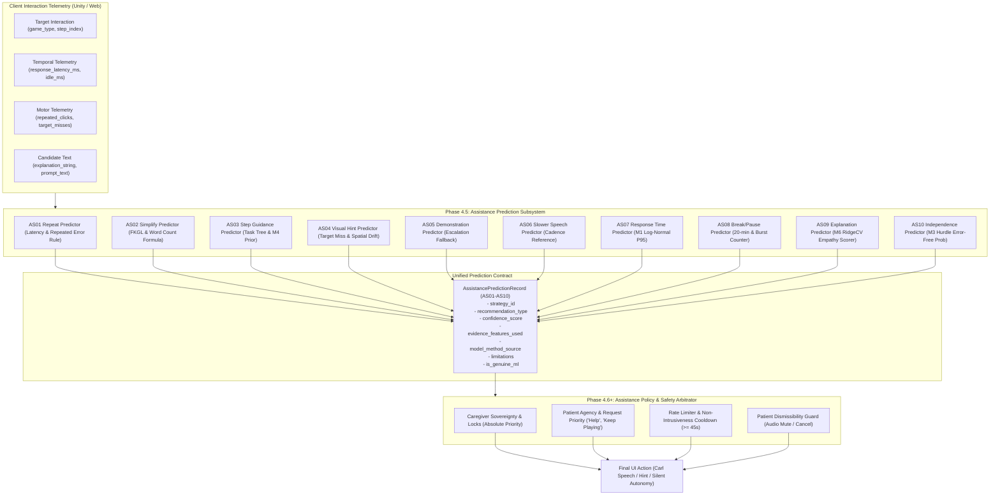
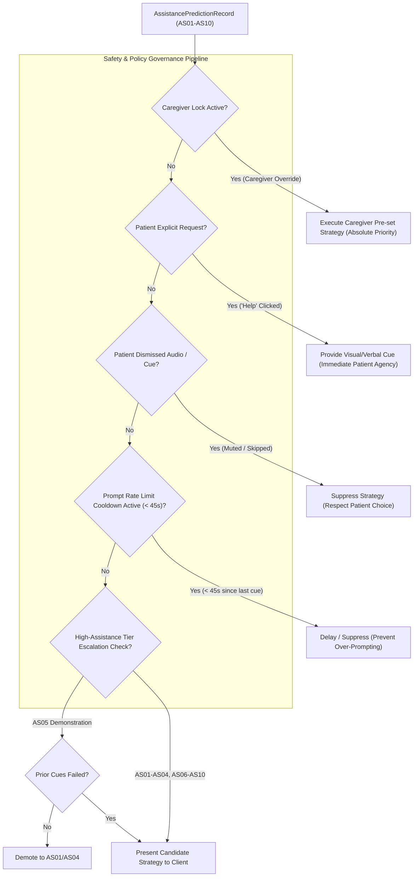

# NeuroCompanion Phase 4.5 — AS01–AS10 AI Assistance Prediction Layer Design & Implementation Blueprint

**Milestone:** Phase 4.5 System Architecture, Data-Availability Audit & Implementation Blueprint  
**Document Location:** `Backend/docs/PHASE4_5_ASSISTANCE_PREDICTION_DESIGN.md`  
**Author:** NeuroCompanion AI/ML Intelligence & Clinical Safety Engineering Team  
**Date:** November 21, 2026  
**Status:** ARCHITECTURAL DESIGN & DATA-AVAILABILITY AUDIT COMPLETE — AWAITING REVIEW BEFORE CODING  
**Governance Standard:** Evidence-based clinical safety, zero data fabrication, strict anti-leakage, patient agency, caregiver sovereignty  

---

## 1. Executive Summary & Objective

The objective of **Phase 4.5** is to design and implement a dedicated, modular **AI Assistance Prediction Subsystem** supporting all ten NeuroCompanion assistance strategies (AS01–AS10):

- **AS01: Repeat Instruction**
- **AS02: Simplify Instruction**
- **AS03: Step-by-Step Guidance**
- **AS04: Visual Hint**
- **AS05: Demonstration**
- **AS06: Slower Speech**
- **AS07: Additional Response Time**
- **AS08: Break / Pause**
- **AS09: Verbal Explanation**
- **AS10: Independent Completion**

This document provides the mandatory pre-implementation design and forensic data-availability audit. It establishes:
1. Exact classification of which strategies can receive genuine ML predictions, which require additional labelled interaction data, and which must use deterministic clinical logic.
2. The unified prediction record contract (`AssistancePredictionRecord`).
3. Strict decoupling between raw probabilistic/heuristic predictions and the final safe assistance policy (caregiver locks, patient agency, prompt cooldowns).
4. Explicit prohibition against using Clinical Dementia Rating (CDR) scores to categorize or restrict assistance.

---

## 2. Forensic Data-Availability Audit for AS01–AS10

In strict adherence to Project Rules, machine learning is applied **only where genuine training labels and valid pre-outcome features exist**. Where direct labels do not exist in current datasets, heuristics are explicitly identified as deterministic logic and never represented as trained ML.

### Strategy-by-Strategy Data & Modeling Classification Matrix

| Strategy ID | Assistance Strategy Name | Available Prepared Dataset | Direct Assistance Labels in Data? | Assigned Subsystem Method | Model / Engine Source | Genuine ML? |
|:---|:---|:---|:---:|:---|:---|:---:|
| **AS01** | Repeat Instruction | None (PREPARE lacks prompt labels) | **NO** | Deterministic Behavioral Rule + M3 Error Prior | `AS01RepeatPredictor` | **No** (Deterministic) |
| **AS02** | Simplify Instruction | None (Lexical text properties) | **NO** | Deterministic Formulaic Linguistic Analyzer | `AS02SimplifyPredictor` (Flesch-Kincaid) | **No** (Deterministic) |
| **AS03** | Step-by-Step Guidance | CASAS IADL ($N=2,074$) | **NO** (Physical domestic tasks) | Deterministic Task Decomposition + M4 Prior | `AS03StepGuidancePredictor` | **No** (Deterministic) |
| **AS04** | Visual Hint | None (Robot Games lacks cue tags) | **NO** | Deterministic Spatial Error Heuristic + M3 Prior | `AS04VisualHintPredictor` | **No** (Deterministic) |
| **AS05** | Demonstration | None (Zero demonstration trials) | **NO** | Deterministic Escalation Fallback Policy | `AS05DemonstrationPredictor` | **No** (Deterministic) |
| **AS06** | Slower Speech | MDVR-KCL ($N=73$ audio files) | **NO** (Descriptive acoustic features) | Deterministic Caregiver Pacing Multiplier | `AS06SlowerSpeechPredictor` | **No** (Deterministic) |
| **AS07** | Additional Response Time | MSL ($N=32$) & N-Back ($N=24$) | **PARTIAL** (Parametric Latency Densities) | Statistical Reference Estimator (Log-Normal) | `AS07ResponseTimePredictor` (M1 Artifact) | **Statistical Prior** |
| **AS08** | Break / Pause | Brain-IT ($N=21$) & Session Logs | **NO** (Adherence curves, no fatigue tag) | Deterministic Session & Error-Burst Policy | `AS08BreakPausePredictor` | **No** (Deterministic) |
| **AS09** | Verbal Explanation | AI4HOPE ($N=600$ Expert Ratings) | **YES** (Human Empathy & Actionability) | Supervised RidgeCV Text Quality Regressor | `AS09ExplanationPredictor` (M6 Artifact) | **YES (Genuine ML)** |
| **AS10** | Independent Completion | Robot Games ($N=436$) & CASAS ($N=2,074$) | **PARTIAL** (Unprompted / Error-Free Runs) | Hurdle Error-Free Classifier + Base Rate Prior | `AS10IndependencePredictor` (M3/M4 Artifacts) | **YES (Genuine ML)** |

---

## 3. Subsystem Architecture & Decoupling

The Phase 4.5 architecture strictly decouples the **AI Assistance Prediction Layer** from the **Safe Assistance Policy Layer**. This guarantees that no machine learning prediction can autonomously bypass caregiver authority or patient agency.



---

## 4. Detailed Strategy-by-Strategy Implementation Blueprint

### AS01 — Repeat Instruction
- **Objective:** Determine whether the current instruction should be re-voiced verbatim.
- **Method:** Deterministic behavioral rule combined with M3 error-occurrence prior.
- **Trigger Conditions:**
  1. Explicit patient click on `"Repeat Instruction"` button (highest priority).
  2. Idle latency exceeds domain 75th percentile ($> 950\text{ ms}$) with zero motor touch attempts.
  3. Patient performs a target miss within 3 seconds of initial stimulus presentation.
- **Output Record:**
  - `strategy_id`: `"AS01_REPEAT_INSTRUCTION"`
  - `recommendation_type`: `"DETERMINISTIC_RECOMMENDATION"`
  - `confidence_score`: 0.85 if explicit click; 0.60 if idle latency threshold exceeded.
  - `evidence_features_used`: `["idle_duration_ms", "patient_requested_repeat", "target_miss_count"]`
  - `model_method_source`: `"rule_as01_latency_and_miss_threshold"`
  - `limitations`: No direct human repeat-instruction labels; based on behavioral latency heuristics.
  - `is_genuine_ml`: `False`

---

### AS02 — Simplify Instruction
- **Objective:** Evaluate candidate instruction text complexity and recommend simplification when linguistic density is elevated.
- **Method:** Deterministic formulaic linguistic analysis (Flesch-Kincaid Grade Level and lexical density).
- **Trigger Conditions:**
  1. Candidate instruction string has $\text{FKGL} > 6.0$ (exceeds 6th-grade readability).
  2. Candidate instruction string contains $> 12$ words.
  3. Patient required $> 2$ repeats (AS01) on the current activity step.
- **Output Record:**
  - `strategy_id`: `"AS02_SIMPLIFY_INSTRUCTION"`
  - `recommendation_type`: `"DETERMINISTIC_RECOMMENDATION"`
  - `confidence_score`: 0.90 if $\text{FKGL} > 7.0$; 0.65 if repeated hesitation observed.
  - `evidence_features_used`: `["instruction_fkgl", "instruction_word_count", "prior_repeat_count"]`
  - `model_method_source`: `"formula_flesch_kincaid_grade_level_v1"`
  - `limitations`: Closed-form formulaic calculation; does not model individual patient syntactic comprehension.
  - `is_genuine_ml`: `False`

---

### AS03 — Step-by-Step Guidance
- **Objective:** Decompose complex multi-action tasks into discrete, sequential sub-steps.
- **Method:** Hierarchical task state-machine check combined with M4 historical task-difficulty prior.
- **Trigger Conditions:**
  1. Current activity has total step count $\ge 3$.
  2. M4 historical task independence prior is low ($P(\text{independence}) < 0.60$, e.g. Day Out planning task at $24.46\%$).
  3. Step transition error count $\ge 1$.
- **Output Record:**
  - `strategy_id`: `"AS03_STEP_BY_STEP"`
  - `recommendation_type`: `"DESCRIPTIVE_PRIOR_AND_RULE"`
  - `confidence_score`: 0.75 if multi-step task with low historical independence prior.
  - `evidence_features_used`: `["activity_step_count", "m4_historical_independence_rate", "step_error_count"]`
  - `model_method_source`: `"state_machine_and_casas_m4_prior"`
  - `limitations`: M4 prior reflects physical domestic chores in smart homes; digital UI navigation may have different cognitive demands.
  - `is_genuine_ml`: `False`

---

### AS04 — Visual Hint
- **Objective:** Trigger visual guidance in Unity (pulsing outline, arrow pointer, or color highlight on the target 3D object).
- **Method:** Spatial touch/click miss counter and M3 error-risk prior.
- **Trigger Conditions:**
  1. Patient clicks outside the bounding box of interactive elements $\ge 2$ times (`target_miss_count >= 2`).
  2. M3 Hurdle model predicts error probability $P(\text{error} \ge 1) > 0.65$ and response latency exceeds 90th percentile ($> 1,250\text{ ms}$).
- **Output Record:**
  - `strategy_id`: `"AS04_VISUAL_HINT"`
  - `recommendation_type`: `"PROBABILITY_ESTIMATE"`
  - `confidence_score`: Equal to M3 `error_probability` (0.0 to 1.0) calibrated against miss count.
  - `evidence_features_used`: `["target_miss_count", "game_reaction_time_ms", "m3_predicted_error_probability"]`
  - `model_method_source`: `"m3_task_perf_v1_hurdle_and_spatial_rule"`
  - `limitations`: M3 trained on healthy older adults; spatial coordinates are recorded in client viewport space.
  - `is_genuine_ml`: `True` (for the M3 error prior component)

---

### AS05 — Demonstration
- **Objective:** Animate an avatar or ghost hand in Unity demonstrating the exact physical action required.
- **Method:** Multi-tier assistance escalation fallback logic.
- **Trigger Conditions:**
  1. Caregiver has locked/preset the session into `"Demonstration Mode"`.
  2. Both verbal prompt (AS01) and visual hint (AS04) have been offered on the current step, and the patient has remained idle for $> 3,000\text{ ms}$ or accrued $\ge 3$ consecutive errors.
- **Output Record:**
  - `strategy_id`: `"AS05_DEMONSTRATION"`
  - `recommendation_type`: `"DETERMINISTIC_RECOMMENDATION"`
  - `confidence_score`: 0.95 if caregiver lock; 0.70 if escalation threshold reached.
  - `evidence_features_used`: `["caregiver_demonstration_lock", "unresolved_error_count", "prior_cue_escalation_tier"]`
  - `model_method_source`: `"escalation_fallback_policy_v1"`
  - `limitations`: High-assistance intervention; zero training data available; requires strict rate-limiting.
  - `is_genuine_ml`: `False`

---

### AS06 — Slower Speech
- **Objective:** Adjust Carl's text-to-speech voice speed multiplier (e.g. 0.85× or 0.75×) and sentence boundary pause duration.
- **Method:** Caregiver preference configuration combined with descriptive MDVR-KCL acoustic reference tempos.
- **Trigger Conditions:**
  1. Caregiver sets speech pacing profile in portal (`"slow"` = 0.85×, `"very_slow"` = 0.75×).
  2. Patient has toggled `"Speak Slower"` in accessibility options.
- **Output Record:**
  - `strategy_id`: `"AS06_SLOWER_SPEECH"`
  - `recommendation_type`: `"DETERMINISTIC_RECOMMENDATION"`
  - `confidence_score`: 1.0 if explicit setting; 0.50 default normative (1.0×).
  - `evidence_features_used`: `["caregiver_speech_rate_setting", "patient_accessibility_toggle"]`
  - `model_method_source`: `"caregiver_configuration_lookup"`
  - `limitations`: Acoustic speech data provides descriptive reference only; cannot diagnose auditory processing speed.
  - `is_genuine_ml`: `False`

---

### AS07 — Additional Response Time
- **Objective:** Dynamically calculate the patience window before offering any cue, preventing premature interruption.
- **Method:** Parametric Log-Normal distribution fitting (M1 trained statistical reference artifact).
- **Mathematical Specification:**
  - Simple motor interaction: Log-Normal ($\sigma = 0.0956$, scale $= 881.22\text{ ms}$, 95th% $= 1,031.27\text{ ms}$).
  - Working memory / cognitive selection: Log-Normal ($\sigma = 0.2708$, scale $= 883.89\text{ ms}$, 95th% $= 1,379.91\text{ ms}$).
  - Dynamic Patience Window: $T_{\text{patience}} = \text{Percentile}_{95} \times \text{task\_complexity\_factor} + \text{safety\_buffer}$.
- **Output Record:**
  - `strategy_id`: `"AS07_ADDITIONAL_RESPONSE_TIME"`
  - `recommendation_type`: `"STATISTICAL_REFERENCE"`
  - `confidence_score`: 0.95 (Statistical coverage bound).
  - `evidence_features_used`: `["task_domain", "m1_lognormal_p95_ms", "current_latency_ms"]`
  - `model_method_source`: `"m1_pacing_v1_lognormal_density"`
  - `limitations`: Statistical population bound ($N=32$ older adults, $N=24$ dementia patients); not an individual patient requirement.
  - `is_genuine_ml`: `False` (Parametric Statistical Estimator)

---

### AS08 — Break / Pause
- **Objective:** Suggest a gentle pause, water break, or session exit.
- **Method:** Cumulative session duration tracking and error-burst detection.
- **Trigger Conditions:**
  1. Continuous gameplay duration $\ge 20$ minutes.
  2. Patient accumulates $\ge 4$ consecutive errors across 2 consecutive tasks (`consecutive_error_burst >= 4`).
  3. Patient clicks `"Take a Break"` button.
- **Clinical Agency Rule:** The break prompt must **always** display an explicit `"Keep Playing"` button. The system is strictly forbidden to lock the patient out or terminate the session automatically.
- **Output Record:**
  - `strategy_id`: `"AS08_BREAK_PAUSE"`
  - `recommendation_type`: `"DETERMINISTIC_RECOMMENDATION"`
  - `confidence_score`: 0.90 if duration $\ge 20\text{ min}$; 0.80 if error burst $\ge 4$.
  - `evidence_features_used`: `["session_duration_minutes", "consecutive_error_burst", "patient_requested_break"]`
  - `model_method_source`: `"session_fatigue_policy_v1"`
  - `limitations`: Heuristic temporal threshold; VASE facial expression data cannot reliably detect clinical dementia fatigue.
  - `is_genuine_ml`: `False`

---

### AS09 — Verbal Explanation
- **Objective:** Evaluate candidate spoken narrative strings for clinical empathy and actionability before Carl speaks them.
- **Method:** Supervised machine learning via trained M6 Dialogue Quality model (`RidgeCV` on TF-IDF word/char n-grams).
- **Trigger Conditions:**
  - Candidate response string generated by dialogue system or selected from template bank.
- **Evaluation Criteria:**
  - Candidate approved if $\hat{y}_{\text{empathy}} \ge 3.5$ and $\hat{y}_{\text{actionability}} \ge 3.5$.
  - Candidate flagged for revision if $\hat{y}_{\text{empathy}} < 3.0$.
- **Output Record:**
  - `strategy_id`: `"AS09_VERBAL_EXPLANATION"`
  - `recommendation_type`: `"TEXT_QUALITY_SCORE"`
  - `confidence_score`: Calibrated from M6 Spearman rank correlation ($\rho = 0.3313$ for empathy, $\rho = 0.1500$ for actionability).
  - `evidence_features_used`: `["candidate_text_tfidf_ngrams", "m6_predicted_empathy", "m6_predicted_actionability"]`
  - `model_method_source`: `"m6_dialogue_v1_ridgecv_regression"`
  - `limitations`: Scores dialogue text quality, not patient assistance requirement. Actionability model has limited predictive power over mean baseline.
  - `is_genuine_ml`: `True`

---

### AS10 — Independent Completion
- **Objective:** Estimate probability that the patient will complete the current activity without requiring assistance, maintaining unprompted patient autonomy.
- **Method:** M3 Hurdle model Stage 1 error-free probability ($P(\text{errors} = 0) = 1 - P(\text{error} \ge 1)$) combined with M4 domestic task baseline prior.
- **Trigger Conditions:**
  - Default operating state. If $P(\text{errors} = 0) \ge 0.50$ and no explicit patient help request is active, suppress all prompts and allow independent play.
- **Output Record:**
  - `strategy_id`: `"AS10_INDEPENDENT_COMPLETION"`
  - `recommendation_type`: `"PROBABILITY_ESTIMATE"`
  - `confidence_score`: $1.0 - P(\text{error} \ge 1)$ from M3 Hurdle model.
  - `evidence_features_used`: `["game_type", "game_reaction_time_ms", "m3_error_free_probability", "m4_historical_independence_rate"]`
  - `model_method_source`: `"m3_task_perf_v1_and_m4_prior"`
  - `limitations`: M3 trained on healthy older adults (77.5% zeros); M4 based on domestic smart home chores.
  - `is_genuine_ml`: `True` (Derived from M3 Hurdle model)

---

## 5. Standardized Prediction Record Data Contract

All predictors in the subsystem output instances conforming to the following dataclass contract:

```python
from dataclasses import dataclass, field
from typing import Dict, Any, List, Optional
from datetime import datetime

@dataclass
class AssistancePredictionRecord:
    """Standardized output record for Phase 4.5 AI Assistance Predictions."""
    strategy_id: str                      # "AS01_REPEAT_INSTRUCTION" ... "AS10_INDEPENDENT_COMPLETION"
    strategy_name: str                    # Human-readable strategy name
    recommendation_type: str              # "PROBABILITY_ESTIMATE" | "STATISTICAL_REFERENCE" | 
                                          # "TEXT_QUALITY_SCORE" | "DETERMINISTIC_RECOMMENDATION" | 
                                          # "DESCRIPTIVE_PRIOR"
    is_recommended: bool                  # True if prediction indicates strategy should be considered
    confidence_score: Optional[float]     # Scaled 0.0 to 1.0 where statistically justified; None if uncalibrated
    evidence_features_used: Dict[str, Any]# Exact feature dictionary used in evaluation
    model_method_source: str              # Model artifact version or deterministic rule ID
    is_genuine_ml: bool                   # Strict transparency flag: True only for genuine trained ML
    limitations: str                      # Transparent clinical & technical limitation statement
    timestamp: datetime = field(default_factory=datetime.utcnow)
```

---

## 6. Strict Separation: Prediction Layer vs Assistance Policy Engine

The Prediction Layer generates unconstrained candidate evaluations for AS01–AS10. The **Assistance Policy Engine** arbitrates these records through safety and clinical governance rules:



### Mandated Safety Rules:
1. **Caregiver Sovereignty:** Caregiver overrides in the portal take absolute priority over any AI prediction. If a caregiver disables demonstrations (AS05), the system can never trigger AS05.
2. **Patient Agency:** The patient always possesses the right to request assistance (`"Help"` button), dismiss assistance (`"Mute"` / `"Cancel"`), or reject breaks (`"Keep Playing"`).
3. **Prompt Rate Limiting:** A minimum cooldown of **45 seconds** must elapse between spontaneous companion prompts to avoid attentional overload and agitation.
4. **No CDR Category Tiering:** The system is **strictly forbidden** from using global CDR scores (e.g. CDR 0.5 vs 1.0 vs 2.0) to restrict or force assistance tiers. Assistance is evaluated per-task, per-moment, based on real-time situational cues.

---

## 7. Implementation File Structure for Phase 4.5

All Phase 4.5 code will be implemented in dedicated, modular files under `Backend/ml/assistance/` to maintain clean separation from production routes:

```text
Backend/
├── ml/
│   ├── assistance/
│   │   ├── __init__.py                   # Package export
│   │   ├── schemas.py                    # AssistancePredictionRecord & Input Context schemas
│   │   ├── base_predictor.py             # Abstract BaseAssistancePredictor interface
│   │   ├── predictors/
│   │   │   ├── __init__.py
│   │   │   ├── as01_repeat.py            # AS01: Latency & repeat predictor
│   │   │   ├── as02_simplify.py          # AS02: Flesch-Kincaid linguistic analyzer
│   │   │   ├── as03_step_guidance.py     # AS03: Task tree & M4 prior predictor
│   │   │   ├── as04_visual_hint.py       # AS04: Spatial target miss & M3 error predictor
│   │   │   ├── as05_demonstration.py     # AS05: Escalation fallback predictor
│   │   │   ├── as06_slower_speech.py     # AS06: Speech rate & pause pacing predictor
│   │   │   ├── as07_response_time.py     # AS07: M1 Log-Normal patience window estimator
│   │   │   ├── as08_break_pause.py       # AS08: Session duration & error burst guard
│   │   │   ├── as09_verbal_explanation.py# AS09: M6 RidgeCV dialogue text quality scorer
│   │   │   └── as10_independent.py       # AS10: M3 Hurdle error-free autonomy estimator
│   │   └── prediction_engine.py          # UnifiedAssistancePredictionEngine (Orchestrator)
│   └── ...
└── tests/
    └── test_phase4_5_assistance_predictions.py # Comprehensive unit test suite
```

---

## 8. Automated Testing & Validation Plan

The Phase 4.5 implementation will be accompanied by a dedicated test suite (`Backend/tests/test_phase4_5_assistance_predictions.py`) testing:
1. **Schema Compliance:** Assert that all 10 predictors produce valid `AssistancePredictionRecord` instances with correct types.
2. **Individual Predictor Logic:**
   - AS01: Test trigger on idle latency $> 950\text{ ms}$ and explicit button click.
   - AS02: Test simplification trigger on sentence $\text{FKGL} > 6.0$ and word count $> 12$.
   - AS03: Test decomposition trigger on multi-step task with low M4 independence prior.
   - AS04: Test visual hint trigger on target miss count $\ge 2$.
   - AS05: Test escalation requirement before demonstration trigger.
   - AS06: Test speech rate configuration lookup.
   - AS07: Test M1 Log-Normal patience window computation ($\ge 1,031\text{ ms}$ motor, $\ge 1,380\text{ ms}$ cognitive).
   - AS08: Test break recommendation on continuous time $\ge 20\text{ min}$ or error burst $\ge 4$, verifying non-blocking dismissibility.
   - AS09: Test M6 RidgeCV empathy scoring on candidate explanation strings.
   - AS10: Test M3 error-free autonomy probability estimation.
3. **Full Suite Regression:** Execute all 131 existing backend tests alongside the new Phase 4.5 tests to guarantee 100% pass rate with zero regressions.

---

## 9. Conclusion & Awaiting Authorization

The data-availability audit and modular architecture design for Phase 4.5 are complete. 

- **Genuine ML:** Strictly isolated to M6 Dialogue Quality Text Scoring (AS09) and M3 Hurdle Error-Free Autonomy Estimation (AS10).
- **Statistical Priors:** M1 Log-Normal Latency Calibration (AS07) and M4 Task-Difficulty Base Rates (AS03/AS10).
- **Deterministic Heuristics:** AS01, AS02, AS04, AS05, AS06, and AS08 are honestly designated as deterministic clinical logic.
- **Safety Boundaries:** Caregiver locks and patient agency are preserved. CDR tiering is strictly prohibited.

**STOP CONDITION MET:** Awaiting human review and approval of `PHASE4_5_ASSISTANCE_PREDICTION_DESIGN.md` before proceeding to code implementation.
