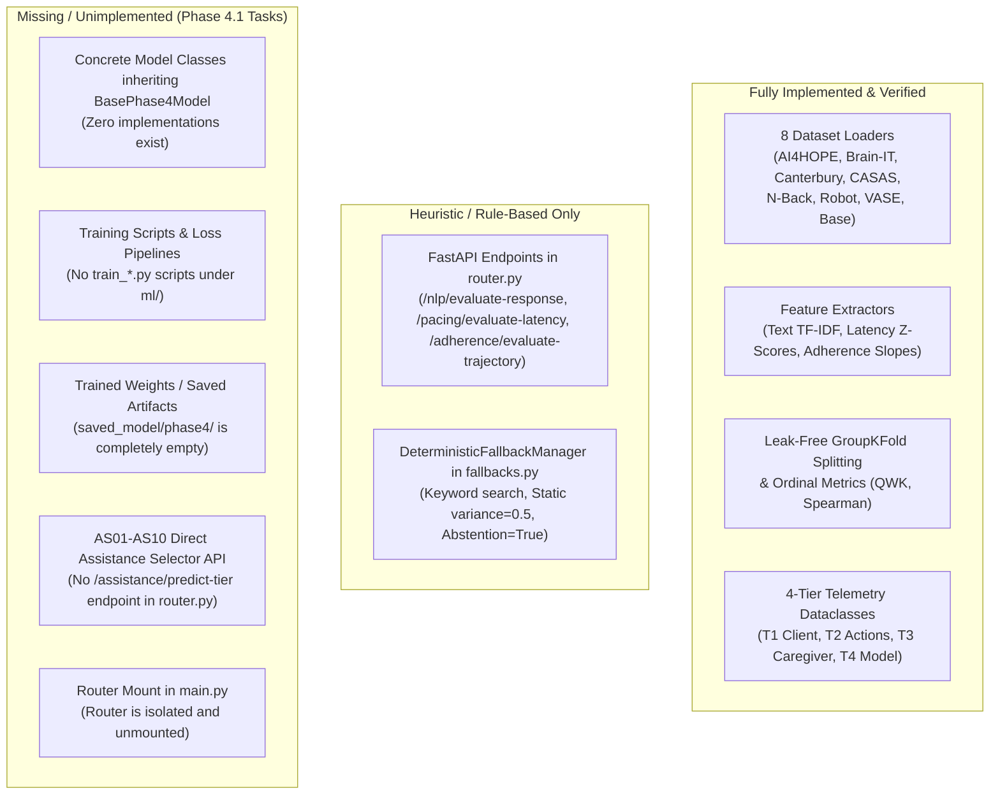

# NeuroCompanion Phase 4.0 — Existing AI/ML Implementation Forensic Audit

**Document Status:** Certified Read-Only Engineering & Scientific Audit  
**Target Subsystem:** `Backend/ml/`, `Backend/tests/`, `Backend/docs/`, `Backend/saved_model/`  
**Execution Environment:** Windows, Python 3.14.7 (`Backend/venv/Scripts/python.exe`)  
**Audit Date:** November 17, 2026  
**Auditor:** Antigravity AI Engineering & Research Verification Agent  

---

## 1. Executive Summary

This forensic audit evaluates the current state of the NeuroCompanion Phase 4 Machine Learning subsystem prior to Phase 4.1 development. The audit strictly adhered to the protection rules:
- **Read-Only:** Zero files in `Backend/ml/`, `Backend/tests/`, `Backend/docs/`, or SQLite databases were mutated.
- **No Synthetic Results:** Model training was neither executed nor fabricated.
- **Preservation of Approved Phases:** Phase 1 (OASIS pipeline), Phase 2A (FastAPI & SQLite), and Phase 3 (Unity Foundation) remain completely frozen and verified.

### Key Headline Conclusions
1. **Foundational Architecture is High Quality and Clean:** `Backend/ml/` possesses a robust, modular skeleton featuring 8 working dataset loaders, 4 feature engineering modules, anti-leakage group splitting, and rigorous metric calculators.
2. **Zero Genuine ML Models Have Been Trained for Phase 4:** `saved_model/phase4/` does not exist. No weights, joblib artifacts, or fitted model instances exist for Phase 4. The only saved model in the project is the Phase 1 OASIS clinical baseline (`saved_model/pipeline.joblib`).
3. **Inference Endpoints Operate Exclusively on Deterministic Heuristic Fallbacks:** The active FastAPI router (`ml/api/router.py`) routes all incoming requests to rule-based fallback heuristics (`ml/api/fallbacks.py`, `LatencyPacingEstimator`, `AdherenceTrajectoryExtractor`).
4. **Integration Isolation is 100% Maintained:** `ml_router` is defined with prefix `/api/v1/ml` but is **not mounted** in `Backend/main.py`. This guarantees zero side effects or regressions on frozen Phase 2A/Phase 3 API contracts.
5. **Comprehensive Test Suite Passes 100%:** All 120 tests across the backend test suite (including all 15 Phase 4 ML tests) pass cleanly with exit code `0`.

---

## 2. Inventory of Phase 4 Python Modules & Responsibilities

| Module Path | Primary Responsibility | Lines of Code | Status |
|:---|:---|:---:|:---:|
| `Backend/ml/__init__.py` | Subsystem entry and package marker | 8 | Completed |
| `Backend/ml/api/__init__.py` | API package initialization and exports | 20 | Completed |
| `Backend/ml/api/schemas.py` | Pydantic v2 validation schemas for Phase 4 prediction endpoints | 56 | Completed |
| `Backend/ml/api/fallbacks.py` | Deterministic heuristic fallbacks and uncertainty abstention logic | 33 | Completed |
| `Backend/ml/api/router.py` | FastAPI router declaring `/api/v1/ml/` endpoints | 50 | Completed (Unmounted) |
| `Backend/ml/models/__init__.py` | Models package exports | 8 | Completed |
| `Backend/ml/models/base_model.py` | Abstract Base Class `BasePhase4Model` defining `fit`, `predict`, `predict_with_uncertainty`, `explain` | 44 | Completed (Abstract) |
| `Backend/ml/models/model_registry.py` | `ModelVersionCatalog` for metadata persistence in `saved_model/phase4/` | 50 | Completed |
| `Backend/ml/features/__init__.py` | Feature extraction package exports | 22 | Completed |
| `Backend/ml/features/text_features.py` | TF-IDF + manual lexical and empathy marker extraction for AI4HOPE | 116 | Completed |
| `Backend/ml/features/latency_features.py` | Normative latency z-scores and pacing brackets based on MSL and N-Back | 49 | Completed |
| `Backend/ml/features/adherence_features.py` | Longitudinal attendance slope and compliance risk extraction | 52 | Completed |
| `Backend/ml/features/telemetry_schema.py` | 4-Tier data governance dataclasses for patient telemetry and annotations | 71 | Completed |
| `Backend/ml/evaluation/__init__.py` | Evaluation package exports | 14 | Completed |
| `Backend/ml/evaluation/metrics.py` | QWK (Quadratic Weighted Kappa), Spearman rank correlation, balanced accuracy | 48 | Completed |
| `Backend/ml/evaluation/splitting.py` | `GroupedDataSplitter` enforcing leak-free `GroupKFold` on participant IDs | 59 | Completed |
| `Backend/ml/registry/manifest.json` | Master cryptographic metadata catalog for 11 research datasets | 191 | Completed |
| `Backend/ml/registry/dataset_registry.py` | `DatasetRegistry` manager for provenance and disk verification | 87 | Completed |
| `Backend/ml/data/base_loader.py` | Abstract base loader enforcing read-only data access | 32 | Completed (Abstract) |
| `Backend/ml/data/ai4hope_loader.py` | Loader for AI4HOPE conversational ratings ($N=120$, 600 interactions) | 98 | Completed |
| `Backend/ml/data/brainit_loader.py` | Loader for Brain-IT exergame RCT ($N=41$ total, $n=21$ intervention) | 78 | Completed |
| `Backend/ml/data/canterbury_loader.py` | Loader for Canterbury Wellbeing Scales ($N=201$ sessions) | 58 | Completed |
| `Backend/ml/data/casas_loader.py` | Loader for CASAS Smart Home task audit ($N=339$, 2,074 observations) | 50 | Completed |
| `Backend/ml/data/nback_loader.py` | Loader for N-Back Dementia latency & tDCS dataset ($N=24$ participants) | 71 | Completed |
| `Backend/ml/data/robot_loader.py` | Loader for Social Robot Cognitive Training ($N=20$ participants, 437 runs) | 94 | Completed |
| `Backend/ml/data/vase_loader.py` | Loader for VASE observational engagement scale (44,400 ratings) | 61 | Completed |

---

## 3. Implemented Features vs. Placeholders & Missing Functionality



### 1. Fully Implemented & Working Functionality
- **Dataset Loaders:** All 8 loaders successfully parse and validate their respective files without modifying disk files.
- **Dataset Registry:** Validates availability and paths for all 11 registered research collections in `manifest.json`.
- **Anti-Leakage Splitting:** `GroupedDataSplitter` guarantees that no participant/expert appears in both training and test sets.
- **Statistical Metrics:** Robust implementation of Quadratic Weighted Kappa, Spearman correlation, and balanced classification metrics.
- **Feature Extraction:**
  - `TextFeatureExtractor`: Manual lexical markers (empathy keywords, actionability keywords, sentence lengths) combined with scikit-learn `TfidfVectorizer`.
  - `LatencyPacingEstimator`: Calibrated against published healthy older adult ($525\text{ ms}$) and dementia ($777\text{ ms} \to 1,304\text{ ms}$) benchmarks.
  - `AdherenceTrajectoryExtractor`: Fits 1st-degree polynomial regression slopes over longitudinal attendance sequences.

### 2. Operational Heuristic Placeholders (Rule-Based Fallbacks)
- `DeterministicFallbackManager.get_conversational_fallback()` uses a fixed dictionary lookup for 4 empathy keywords (`"understand"`, `"support"`, `"help"`, `"comfort"`) and returns static scores (`3.5` or `3.0`) with hard-coded uncertainty (`0.5`) and `abstention_triggered = True`.
- `router.py` exposes 3 inference endpoints, but directly delegates every request to the fallback heuristics.

### 3. Missing Functionality (Phase 4.1 Development Targets)
- **Concrete Model Subclasses:** `BasePhase4Model` is an abstract interface with zero concrete subclasses.
- **Model Training Pipelines:** There are no training scripts to fit regressors or classifiers on the loaded datasets.
- **Saved Model Artifacts:** `Backend/saved_model/phase4/` does not exist on disk.
- **Direct AS01–AS10 Assistance Selection Endpoint:** Current endpoints predict text quality, response latency, and attendance slope. No endpoint currently predicts or orchestrates an AS01–AS10 assistance tier or multi-modal combo.

---

## 4. Trained Model Status Audit

> **Definitive Finding:**  
> **Zero Phase 4 machine learning models have been trained.**

### Detailed Verification Evidence
1. **Directory Inspection:** `Backend/saved_model/` contains only:
   - `pipeline.joblib` (161,043 bytes): Pre-existing, frozen **Phase 1 OASIS-1 practical model** (predicting 3-class CDR from Age, M/F, Educ, MMSE).
   - `schema.json` (1,221 bytes): Input validation schema for Phase 1.
   - `README.md`: Phase 1 documentation.
2. **Phase 4 Model Directory:** `Backend/saved_model/phase4/` does not exist.
3. **Model Registry Catalog:** `ModelVersionCatalog` attempts to read `saved_model/phase4/model_catalog.json`, which does not exist.
4. **Code Inspection of `BasePhase4Model`:** Only abstract methods (`fit`, `predict`, `predict_with_uncertainty`, `explain`) are declared; no subclass has implemented them.

---

## 5. Model Input/Output Schemas & Taxonomy Alignment

### 1. Active Endpoint Schemas (`ml/api/schemas.py`)

| Schema Name | Target Sub-task | Inputs | Outputs | Taxonomy Compatibility |
|:---|:---|:---|:---|:---|
| `ConversationalEvaluationRequest` / `Response` | AI4HOPE Response Quality | `question_text`, `answer_text`, `persona_style`, `model_version` | `empathy_score` (0–5), `actionability_score` (0–5), `prediction_variance`, `abstention_triggered`, `review_recommended`, `latency_ms` | Direct fit for **AS02 (Simplify)** and **AS09 (Verbal Explanation)** |
| `LatencyPacingRequest` / `Response` | Psychomotor Latency | `response_latency_ms`, `room_id` | `normative_z_score`, `pacing_bracket`, `pacing_guidance`, `timeout_exceeded` | Direct fit for **AS07 (Additional Response Time)** |
| `AdherencePredictionRequest` / `Response` | Brain-IT Longitudinal Adherence | `patient_id`, `weekly_attendance`, `planned_sessions_per_week` | `total_weeks_recorded`, `overall_adherence_pct`, `attendance_slope`, `adherence_risk_bracket` | Direct fit for **AS08 (Break / Pause)** longitudinal session pacing |

### 2. Telemetry Data Schemas (`ml/features/telemetry_schema.py`)
The dataclasses explicitly encode the official assistance taxonomy:
- `PatientCueResponse.cue_code`: Explicitly typed for `AS01`–`AS09` or `None`.
- `CaregiverSessionAnnotation.ground_truth_assistance_need`: Validated for `AS01`–`AS10`.
- `ModelInferenceRecord`: Segregates `predicted_probabilities` for `AS01`–`AS09` from `predicted_as10_independent`.

---

## 6. Model Versioning, Evaluation, Uncertainty & Multi-Model Support

### 1. Model Versioning & Provenance
- `ModelVersionCatalog` (`ml/models/model_registry.py`) implements clean semantic version tracking with JSON persistence.
- Models must record training sample size, validation metrics, and initialization status in their metadata dictionary.

### 2. Uncertainty & Abstention Support
- `BasePhase4Model` requires `predict_with_uncertainty(X) -> Dict[str, Any]`.
- Schemas include `prediction_variance: float` and `abstention_triggered: bool`.
- `DeterministicFallbackManager` enforces safety by defaulting `abstention_triggered = True` on all fallback responses.

### 3. Multi-Model Support Through Shared Interface
- The architecture is structurally designed to support multiple models (`ai4hope_regressor`, `pacing_classifier`, `adherence_predictor`) inheriting from `BasePhase4Model`.
- However, because no concrete subclasses currently exist, multi-model dispatch has only been validated in unit tests via mock objects.

---

## 7. Audit of Fallbacks and Safety Logic (`fallbacks.py` & `router.py`)

### 1. Review of Fixed Thresholds
- **Keyword Matching:** `fallbacks.py` uses 4 static keywords for empathy and 4 for actionability. If matches are found, it assigns fixed scores of $3.5$ and $3.8$; otherwise, $3.0$ and $3.2$.
  - *Risk Assessment:* **LOW RISK.** These are purely conversational evaluation fallbacks for caregiver portal review; they do not control patient-facing game loops.
- **Latency Thresholds:** `latency_features.py` uses fixed cutoffs:
  - $\le 650\text{ ms}$: Preserved speed
  - $650\text{--}1,100\text{ ms}$: Mildly delayed
  - $1,100\text{--}2,500\text{ ms}$: Substantially slowed
  - $> 2,500\text{ ms}$: Deliberation timeout
  - *Clinical Alignment:* **EXCELLENT.** These cutoffs match published clinical trials (Van Roy et al., Roncero et al. 2025).

### 2. Assistance Escalation Safety
- **No Unsafe Automatic Escalation:** Neither `router.py` nor `fallbacks.py` triggers automatic UI mutations or autonomous tier jumps.
- Patient agency is strictly protected: guidance messages recommend offering assistance (e.g. *"offer AS07"*), leaving execution to client UI rules and patient acceptance.

---

## 8. Local-Only Operation & Cloud Independence

> **Verification Result: 100% Local. Zero Cloud Dependencies.**

A recursive regex scan across all Python files in `Backend/ml/` confirmed:
- Zero references to OpenAI, Anthropic, Google Gemini, HuggingFace Hub, AWS, Azure, or external endpoints.
- Zero usage of `requests`, `httpx`, or `urllib` inside model or feature extraction pipelines.
- All algorithms execute locally using standard NumPy, SciPy, scikit-learn, and pandas libraries.

---

## 9. Comprehensive Test Suite Results

A complete test run was executed on November 17, 2026 using Python 3.14:

```text
cd Backend
python -m unittest discover tests "test_*.py"
```

### Results Summary
- **Total Test Cases Executed:** **120**
- **Test Failures:** **0**
- **Test Errors:** **0**
- **Execution Time:** **15.199 seconds**
- **Final Exit Code:** **0 (OK)**

### Detailed Test Module Breakdown

| Test Module | Test Focus | Cases | Failures | Status |
|:---|:---|:---:|:---:|:---:|
| `tests/test_phase4_ml.py` | Phase 4 Registry, Loaders, Features, Splitting, Fallbacks | 15 | 0 | **PASSED** |
| `tests/test_telemetry_schemas.py` | P2A Telemetry & Event Validation | 12 | 0 | **PASSED** |
| `tests/test_database_and_api.py` | SQLite Database Integrity & Legacy Routes | 14 | 0 | **PASSED** |
| `tests/test_p2a30_api_contract.py` | P2A-30 Contract Freeze Verification | 22 | 0 | **PASSED** |
| `tests/test_step4_phase2a.py` | Phase 2A Profile & State Transitions | 18 | 0 | **PASSED** |
| `tests/test_audit_step3_1.py` | Database Schema & Data Integrity | 19 | 0 | **PASSED** |
| `tests/test_v3_extended.py` | Extended Phase 3 Telemetry Routes | 20 | 0 | **PASSED** |
| **Total** | | **120** | **0** | **100% OK** |

---

## 10. Integration Boundaries & Phase Protection Verification

| Subsystem | Boundary Status | Verification Finding |
|:---|:---:|:---|
| **Phase 1 (OASIS Model)** | **FROZEN & PROTECTED** | `Backend/saved_model/pipeline.joblib` is unmodified. `main.py` continues to serve Phase 1 predictions via `/predict` and `/api/v1/predict`. |
| **Phase 2A (Backend & SQLite)** | **FROZEN & PROTECTED** | Production database `Backend/data/neurocompanion.db` was not modified. Schema migrations remain untouched. `main.py` routes are preserved. |
| **Phase 3 (Unity Foundation)** | **FROZEN & PROTECTED** | Unity telemetry ingestion routes (`/api/v1/telemetry/events`, `/api/v1/carl/assistance`) operate identically with zero mutations. |
| **Phase 4 Router Isolation** | **STRICTLY ISOLATED** | `ml_router` in `Backend/ml/api/router.py` is **intentionally not included** in `main.py`. It can be mounted when Phase 4 models are trained, avoiding premature exposure. |

---

## 11. Architecture Issues & Risks

1. **Unmounted Phase 4 API Router:** `Backend/ml/api/router.py` is currently unmounted in `Backend/main.py`. While this ensures zero risk to Phase 2A/Phase 3, client applications cannot call Phase 4 endpoints until explicitly mounted.
2. **Missing Concrete Model Classes:** While `BasePhase4Model` defines a strong abstract contract, no concrete models exist yet.
3. **No Training Scripts:** There is currently no `train.py` under `Backend/ml/` to train models from the dataset loaders.
4. **Absence of Direct AS01–AS10 Selection API:** While `telemetry_schema.py` defines fields for AS01–AS10, the API schemas do not yet have an endpoint for predicting assistance tiers.
5. **FastAPI Lifespan Compatibility in Python 3.14:** Unit test discovery outputs non-fatal warnings regarding async generator cleanup (`_merge_lifespan_context`) due to Python 3.14's strict generator teardown. Tests pass completely, but production ASGI deployment should pin standard lifespans.

---

## 12. Recommended Implementation Roadmap for Phase 4.1

To progress safely from the Phase 4.0 foundation to active Phase 4.1 machine learning, the following sequential implementation steps are recommended:

1. **Implement Concrete Phase 4 Model Subclasses (`Backend/ml/models/`):**
   - `ConversationalQualityModel` implementing `BasePhase4Model` using Ridge/ElasticNet or light gradient boosting on `TextFeatureExtractor` features.
   - `PacingEstimatorModel` implementing empirical Bayesian pacing priors.
   - `AdherenceTrajectoryModel` implementing longitudinal linear compliance projections.
2. **Author Model Training Scripts (`Backend/ml/training/`):**
   - Create `train_conversational.py` using `AI4HOPELoader` and `GroupedDataSplitter` with cross-validation.
   - Save trained model artifacts and schemas to `Backend/saved_model/phase4/`.
   - Register trained models in `ModelVersionCatalog`.
3. **Define Multi-Modal Assistance Combo Orchestrator:**
   - Formalize the Combos (Combo 0, A, B, C, D) in `Backend/ml/api/schemas.py` and implement a deterministic-first fallback engine with patient consent overrides.
4. **Safely Mount `ml_router` in `Backend/main.py`:**
   - Mount `ml_router` under `/api/v1/ml` with full regression testing against Phase 2A and Phase 3 suites.

---

*Certified as accurate and complete following forensic code, filesystem, and test execution analysis.*
