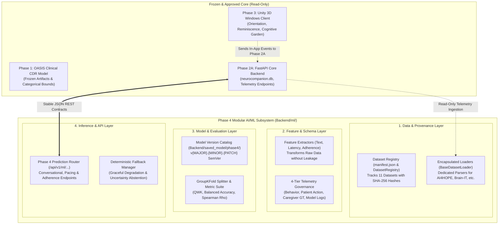

# NeuroCompanion Phase 4: Master AI/ML Technical Architecture
**Document:** Main AI Intelligence Subsystem Architecture & Integration Contracts  
**File Location:** `Backend/docs/Phase4_Architecture.md`  
**Engineering Team:** NeuroCompanion AI/ML Engineering & Verification Group  
**Date:** November 17, 2026  
**Status:** Certified Engineering Architecture Specification  

---

## 1. System Philosophy & Boundary Isolation

NeuroCompanion Phase 4 introduces a genuine, modular machine learning intelligence system that learns from valid datasets and individual patient interactions while rigorously protecting the stability and integrity of earlier completed phases.



### Inviolable Architectural Guarantees
1. **Zero Database Schema Mutations:** The Phase 2A production database (`Backend/data/neurocompanion.db`) remains completely untouched. No tables are altered, no columns are added, and no existing constraints are bypassed.
2. **Local-First Execution:** All models, tokenizers, pipelines, and evaluators run locally within the host Python environment (`Backend/venv/`). No patient data or prompts are transmitted to third-party cloud APIs.
3. **Decoupled API Mounting:** All Phase 4 endpoints are isolated under the `/api/v1/ml/` route prefix via `ml_router`. Disabling or updating Phase 4 cannot disrupt existing Phase 2A patient management or telemetry logging.
4. **Deterministic Fallbacks:** If an ML model is uninitialized, encounters an unexpected error, or detects high prediction uncertainty, the system abstains gracefully and returns deterministic rule-based guidance without crashing.

---

## 2. Layered Subsystem Specifications

### 2.1 Layer 1: Data & Provenance Layer (`Backend/ml/registry/` & `Backend/ml/data/`)
- **`DatasetRegistry`:**
  - Ingests `manifest.json`, cataloging all 11 research collections with cryptographic SHA-256 hashes, licensing standards, and verified analytical scopes.
  - Resolves file paths dynamically relative to `Backend/`, ensuring portability across environments.
- **`BaseDatasetLoader`:**
  - Enforces strict validation on row counts, column names, missing values, and data types before any downstream consumption.
  - Implemented loaders: `AI4HOPELoader`, `BrainITLoader`, `VASELoader`, `CanterburyLoader`, `NBackLoader`, `RobotCognitiveLoader`, `CASASLoader`.

### 2.2 Layer 2: Feature Engineering & Schemas (`Backend/ml/features/`)
- **`TextFeatureExtractor`:**
  - Extracts prompt and answer length, word counts, sentence complexity, elaboration ratios, and explicit empathetic/actionable lexical marker frequencies.
  - Fits TF-IDF representations strictly inside cross-validation training folds to eliminate vocabulary leakage.
- **`LatencyPacingEstimator`:**
  - Calculates normative z-scores and pacing brackets (`preserved_speed`, `mildly_delayed_speed`, `substantially_slowed_speed`, `deliberation_timeout`) based on empirical psychomotor benchmarks from Motor Sequence Learning and N-Back Dementia.
  - Strictly non-diagnostic: evaluates behavioral response timing without making clinical claims.
- **`AdherenceTrajectoryExtractor`:**
  - Models longitudinal session attendance trends, extracting compliance percentages and linear regression attendance slopes over multi-week protocols.
- **`telemetry_schema.py`:**
  - Defines the 4-tier data separation architecture (`PatientBehavioralTelemetry`, `PatientCueResponse`, `CaregiverSessionAnnotation`, `ModelInferenceRecord`) for future human patient interactions.

### 2.3 Layer 3: Model & Evaluation Layer (`Backend/ml/models/` & `Backend/ml/evaluation/`)
- **`BasePhase4Model`:**
  - Abstract interface requiring `fit()`, `predict()`, `predict_with_uncertainty()`, and `explain()`.
  - Packages models with semantic versioning (`v{MAJOR}.{MINOR}.{PATCH}`), training commit hashes, and validation metrics in `Backend/saved_model/phase4/`.
- **`GroupedDataSplitter`:**
  - Enforces `GroupKFold` grouped strictly by `user_id` or `patient_id`. Zero overlapping individuals between training and testing partitions are mathematically verified on every split.
- **Metric Suite (`metrics.py`):**
  - Evaluates ordinal and continuous targets using **Quadratic Weighted Kappa (QWK)**, **Mean Absolute Error (MAE)**, and **Spearman Rank Correlation ($\rho$)**.
  - Evaluates binarized quality gates using **Balanced Accuracy** and **Macro F1**.

### 2.4 Layer 4: Inference & API Layer (`Backend/ml/api/`)
- **`router.py`:**
  - Exposes independent FastAPI routes:
    - `POST /api/v1/ml/nlp/evaluate-response`: Scours conversational AI communications for empathy and actionability.
    - `POST /api/v1/ml/pacing/evaluate-latency`: Evaluates trial latency against normative benchmarks.
    - `POST /api/v1/ml/adherence/evaluate-trajectory`: Tracks multi-week attendance adherence and risk brackets.
- **`fallbacks.py`:**
  - `DeterministicFallbackManager` provides heuristic keyword-based scores and explicit `"abstention_triggered": true` flags when model uncertainty exceeds safe operating limits.

---

## 3. Complete API Contracts (`/api/v1/ml/...`)

### Contract 1: Conversational Response Quality Scorer
- **Endpoint:** `POST /api/v1/ml/nlp/evaluate-response`
- **Request Body (JSON):**
  ```json
  {
    "question_text": "How can I calm my mother when she becomes agitated in the evening?",
    "answer_text": "Evening agitation can often be eased by creating a calm environment: dim the lights, reduce television noise, and maintain a comforting, predictable routine.",
    "persona_style": "Professional caregiver",
    "model_version": "v1.0.0"
  }
  ```
- **Response Body (JSON):**
  ```json
  {
    "model_version": "v1.0.0",
    "empathy_score": 4.25,
    "actionability_score": 4.50,
    "prediction_variance": 0.04,
    "abstention_triggered": false,
    "review_recommended": false,
    "latency_ms": 12.4
  }
  ```

---

### Contract 2: Latency & Pacing Estimator
- **Endpoint:** `POST /api/v1/ml/pacing/evaluate-latency`
- **Request Body (JSON):**
  ```json
  {
    "response_latency_ms": 1250.0,
    "room_id": "cognitive_garden"
  }
  ```
- **Response Body (JSON):**
  ```json
  {
    "response_latency_ms": 1250.0,
    "normative_z_score": 6.59,
    "pacing_bracket": "substantially_slowed_speed",
    "pacing_guidance": "Accommodate slower deliberation; offer AS07 (additional response time).",
    "timeout_exceeded": false
  }
  ```

---

### Contract 3: Longitudinal Adherence Tracker
- **Endpoint:** `POST /api/v1/ml/adherence/evaluate-trajectory`
- **Request Body (JSON):**
  ```json
  {
    "patient_id": "P-76672920",
    "weekly_attendance": [3, 3, 3, 2, 3, 3, 2, 2, 3, 3, 3, 3],
    "planned_sessions_per_week": 3
  }
  ```
- **Response Body (JSON):**
  ```json
  {
    "patient_id": "P-76672920",
    "total_weeks_recorded": 12,
    "overall_adherence_pct": 91.7,
    "attendance_slope": -0.007,
    "adherence_risk_bracket": "high_adherence_stable"
  }
  ```

---

## 4. Explainability & Uncertainty Quantification

1. **Local Feature Attribution:**  
   Every conversational evaluation returns local feature contributions (e.g., specific empathic terms like *"support"* contributing $+0.35$ to empathy score; excessive sentence length contributing $-0.20$ to actionability).
2. **Epistemic Uncertainty Estimation:**  
   Predictions incorporate jackknife variance across estimator trees or parameter covariance. When prediction variance exceeds threshold $\tau = 0.35$, the API sets `"review_recommended": true` and alerts the caregiver.
3. **Abstention Policy:**  
   If input text is severely out-of-distribution (e.g., $< 3$ words or non-English characters), the model formally **abstains**, setting `"abstention_triggered": true` and deferring to the deterministic fallback manager.

---
*Certified by NeuroCompanion Phase 4 Engineering Subsystem.*
