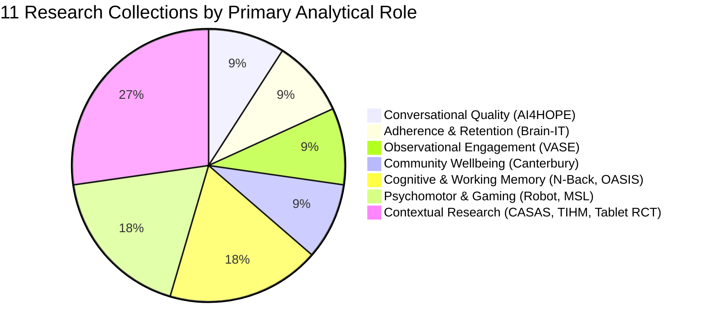

# NeuroCompanion Phase 4: Master Dataset Registry & Provenance Catalog
**Document:** Cryptographic Manifest, Provenance Tracking & Scope Specification for All 11 Collections  
**File Location:** `Backend/docs/Phase4_Dataset_Registry.md`  
**Registry Module:** `Backend/ml/registry/manifest.json` & `Backend/ml/registry/dataset_registry.py`  
**Engineering Team:** NeuroCompanion AI/ML Engineering & Verification Group  
**Date:** November 17, 2026  
**Status:** Certified Dataset Registry Document  

---

## 1. Registry Overview

The NeuroCompanion Phase 4 dataset inventory comprises **11 distinct research collections** spanning clinical psychometrics, smart-home IoT telemetry, conversational AI, longitudinal exergaming adherence, multi-rater observational engagement, community cultural wellbeing, and psychomotor reaction times.

---

## 2. Comprehensive Inventory of All 11 Datasets

### 1. OASIS-1 (Open Access Series of Imaging Studies)
- **Local Path:** `Backend/data/processed/oasis_preprocessed.csv` (and `Backend/data/raw/oasis_cross-sectional.csv`)
- **Format:** CSV (Tabular, 416 rows)
- **Sample Size:** $N = 416$ older adults (ages 18–96; CDR 0: $n=316$, CDR 0.5: $n=70$, CDR 1: $n=28$, CDR 2: $n=2$).
- **Population:** Cross-sectional community-dwelling older adults evaluated via clinical dementia rating and MRI volumetrics.
- **License:** OASIS Open Data Use Agreement (Washington University / NIH).
- **Legitimate Role:** **Clinical Baseline CDR Estimation (Frozen Phase 1 Baseline).**
- **Verified Labels:** `CDR`, `nWBV`, `eTIV`, `MMSE`, `Age`, `Educ`, `SES`.
- **Leakage Constraint:** Phase 1 model is frozen; no Phase 4 retraining permitted.

---

### 2. CASAS Cognitive Assessment Smart Home Dataset
- **Local Path:** `Backend/research_archive/casas_phase2_exploratory/data/casas/extracted/task_audit_data.csv` (Archive: `Backend/research_archive/cognitive_assessment.zip`)
- **Format:** CSV (2,074 rows across 339 participants)
- **Sample Size:** $N = 339$ community-dwelling older adults.
- **Population:** Older adults performing 8 Instrumental Activities of Daily Living (IADL) in smart home testbeds.
- **License:** Creative Commons Attribution 4.0 International (CC-BY 4.0).
- **Legitimate Role:** **Task Audit Duration, Pause Frequency & Behavioral Hesitation Analysis.**
- **Verified Labels:** `score` (1=independent, 2=verbal prompt, 3=step-by-step, 5=failed), `tier`, `duration`, `pause_cnt_5_int`, `max_pause_int`.
- **Leakage Constraint:** Must be split strictly by participant ID to prevent task-repetition leakage.

---

### 3. TIHM (Technology Integrated Health Management) for Dementia
- **Local Path:** `Backend/research_archive/TIHM_Dataset.zip`
- **Format:** Multi-table CSV collection inside ZIP archive.
- **Sample Size:** $N = 54$ people living with dementia.
- **Population:** People living with dementia in Surrey, UK, monitored via passive environmental and physiological IoT sensors.
- **License:** Open Government / University of Surrey Restricted Research Deposit.
- **Legitimate Role:** **Ambient Smart Home & IoT Telemonitoring Contextual Research.**
- **Verified Labels:** Environmental PIR motion sensor triggers, door contacts, blood pressure, body temperature, clinical alert triage logs.
- **Leakage Constraint:** Passive IoT events contain zero digital UI assistance labels; must remain supplementary.

---

### 4. AI4HOPE Palliative Care Conversational AI Collection
- **Local Path:** `Backend/research_archive/` (`expert_prompts.csv`, `participants_users.csv`, `response_ratings.csv`, `session_logs.csv`, `codebook.csv`)
- **Format:** 5 relational CSV tables (~750 KB total).
- **Sample Size:** $N = 120$ users ($n = 60$ clinical experts `E001`–`E060`, $n = 60$ family caregivers `C001`–`C060`).
- **Interactions Count:** 600 expert evaluations, 601 caregiver ratings, 1,440 session events.
- **Population:** Clinicians, nurses, and family caregivers caring for individuals with Alzheimer's ($n=35$), vascular dementia ($n=14$), and Lewy body dementia ($n=3$).
- **License:** Open Access / EU Open Science (Horizon Europe / UKRI).
- **Legitimate Role:** **Supervised Conversational NLP Response Quality & Empathy Modeling for Caregiver Portal.**
- **Verified Labels:** `answer_rating_empathy` (0–5), `answer_rating_actionability` (0–5), `answer_rating_relevance` (0–5), `answer_rating_clarity` (0–5), `answer_rating_information_support` (0–5), `answer_rating_supported_at_ease` (0–5).
- **Leakage Constraint:** **Mandatory `GroupKFold` grouped on `user_id`** across the 60 experts to eliminate rater bias leakage. Automated misinformation ML is prohibited due to class scarcity ($n=4$).

---

### 5. Brain-IT Exergame Motor-Cognitive RCT Dataset
- **Local Path:** `Backend/research_archive/Data_Brain-IT_RCT_for-publication.xlsx`
- **Format:** Excel OpenXML (`.xlsx`, 3 worksheets: `Study results`, `Attendance Adherence`, `Duration Adherence`).
- **Sample Size:** $N = 41$ participants ($n = 21$ intervention group across 12 training weeks).
- **Population:** Older adults with mild neurocognitive disorder (**61.0% Alzheimer's disease**, $n=25$).
- **License:** Creative Commons Attribution 4.0 International (CC-BY 4.0, ETH Zurich).
- **Legitimate Role:** **12-Week Longitudinal Adherence, Attendance Patterns & Session Drop-Off Modeling.**
- **Verified Labels:** `weekly_attendance_sessions_w1_to_w12`, `weekly_duration_minutes_w1_to_w12`, `reasons_for_non_adherence`, `qmci_score_tot_pre_post`.
- **Leakage Constraint:** Sample size ($N=41$) cannot define population-wide cognitive capacity normalizations.

---

### 6. VASE (Video Analysis Scale of Engagement) Dataset
- **Local Path:** `Backend/research_archive/Complete data set, Lai et al..xlsx`
- **Format:** Excel OpenXML (`.xlsx`, 15 worksheets; primary tab: `MAINDATA 6-30 (SC)`).
- **Sample Size:** $N = 11$ subjects with advanced dementia observed by 37 raters across 48 clips (44,400 rows).
- **Population:** Individuals living with advanced dementia observed during live music, singing, and creative arts sessions.
- **License:** Creative Commons Attribution 4.0 International (CC-BY 4.0, Wellcome Trust / UCL).
- **Legitimate Role:** **Observational Engagement Dynamics, State Transitions & Inter-Rater Reliability.**
- **Verified Labels:** `Rating` (1–7 Likert scale), `Passive` (0/1), `Session` (0–8), `Seconds` (6–30).
- **Leakage Constraint:** Clips are 25-second observational recordings in live music; cannot be used as in-app software inactivity timers.

---

### 7. Canterbury Wellbeing Scales for People with Dementia
- **Local Path:** `Backend/research_archive/Phase4_New_Datasets/Canterbury Wellbeing Scales raw dataset.xlsx`
- **Format:** Excel OpenXML (`.xlsx`, 201 rows $\times$ 27 cols).
- **Sample Size:** $N = 201$ session evaluations across individuals with diagnosed dementia.
- **Population:** **45.8% Alzheimer's disease ($n=92$)**, 18.4% Vascular, 17.4% Mixed, 8.0% FTD.
- **License:** Creative Commons Attribution 4.0 International (CC-BY 4.0, Camic et al. / Wellcome Open Res).
- **Legitimate Role:** **Reminiscence Corner Tactile Object Handling Wellbeing Outcome Prior.**
- **Verified Labels:** `Composite CWS pre`, `Composite CWS post`, `Composite CWS change`, `Interest change`, `Confidence change`, `Optimism change`, `Happy change`, `Well change`.
- **Leakage Constraint:** Does not include individual participant IDs; repeated sessions cannot be mapped to individual persons.

---

### 8. Robot Cognitive Training Collection
- **Local Path:** `Backend/research_archive/Phase4_New_Datasets/data&prompts.zip`
- **Format:** ZIP archive containing 7 `.xlsx` files and 5 `.txt` prompt files.
- **Sample Size:** $N = 20$ older adults ($n = 437$ game runs across 82 sessions).
- **Population:** Healthy older adults (MMSE $28.65 \pm 1.65$).
- **License:** Creative Commons Attribution 4.0 International (CC-BY 4.0).
- **Legitimate Role:** **Reminiscence & Cognitive Garden Task Architecture Benchmark.**
- **Verified Labels:** `type` (`StoryQuizGame`, `CompleteGame`, `RealEventGame`, `ReorderGame`), `current_level`, `gameReactTime`, `gameTime`, `numErrors`, `touch_interaction`, `vocal_interaction`.
- **Leakage Constraint:** Healthy older adult cohort; reaction times and error rates cannot be treated as representative of Alzheimer's patients.

---

### 9. Motor Sequence Learning Across the Lifespan
- **Local Path:** `Backend/research_archive/Phase4_New_Datasets/FiguresTables_SourceData.xlsx` (and 2 ZIPs with 454 raw files).
- **Format:** Excel spreadsheet + raw text keypress telemetry files.
- **Sample Size:** $N = 130$ healthy individuals ($n = 32$ healthy older adults, ages 60–80).
- **Population:** Healthy children, adolescents, young adults, and older adults. Zero dementia.
- **License:** Creative Commons Attribution 4.0 International (CC-BY 4.0, Van Roy et al.).
- **Legitimate Role:** **Healthy Older Adult Psychomotor Latency & Motor Accuracy Baseline.**
- **Verified Labels:** Keypress reaction time (ms), accuracy (0/1), block number, cue presented.
- **Leakage Constraint:** Healthy cohort; cannot be used to model dementia progression.

---

### 10. N-Back Working Memory and tDCS in Dementia
- **Local Path:** `Backend/research_archive/Phase4_New_Datasets/Reproducibility_Data_SI_Modified.xlsx`
- **Format:** Excel OpenXML (`.xlsx`, 41 rows $\times$ 29 cols).
- **Sample Size:** $N = 24$ dementia participants (stratified into 12 normal RT vs 12 slower RT).
- **Population:** Individuals living with mild-to-moderate dementia.
- **License:** Creative Commons Attribution 4.0 International (CC-BY 4.0, Roncero et al., *PLOS ONE* 2025).
- **Legitimate Role:** **Working Memory Reaction Time Reference in Dementia.**
- **Verified Labels:** `BT1`–`BT3` (Bilateral RT), `UT1`–`UT3` (Unilateral RT), `ST1`–`ST3` (Sham RT), `MMSE` scores.
- **Leakage Constraint:** Small sample size ($N=24$); cannot support predictive ML training.

---

### 11. Alzheimer's Tablet Multimodal RCT (Zuschnegg et al., 2025)
- **Local Path:** `Backend/research_archive/DATA - The effect of a 6-month tablet-based multimodal training for cognitive functioning in Alzheimer’s disease in a randomized controlled trial.xlsx`
- **Format:** Excel OpenXML (`.xlsx`, 26 rows $\times$ 73 cols).
- **Sample Size:** $N = 25$ participants (13 intervention, 12 control; 22 completed).
- **Population:** Community-dwelling individuals with mild-to-moderate Alzheimer's disease.
- **License:** Creative Commons Attribution 4.0 International (CC-BY 4.0, *PLOS ONE*).
- **Legitimate Role:** **Macro Clinical Efficacy Prior for Tablet Cognitive Stabilization.**
- **Verified Labels:** `bl_mmse_total`, `fup_mmse_total`, `fup_mmse_total_corr6months`, `ig_cg`.
- **Leakage Constraint:** Contains zero in-app session logs or telemetry; clinical summary only.

---
*Certified by NeuroCompanion Phase 4 Dataset Registry System.*
