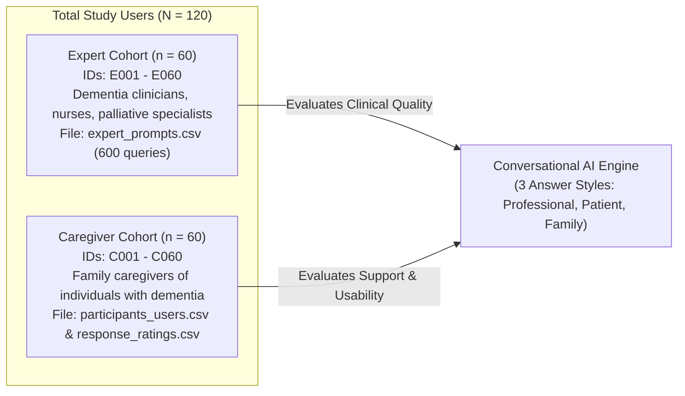

# Dataset Audit Report: AI4HOPE Generative Palliative Care Collection
**Collection Name:** AI4HOPE (Artificial Intelligence Based Health, Optimism, Purpose, and Endurance in Palliative Care for Dementia)  
**Dataset Path:** `Backend/research_archive/` (`codebook.csv`, `expert_prompts.csv`, `participants_users.csv`, `response_ratings.csv`, `session_logs.csv`)  
**Funder / Consortium:** European Union Horizon Europe / UK Research and Innovation (UKRI)  
**Auditor:** NeuroCompanion Phase 4 AI/ML Research & Verification Team  
**Audit Date:** November 17, 2026  
**Status:** Certified Read-Only Technical Audit  

---

## 1. Physical Files, Formats & Metadata

| Field | Verified Value | Inspection Method |
| :--- | :--- | :--- |
| **Component Files** | 5 CSV files: `codebook.csv`, `participants_users.csv`, `expert_prompts.csv`, `response_ratings.csv`, `session_logs.csv` | Filesystem scan & Python `pandas` |
| **File Format** | Comma-Separated Values (`.csv`, UTF-8 encoded) | Python `pandas.read_csv` |
| **Total Cumulative Size** | ~750 KB across the 5 files | Filesystem metadata |
| **Codebook Documentation** | `codebook.csv` (102 rows $\times$ 4 columns defining all table schemas, field data types, and semantic descriptions) | Structured schema inspection |
| **Project Identity** | AI4HOPE Consortium (EU Horizon Europe grant project spanning 16 international clinical, academic, and industrial institutions, including Alzheimer Europe and EAPC) | Open web search & official repository |
| **System Tested** | Conversational Generative AI Decision-Support System / Palliative Care Assistant for Dementia | Actual prompt and answer inspection |

---

## 2. Participant Population, Cohort Size & Clinical Diagnoses

The AI4HOPE collection evaluates interactions across two distinct stakeholder groups totaling **$N = 120$ unique users**:

### Caregiver Cohort Breakdown (`participants_users.csv`, $n = 60$)
- **Participant Identifiers:** Pseudonymous IDs `C001` through `C060`.
- **Relationship:** 100% ($n = 60$) are **Family Caregivers** caring for a relative with dementia.
- **Dementia Diagnoses of Care Recipients:**
  - **Alzheimer’s Disease:** $n = 35$ (58.3%) [including multilingual annotations *Alzheimer-kór* and *Alzheimer-Krankheit*].
  - **Vascular Dementia:** $n = 14$ (23.3%).
  - **Lewy Body Dementia:** $n = 3$ (5.0%).
  - **Not Sure / Prefer Not to Say:** $n = 6$ (10.0%).
  - **Other Dementia:** $n = 1$ (1.7%).
  - **Missing:** $n = 1$ (1.7%).
- **Caregiver Demographics:**
  - Age Groups: 18–39 ($n=38$, 63.3%), 40–49 ($n=11$, 18.3%), 50–59 ($n=7$, 11.7%), 60–69 ($n=4$, 6.7%).
  - Biological Sex: 33 Male, 25 Female, 1 Non-binary, 1 unspecified.
  - Interaction Language: English (44), Spanish (7), German (5), Portuguese (4).
  - Devices Used: Smartphone ($n=31$), Computer ($n=21$), Both ($n=8$).
  - Self-Reported Tech Savviness: Mean $3.9 \pm 0.8$ (scale 1–5).
  - System Usability Scale (SUS): Mean **$85.4 \pm 12.1$** (range: 55.0 to 100.0, indicating high usability).

### Clinical Expert Cohort (`expert_prompts.csv`, $n = 60$)
- **Participant Identifiers:** Pseudonymous IDs `E001` through `E060`.
- **Role:** Clinical experts, dementia nurses, palliative care physicians, and researchers.
- **Evaluation Load:** Each expert submitted and evaluated 10 structured queries (total = 600 interactions).

---

## 3. Table Schema & Column-Level Forensic Audit

### 1. `participants_users.csv` (60 rows $\times$ 27 columns)
Records baseline characteristics, self-reported tech proficiency, and post-trial System Usability Scale (SUS) scores for all 60 family caregivers:
- `user_id`, `study_group` (`patients_caregivers`), `age_group`, `gender`, `relationship`, `stage` (unpopulated), `diagnosis`, `language`, `device`, `tech_comfort`, `tech_savviness`, `has_support`, `queries_completed` (all 10), `sus_q1` through `sus_q10`, `sus_score`, `phase`.

### 2. `expert_prompts.csv` (600 rows $\times$ 14 columns)
Contains the natural-language question-answer pairs submitted and evaluated by the clinical expert cohort:
- `user_id` (`E001`–`E060`), `study_group` (`experts`), `interaction_id` (1–600).
- `question`: Natural language clinical/palliative dementia query (e.g., *"What non-pharmacological interventions manage twilight agitation?", "How to address dysphagia in moderate Alzheimer's?"*).
- `answer_style`: Persona adopted by the generative AI:
  - *Professional caregiver* ($n = 275$, 45.8%)
  - *Patient* ($n = 177$, 29.5%)
  - *Family caregiver* ($n = 148$, 24.7%)
- `answer`: Full generated natural-language response.
- `language`, `relationship`.
- **Expert Outcome Ratings (6 Dimensions):**
  - `answer_rating_relevance`: 0–5 Likert scale (Mean 4.39; 84.2% rated 4 or 5).
  - `answer_rating_clarity`: 0–5 Likert scale (Mean 4.52; 89.3% rated 4 or 5).
  - `answer_rating_empathy`: 0–5 Likert scale (Mean 4.34; 81.8% rated 4 or 5).
  - `answer_rating_actionability`: 0–5 Likert scale (Mean 4.21; 78.5% rated 4 or 5).
  - `answer_rating_misinformation_flagged`: Binary string (`yes` = 4 instances [0.67%], `no` = 596 instances [99.33%]).
  - `answer_rating_bias_flagged`: Binary string (`yes` = 8 instances [1.33%], `no` = 592 instances [98.67%]).

### 3. `response_ratings.csv` (601 rows $\times$ 7 columns)
Records evaluation ratings from the 60 family caregivers on the responses they received:
- `user_id` (`C001`–`C060`), `study_group`, `interaction_id` (1–601), `answer_rating_role` (`Family caregiver`).
- **Caregiver Perception Ratings (3 Dimensions, 0–5 Likert):**
  - `answer_rating_information_support`: Perceived adequacy of informational support (Mean 3.84; 62.9% rated 4 or 5).
  - `answer_rating_supported_at_ease`: Emotional reassurance / feeling supported and at ease (Mean 3.73; 54.6% rated 4 or 5).
  - `answer_rating_ease_of_understanding`: Perceived cognitive clarity / ease of understanding (Mean 4.60; 90.2% rated 4 or 5).

### 4. `session_logs.csv` (1,440 rows $\times$ 6 columns)
Chronological interaction telemetry for both expert and caregiver sessions:
- `phase`: `patients_caregivers` ($n = 721$), `experts` ($n = 719$).
- `user_id`: 120 unique IDs.
- `session_id`: Session tracking hash.
- `event_type`: Categorical session state:
  - `registration` ($n = 120$): Account onboarding event.
  - `interaction` ($n = 1,201$): Query submission and response generation event.
  - `sus_submitted` ($n = 119$): Post-study usability scale completion event.
- `interaction_id`: Foreign key link to `expert_prompts` and `response_ratings`.

---

## 4. Missing Values, Duplicates & Data Quality

- **Duplicates:** Zero duplicate interaction records.
- **Completeness:** 
  - `expert_prompts.csv` has **0 missing values** across all 14 columns ($600 \times 14 = 8,400$ complete cells).
  - `response_ratings.csv` has **0 missing values** across all 7 columns ($601 \times 7 = 4,207$ complete cells).
  - `participants_users.csv`: `stage`, `experience`, `occupation` are unpopulated (0 non-null values; optional demographic fields not collected from family caregivers). `diagnosis` is missing in exactly 1 caregiver.
- **Data Quality:** Excellent. Clean, consistently relational, valid foreign keys (`user_id`, `interaction_id`) linking demographics, text interactions, and session logs.

---

## 5. Nature of Observations & Data Source

> [!CAUTION]
> **Source Stakeholders:** The data in AI4HOPE represents **family caregivers** and **clinical experts**. It does **NOT** represent direct patient telemetry, in-app patient gameplay, or motor-cognitive patient behavior. Caregiver ratings of emotional ease or understanding must never be conflated with Alzheimer's patient cognitive states.

---

## 6. Evaluation Against NeuroCompanion ML Research Tasks

| Potential Research Task | Evidence Level | Detailed Technical Justification |
| :--- | :---: | :--- |
| **Assistance Recommendation (AS01–AS09)** | **Not Supported** | Contains **zero** digital UI assistance labels (no hints, cues, highlights, or step breakdowns). |
| **Independent Completion Prediction (AS10)** | **Not Supported** | Contains **zero** task completion records. Interacting with a web chatbot does not provide task completion ground truth. |
| **Assistance Effectiveness Modeling** | **Not Supported** | Does not record patient task performance under assistance. |
| **Conversational Response Quality Modeling** | **Directly Supported** | Contains 600 verified text prompt-response pairs labeled on relevance, clarity, empathy, actionability, misinformation, and bias. This can directly train NLP models evaluating AI-generated communicative assistance for caregivers. |
| **Caregiver Satisfaction & Usability Prediction** | **Directly Supported** | Contains 601 interaction ratings from family caregivers evaluating information support and emotional ease, coupled with SUS usability scores. |
| **Cognitive / Communication Context** | **Partially Supported** | Natural language queries reflect real-world communication challenges and caregiver information-seeking behavior across Alzheimer's and vascular dementia. |
| **Interaction Patterns & Session Navigation** | **Partially Supported** | Session logs (1,440 events) record registration, query completion, and survey submission sequences. |
| **Personalization Research** | **Partially Supported** | Allows modeling caregiver preferences across different answer styles (`Professional caregiver`, `Patient`, `Family caregiver`) and linguistic backgrounds. |

---

## 7. Licensing & Research-Use Restrictions

- **Origin:** EU Horizon Europe Framework Programme (Research & Innovation Action).
- **Public Open-Science Deposit:** Deposit under open research dissemination protocols for academic validation.
- **Privacy & Anonymization:** De-identified (pseudonymous user IDs `C001`–`C060`, `E001`–`E060`). No direct personal identifiers (PII). Open for scientific and secondary AI research.

---

## 8. Final Verdict & Contribution to Phase 4

> [!IMPORTANT]
> **Role in Phase 4:** **Primary Foundation for Caregiver Communication & NLP Quality Assurance**.  
> While AI4HOPE cannot be used to train patient-facing motor-cognitive assistance (AS01–AS09), it is **uniquely valuable** for:
> 1. Training and validating **conversational AI safety and quality classifiers** (predicting empathy, clarity, actionability, and misinformation) within NeuroCompanion’s caregiver portal.
> 2. Providing empirical benchmarks for caregiver digital engagement, answer-style personalization, and system usability (SUS) in dementia support applications.
