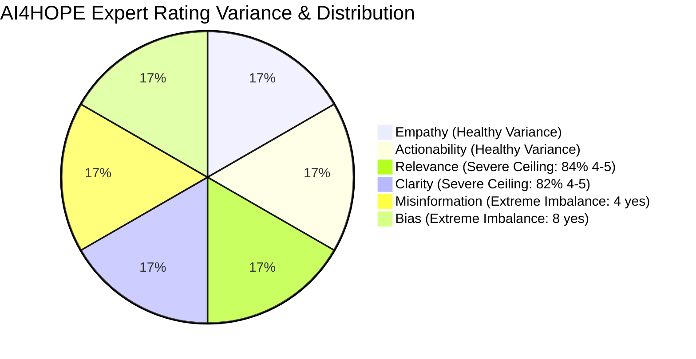
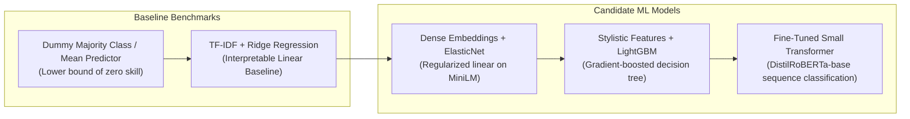

# AI4HOPE Supervised Model Feasibility Study: Conversational Response Quality
**Document:** Machine Learning Feasibility Study, Target Selection & Evaluation Protocol  
**File Location:** `Backend/research_archive/Phase4_Initial_Audit/AI4HOPE_Model_Feasibility.md`  
**Auditor:** NeuroCompanion Phase 4 AI/ML Verification & Architecture Team  
**Date:** November 17, 2026  
**Status:** Certified Feasibility Protocol (Pre-Training Evaluation)  

---

## 1. Objective & Scope

This feasibility study investigates whether the `AI4HOPE` dataset collection can support a mathematically legitimate, reproducible, and verifiable supervised machine learning model to evaluate the quality of conversational AI responses in dementia caregiving.

> [!IMPORTANT]
> **Pre-Training Gate:** In compliance with project rules, **no model training has been initiated**. This document specifies the mathematical target, feature space, splitting protocol, baseline benchmarks, and generalization limitations for user approval prior to execution.

---

## 2. Target Variable Selection & Label Distribution Audit

We examine the six target variables available in `expert_prompts.csv` ($N = 600$ interactions evaluated by $60$ clinical experts):

### Detailed Distribution Breakdown ($N = 600$)

| Candidate Target Variable | Type | Class Distribution | Feasibility Assessment |
| :--- | :---: | :--- | :--- |
| **`answer_rating_misinformation_flagged`** | Binary | `no`: 596 ($99.33\%$), `yes`: 4 ($0.67\%$) | **INFEASIBLE FOR SUPERVISED ML.** With only 4 positive instances in the entire dataset, any train/test split leaves $\le 1$ positive sample in the test fold. Class collapse is guaranteed. Cannot be trained as a standard supervised classifier. |
| **`answer_rating_bias_flagged`** | Binary | `no`: 592 ($98.67\%$), `yes`: 8 ($1.33\%$) | **INFEASIBLE FOR SUPERVISED ML.** Extreme class scarcity ($n=8$) prevents valid statistical learning or cross-validation. |
| **`answer_rating_relevance`** | Ordinal (0–5) | 5: 343 ($57.2\%$), 4: 162 ($27.0\%$), 3: 64 ($10.7\%$), 1: 14 ($2.3\%$), 2: 13 ($2.2\%$), 0: 4 ($0.7\%$) | **Severely Restricted.** $84.2\%$ of samples are concentrated in classes 4 and 5 (strong ceiling effect). |
| **`answer_rating_clarity`** | Ordinal (0–5) | 5: 306 ($51.0\%$), 4: 187 ($31.2\%$), 3: 76 ($12.7\%$), 2: 16 ($2.7\%$), 1: 12 ($2.0\%$), 0: 3 ($0.5\%$) | **Severely Restricted.** $82.2\%$ of samples are concentrated in classes 4 and 5. |
| **`answer_rating_actionability`** | Ordinal (0–5) | 5: 245 ($40.8\%$), 4: 214 ($35.7\%$), 3: 106 ($17.7\%$), 2: 19 ($3.2\%$), 1: 10 ($1.7\%$), 0: 6 ($1.0\%$) | **FEASIBLE.** Demonstrates sufficient spread across lower and middle ratings ($23.5\%$ rated $\le 3$). |
| **`answer_rating_empathy`** | Ordinal (0–5) | 5: 182 ($30.3\%$), 4: 173 ($28.8\%$), 3: 136 ($22.7\%$), 2: 73 ($12.2\%$), 1: 32 ($5.3\%$), 0: 4 ($0.7\%$) | **HIGHLY FEASIBLE.** Highest rating entropy and natural dispersion across classes 1 through 5. |

### Formal Target Selection: `answer_rating_empathy`
We select **`answer_rating_empathy`** as the primary prediction target for the first supervised model. Empathy is a critical clinical requirement in Alzheimer's communication, and its rating distribution is the healthiest in the dataset:
- **Continuous / Ordinal Formulation:** Predicting the exact rating $y \in [0.0, 5.0]$ via ordinal regression or penalized linear regression.
- **Binarized Quality Gate Formulation:** High Empathy ($y \in \{4, 5\}$, $n = 355$, $59.2\%$) vs Low-to-Moderate Empathy ($y \in \{0, 1, 2, 3\}$, $n = 245$, $40.8\%$). This provides a balanced $59/41$ class split ideal for binary classification.

---

## 3. Input Feature Representation

The model takes as input the clinical prompt, generated response, and assigned persona style:

1. **Textual Feature Space:**
   - Prompt text (`question`): Character length, word count, presence of clinical keywords, sentiment polarity.
   - Answer text (`answer`): Character length, word count, readability index (Flesch-Kincaid grade level), passive voice frequency, polite/empathic marker density (e.g., words like *"understand"*, *"challenging"*, *"support"*, *"comfort"*).
   - Term Frequency-Inverse Document Frequency (TF-IDF): Unigrams and bigrams extracted from answer text (top 500 features, English subcorpus).
   - Dense Semantic Embeddings: 384-dimensional sentence embeddings generated via `sentence-transformers/all-MiniLM-L6-v2` pooled across the generated response text.
2. **Categorical Feature Space:**
   - `answer_style`: One-hot encoded persona representation (`Professional caregiver`, `Patient`, `Family caregiver`).

---

## 4. Train / Test Splitting Protocol: Preventing Expert Leakage

> [!CAUTION]
> **Leakage Hazard:** In `expert_prompts.csv`, each of the 60 experts (`E001` to `E060`) evaluated exactly 10 prompt-response pairs. Randomly splitting rows would place interactions from the same expert into both training and test folds, causing **rater-level data leakage** (the model would learn individual rater bias rather than true linguistic empathy).

### Mandatory Grouped Cross-Validation Protocol
- **Splitting Method:** **`GroupKFold` ($k = 5$ folds) grouped strictly on `user_id`**.
- **Fold Allocation:**
  - In each fold, $48$ experts ($480$ interactions, $80\%$) are allocated to training.
  - $12$ experts ($120$ interactions, $20\%$) are allocated to testing.
  - **No expert appears in both train and test partitions within any fold.**
- **Independent Final Test Set:** Prior to hyperparameter tuning, a stratified $20\%$ holdout ($12$ experts, $120$ interactions) is permanently sequestered and evaluated only after all modeling decisions are locked.

---

## 5. Model Benchmarking Architecture

1. **Baseline Model 0 (Trivial Dummy):** Constant mean prediction ($3.72$) for regression; majority class (`High Empathy`, $59.2\%$) for binary classification.
2. **Baseline Model 1 (TF-IDF + Ridge):** Word-level n-gram representation with $L_2$ regularization. Establishes the performance ceiling of shallow linear lexical models.
3. **Candidate Model 1 (MiniLM Embeddings + Ridge):** Dense semantic representation capturing synonymy and contextual meaning with calibrated linear weights.
4. **Candidate Model 2 (Combined Features + LightGBM):** Non-linear gradient boosted tree trained on concatenation of dense embeddings, readability scores, and one-hot persona styles.

---

## 6. Evaluation Metrics

To account for ordinal relationships and class proportions:

- **Primary Regression Metric:** **Mean Absolute Error (MAE)** and **Quadratic Weighted Kappa (QWK)** (standard in psychometric and rating evaluations).
- **Correlation Metric:** **Spearman Rank Correlation ($\rho$)** evaluating monotonic agreement between predicted and expert-assigned empathy ranks.
- **Classification Metrics (Binarized High vs Low/Moderate):**
  - **Balanced Accuracy** (unweighted mean of sensitivity and specificity).
  - **Macro F1 Score** (penalizes poor minority-class identification).
  - **Expected Calibration Error (ECE)** (ensures predicted probabilities reflect true reliability).

---

## 7. Limitations & Expected Generalization

1. **Sample Size Constraints ($N = 600$):**  
   While $600$ samples are sufficient for linear and regularized tree models on fixed embeddings, fine-tuning large language models (e.g., 7B parameters) would lead to catastrophic overfitting. Modeling will strictly adhere to lightweight, regularized architectures.
2. **Domain Shift to Real-Time Caregiver Interactions:**  
   The questions in AI4HOPE were curated clinical prompts. Real-world family caregivers may type shorter, grammatically fragmented queries. The model must be validated with noise-injected text variations during stress-testing.
3. **Linguistic Scope:**  
   The primary model will be trained on the English subcorpus ($n = 440$ queries). The multilingual subset (Spanish $n=70$, German $n=50$, Portuguese $n=40$) requires dedicated cross-lingual zero-shot evaluation before deployment.

---

## 8. Feasibility Conclusion & Next Step

> **Feasibility Verdict:** **CONFIRMED FOR SUPERVISED EMPATHY & ACTIONABILITY MODELING.**  
> The `AI4HOPE` dataset contains clean, relational, expert-evaluated target labels suitable for supervised regression and classification of conversational empathy, provided that:
> 1. `GroupKFold` on `user_id` is enforced.
> 2. Automated misinformation detection is excluded from standard supervised training due to class scarcity ($n=4$).
> 3. Models are evaluated using QWK and Balanced Accuracy.

*Awaiting user approval before running training pipelines.*
