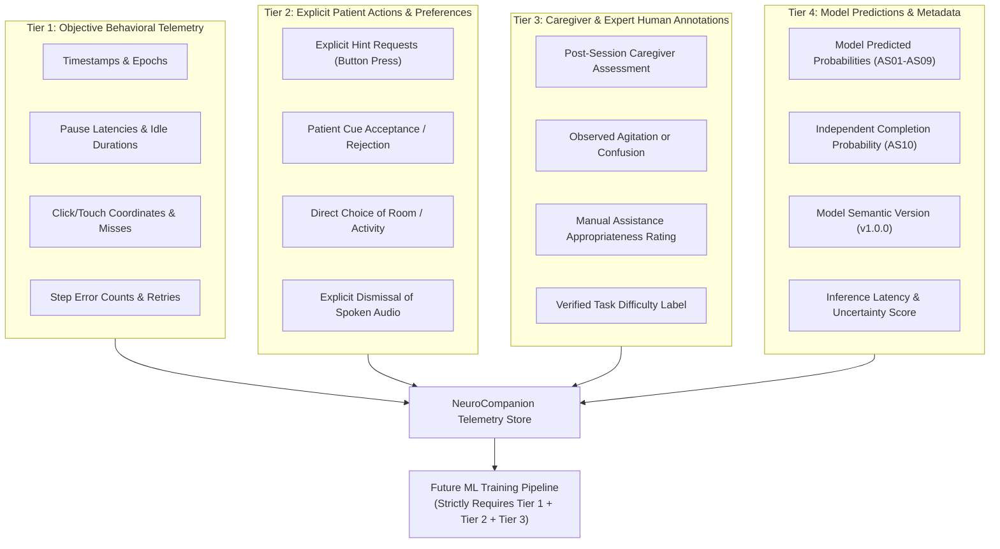
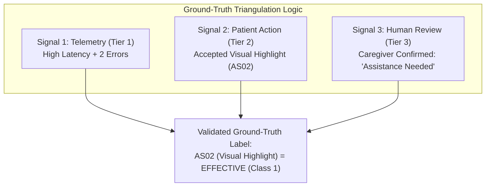
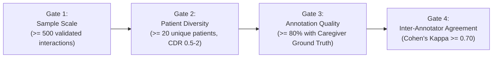

# AS01–AS10 Future Data Collection, Annotation & Ground-Truth Strategy
**Document:** Clinical Data Governance, Multi-Tier Ground Truth & Annotation Strategy  
**File Location:** `Backend/research_archive/Phase4_Initial_Audit/AS01_AS10_Data_Collection_Strategy.md`  
**Auditor:** NeuroCompanion Phase 4 AI/ML Verification & Architecture Team  
**Date:** November 17, 2026  
**Status:** Certified Strategy Specification  

---

## 1. Truth in Data: Current Database Status

> [!CAUTION]
> **Definitive Status of Current Database Records:**  
> All existing interaction records in `Backend/data/neurocompanion.db` (tables `interaction_profiles`, `telemetry_events`, `task_outcomes`) were generated synthetically during Phase 2A and Phase 3 automated integration testing to verify API routes, schema constraints, foreign-key cascades, and SQLite performance.
> 
> **These synthetic development records do NOT represent real human patient behavior.** They must NEVER be used to train production machine learning models, evaluate clinical accuracy, or publish performance metrics.

To transition NeuroCompanion to genuine, clinically valid machine learning, this document establishes a rigorous data collection, annotation, and governance protocol for future patient interactions.

---

## 2. Four-Tier Data Separation Architecture

To prevent data pollution, confirmation bias, and feedback loops, all future collected interaction data must be strictly categorized into four independent tiers:

### Tier 1: Objective Behavioral Telemetry (Direct Client Measurement)
- **Source:** Automated instrumented logging from the Unity client.
- **Variables Recorded:**
  - `step_start_timestamp`, `step_end_timestamp`.
  - `pre_action_latency_ms`: Time elapsed before first input.
  - `idle_duration_ms`: Duration of unbroken inactivity.
  - `target_miss_count`: Number of clicks outside valid interactive colliders.
  - `repeated_click_count`: Rapid successive clicks on the same element within $500 \text{ ms}$ (frustration marker).
  - `step_error_count`: Incorrect card matches (Orientation Room) or wrong sequence order (Cognitive Garden).

### Tier 2: Explicit Patient Actions & Behavioral Preferences
- **Source:** Direct interactive choices made by the patient during the session.
- **Variables Recorded:**
  - `patient_requested_hint`: Boolean indicating patient explicitly pressed the help button.
  - `patient_accepted_cue`: Boolean indicating patient touched/listened to the provided assistance within $10 \text{ seconds}$.
  - `patient_dismissed_audio`: Boolean indicating patient clicked "Skip" or muted spoken guidance.
  - `subsequent_completion_success`: Boolean indicating whether the step was completed successfully following assistance.

### Tier 3: Caregiver & Expert Human Annotations (Verified Ground Truth)
- **Source:** Structured post-session evaluation entered by the caregiver or attending clinician via the Caregiver Portal.
- **Annotation Protocol:**
  - Caregivers are prompted with a lightweight 30-second post-session review:
    1. *"Did the patient experience noticeable confusion during this activity?"* (Yes / Mild / No).
    2. *"Was the provided assistance helpful, unneeded, or distracting?"* (Categorical).
    3. *"Did you (caregiver) physically intervene to help the patient?"* (Yes / No).
- **Quality Control:** Annotations are marked with `annotator_id`, `annotator_role` (`Family caregiver` vs `Certified nurse`), and `annotation_timestamp`.

### Tier 4: Model-Generated Predictions & Inference Metadata
- **Source:** Real-time logging of ML model outputs.
- **Variables Recorded:**
  - `model_version`, `prediction_timestamp`.
  - `predicted_probabilities`: Vector of 9 probabilities for AS01–AS09.
  - `predicted_as10_independent_completion`: Probability $\in [0, 1]$.
  - `model_uncertainty_variance`: Jackknife predictive variance.
- **Isolation Guarantee:** Tier 4 data is stored in a separate table (`model_inference_logs`) and is **never** fed back as ground-truth training labels, preventing destructive positive feedback loops.

---

## 4. Multi-Stakeholder Ground-Truth Formation

True ground truth in Alzheimer's assistive technology is multifaceted and cannot be derived from a single signal:

$$\text{Ground Truth} = f(\text{Behavioral Telemetry}, \text{Patient Acceptance}, \text{Caregiver Verification})$$

### Label Categorization Rules
1. **Definitive Independent Completion (AS10 = 1):**
   - Step completed successfully.
   - `error_count == 0`, `idle_duration < baseline_p75`, `hint_requested == False`.
   - No assistance triggered and no caregiver physical intervention.
2. **Definitive Assistance Need (AS01–AS09 = Target):**
   - Step resulted in $> 2$ errors or idle timeout exceeding threshold.
   - Patient requested help OR accepted provided assistance.
   - Caregiver confirmed assistance was appropriate.
3. **Ambiguous / Quarantined Record:**
   - Assistance offered but rejected by patient, followed by independent completion.
   - Caregiver noted assistance was distracting or unnecessary.
   - These records are quarantined in an exploratory research partition and excluded from primary supervised training.

---

## 5. Data Readiness Gates Before Model Training

Before any machine learning training pipeline is executed on newly collected patient data, the dataset must pass four strict Data Readiness Gates:

| Gate | Criterion | Minimum Requirement | Verification Method |
| :---: | :--- | :--- | :--- |
| **Gate 1** | Sample Scale | $\ge 500$ verified task steps across environments. | Automated row count query excluding synthetic tests. |
| **Gate 2** | Cohort Diversity | $\ge 20$ unique individuals across CDR stages 0.5, 1, and 2. | Cohort distribution audit. |
| **Gate 3** | Ground-Truth Density | $\ge 80\%$ of records paired with Tier 3 caregiver validation. | Missingness query on caregiver annotation foreign keys. |
| **Gate 4** | Annotation Reliability | Cohen’s Kappa $\kappa \ge 0.70$ on a dual-annotated validation sample ($10\%$ subset). | Inter-rater agreement script. |

---

## 6. Privacy, Ethics & Local Governance

1. **Local-First Storage:** In compliance with NeuroCompanion’s Windows architecture, all patient interaction telemetry remains strictly on the local machine in SQLite. No patient data is transmitted to third-party cloud servers without explicit user-initiated export.
2. **De-Identification by Design:** All telemetry references random UUIDs. Direct identifiers (patient names, birthdates, addresses) are stored in an encrypted table and excluded from feature extraction pipelines.
3. **Informed Consent & Opt-Out:** Caregivers retain complete control via the Caregiver Settings menu to pause telemetry recording, export interaction logs, or purge historical records permanently.

---
*Certified by NeuroCompanion Phase 4 Data Governance System.*
