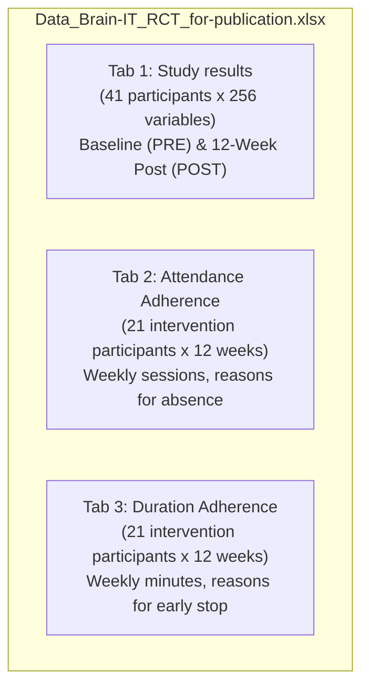

# Dataset Audit Report: Brain-IT Exergame RCT Collection
**Collection Name:** Brain-IT (ETH Zurich)  
**Dataset Path:** `Backend/research_archive/Data_Brain-IT_RCT_for-publication.xlsx`  
**Accompanying Documentation:** `Backend/research_archive/README-file_Data_Brain-IT-RCT.txt`  
**Auditor:** NeuroCompanion Phase 4 AI/ML Research & Verification Team  
**Audit Date:** November 17, 2026  
**Status:** Certified Read-Only Technical Audit  

---

## 1. Physical Files, Formats & Metadata

| Field | Verified Value | Inspection Method |
| :--- | :--- | :--- |
| **Primary Data File** | `Data_Brain-IT_RCT_for-publication.xlsx` | Python `openpyxl`, `os.path.getsize` |
| **File Format** | Microsoft Excel OpenXML Spreadsheet (`.xlsx`) | OpenXML container check |
| **File Size** | 100,561 bytes (98.2 KB) | Filesystem metadata |
| **Documentation File** | `README-file_Data_Brain-IT-RCT.txt` (and identical copy `README-file_Data_Brain-IT-RCT (1).txt`) | Plain text UTF-8 / ASCII inspection |
| **Worksheets** | 3 tabs: `Study results`, `Attendance Adherence`, `Duration Adherence` | `openpyxl.workbook.sheetnames` |
| **Creation / Export Date** | 2024-02-14 (Study completed February 2024; Readme generated 2023-02-19 / updated 2024) | Electronic Case Report Form (Castor EDC) |
| **DOI / Repository** | [10.5281/zenodo.10695988](https://doi.org/10.5281/zenodo.10695988) | Zenodo open repository |
| **Principal Investigators** | Patrick Manser & Prof. Dr. Eling D. de Bruin (ETH Zurich, Switzerland) | Official Zenodo & JMIR Protocol |
| **Trial Registration** | ClinicalTrials.gov (NCT05387057; registered May 18, 2022) | Clinical trial registry |

---

## 2. Participant Population, Cohort Size & Clinical Diagnoses

- **Total Enrolled / Randomized:** $N = 41$ unique participants.
- **Participant Identifiers:** Pseudonymous 8-digit IDs generated by Castor EDC prefixed with `P-` (e.g., `P-01632688`, `P-05415422`, `P-06821593`, ..., `P-96880558`).
- **Group Allocation (`pat_allocation`):**
  - **Brain-IT Intervention Group:** $n = 21$ (12-week exergame training with biofeedback breathing on Dividat Senso Flex platform).
  - **Usual Care Control Group:** $n = 18$ (standard care without exergame).
  - **Unassigned / Excluded post-randomization:** $n = 2$ (`-96`).
- **Age Distribution:** Mean age $72.8 \pm 7.1$ years (range: 56.0 to 88.0 years, excluding missing codes `-99`).
- **Biological Sex:** 27 males (69.2%), 12 females (30.8%), 2 missing (`-99`).
- **Diagnostic Categories (`pat_category`):**
  - **mNCD (Clinically Diagnosed Mild Neurocognitive Disorder):** $n = 34$ (82.9%) diagnosed under ICD-11 / DSM-5.
  - **sMCI (Screened Mild Cognitive Impairment):** $n = 7$ (17.1%) screened via Quick Mild Cognitive Impairment Screen (Qmci: score $45 \le \text{Qmci} < 62$).
- **Etiological Clinical Subtypes (`pat_clinicalsubtype`):**
  - **mNCD due to Alzheimer’s Disease:** $n = 25$ (61.0%).
  - **Mild Vascular NCD:** $n = 8$ (19.5%).
  - **Unclear / Not yet determined:** $n = 4$ (9.8%).
  - **Mild Frontotemporal NCD:** $n = 3$ (7.3%).
  - **mNCD with Lewy Bodies:** $n = 1$ (2.4%).

---

## 3. Worksheet Structure, Dimensions & Schema

### Tab 1: `Study results` (55 rows $\times$ 258 columns)
- **Structure:** Multi-level header rows (Row 1: Section name; Row 3: Column variable names; Row 4: Variable units/coding; Rows 5–45: 41 participant rows).
- **Measurement Windows:** Longitudinal pre-post design with two assessment time points:
  - **PRE-Measurement:** Prior to intervention start (Weeks 0).
  - **POST-Measurement:** Immediately following 12-week intervention.
- **Variable Breakdown (256 Evaluated Outcomes):**
  1. *Identifiers & Allocation (Cols 1–2):* `pat_ID`, `pat_allocation`.
  2. *Demographics & Clinical Baseline (Cols 3–11):* `pat_age`, `pat_sex`, `pat_education`, `pat_height`, `pat_weight`, `pat_bmi`, `pat_activity`, `pat_category`, `pat_clinicalsubtype`.
  3. *Medication & Usual Care (Cols 12–16):* `pat_regularmedication`, `pat_medication_list`, `pat_changes_of_medication`, `pat_changes_of_medication_list`, `pat_usualcare`.
  4. *Autonomic Regulation (Resting vm-HRV) (Cols 17–25 PRE, Cols 137–145 POST):* Beat correction, mRR, RMSSD, pNN50, HF power, HFnu, SD1, PNS-Index.
  5. *HOTAP Picture-Sorting Test (Cols 26–28 PRE, Cols 146–148 POST):* Part A sum of points, arrangement time (s), combi-score (pts/min).
  6. *Quick Mild Cognitive Impairment Screen (Qmci) (Cols 29–35 PRE, Cols 149–155 POST):* Orientation, registration, clock drawing, delayed recall, verbal fluency, logical memory subscores, and total score.
  7. *TAP Alertness & Go/NoGo (Cols 36–39 PRE, Cols 156–159 POST):* Go/NoGo median reaction time (ms) and error counts.
  8. *WMS-IV Logical Memory (Cols 40–43 PRE, Cols 160–163 POST):* Immediate recall (LM1), delayed recall (LM2), and recognition score.
  9. *Quality of Life in AD (QoL-AD) (Cols 44–57 PRE, Cols 164–177 POST):* 13 item subscores (physical health, energy, mood, living situation, memory, family, marriage, friends, self, chores, fun, money, life as a whole) and total score.
  10. *Gait & Dual-Task Motor Analysis (Cols 58–98 PRE, Cols 178–218 POST):* Single-task and dual-task spatio-temporal parameters (velocity, cadence, stride length, step time, gait variability).
  11. *Depression, Anxiety & Stress (DASS-21) (Cols 99–122 PRE, Cols 219–242 POST):* 21 Likert items and domain totals.
  12. *PEBL Computerized Cognitive Tasks (Cols 123–134 PRE, Cols 243–254 POST):* Digit Span Forward (DSF), Digit Span Backward (DSB), Mental Rotation Task (MRT) accuracy/reaction times, and Trail Making Test Part A/B errors and times.
  13. *Amsterdam IADL Questionnaire (Cols 135–136 PRE, Cols 255–256 POST):* Total T-Score and standard error.
  14. *Study Completion & Adverse Events (Cols 257–258):* Dropout reasons and trial completion status.

### Tab 2: `Attendance Adherence` (72 rows $\times$ 31 columns)
- Covers the $n = 21$ intervention participants.
- Records planned vs attended sessions across **12 distinct training weeks** (`W1` through `W12`), weekly averages, overall attendance adherence percentage, total missed sessions, reasons for non-adherence (e.g., illness, vacation, technical failure), and number of professionally supervised sessions.

### Tab 3: `Duration Adherence` (74 rows $\times$ 30 columns)
- Covers the $n = 21$ intervention participants.
- Records planned vs actual training duration (minutes) across Weeks 1 to 12, weekly average duration, overall duration adherence percentage, and recorded clinical reasons for early termination.

---

## 4. Missing Values, Duplicates & Data Quality

- **Duplicate Rows:** **0 duplicates**. Every `pat_ID` is strictly unique.
- **Missing Value Coding:** The electronic data capture system (Castor EDC) uses standardized numerical codes for missingness:
  - `-99`: Missing data / participant did not complete assessment.
  - `-96`: Not applicable / excluded / dropout.
- **Attrition Rate:** 
  - 39 out of 41 participants (95.1%) completed baseline testing.
  - 2 participants dropped out before pre-measurement (`P-01632688`, `P-45132867`).
  - Study completion rate was high (> 85%), with reasons for missed individual exergame sessions documented in the adherence tabs.
- **Data Quality:** Excellent. Clean, cross-validated by two study investigators prior to public deposit on Zenodo.

---

## 5. Nature of Observations & Data Source

- **Objective Psychometric Assessments:** Administered by trained clinical neuropsychologists (Qmci, WMS-IV, TAP, PEBL).
- **Biophysiological Measures:** Heart rate variability (Kubios HRV software) and instrumented gait mat kinematics.
- **Participant Self-Reports:** QoL-AD, DASS-21, Amsterdam IADL (informant/caregiver-rated).
- **Investigator-Logged Protocol Adherence:** Weekly attendance and duration matrices maintained by trial monitors.
- **In-App Digital Game Telemetry:** **ABSENT**. The raw step-by-step game logs from the Dividat Senso Flex exergame (e.g., target coordinates, foot contact reaction times, in-game error sequences, step latencies) were **not included** in this publication deposit.

---

## 6. Evaluation Against NeuroCompanion ML Research Tasks

| Potential Research Task | Evidence Level | Detailed Technical Justification |
| :--- | :---: | :--- |
| **Assistance Recommendation (AS01–AS09)** | **Not Supported** | Contains **zero** assistance-type labels. The Dividat Senso Flex exergame protocol provided physical exergaming, not adaptive software scaffolding. |
| **Independent Completion Prediction (AS10)** | **Not Supported** | Contains **zero** step-level or interaction-level completion labels. Only global clinical trial completion is recorded. |
| **Assistance Effectiveness Modeling** | **Not Supported** | Neither software assistance nor immediate task success/failure is tracked. |
| **Activity Participation & Adherence Modeling** | **Partially Supported** | Weekly attendance (Tab 2) and duration adherence (Tab 3) provide ground truth on longitudinal compliance in $n=21$ participants over 12 weeks. However, the small sample size ($n=21$) limits ML training to descriptive baseline feature correlation. |
| **Cognitive / Diagnostic Context Baseline** | **Directly Supported** | Accurately characterizes the multidimensional cognitive, affective, autonomic, and gait profile of older adults with mild Alzheimer's disease ($n=25$) and other mNCD subtypes. |
| **Longitudinal Cognitive Trajectory Analysis** | **Partially Supported** | Provides pre-to-post (12-week) delta scores on Qmci, WMS-IV, TAP, and PEBL cognitive batteries under active motor-cognitive training vs usual care. |
| **Personalization Research** | **Not Supported** | No runtime telemetry or in-app adaptation curves exist to inform real-time UI/assistance tuning. |

---

## 7. Licensing & Research-Use Restrictions

- **License:** **Creative Commons Attribution 4.0 International (CC-BY 4.0)**.
- **Permissions:** Unrestricted academic and commercial reuse, adaptation, and sharing, provided appropriate credit is given to the original authors (Patrick Manser & Eling D. de Bruin, ETH Zurich).
- **Privacy Compliance:** Fully anonymized (pseudonymous 8-digit Castor IDs). No direct patient identifiers (names, dates of birth, addresses) are included.

---

## 8. Final Verdict & Contribution to Phase 4

> [!IMPORTANT]
> **Role in Phase 4:** **Supplementary Clinical & Adherence Benchmark Only**.  
> The Brain-IT dataset cannot be used to train NeuroCompanion's runtime assistance models (M1, M2, M3). However, its 12-week adherence protocols (Tabs 2 & 3) offer valuable **empirical priors on exercise adherence rates and drop-off patterns** in older adults with mild Alzheimer's disease, and its rich clinical battery provides an external standard for mapping baseline cognitive profiles to digital engagement limits.
