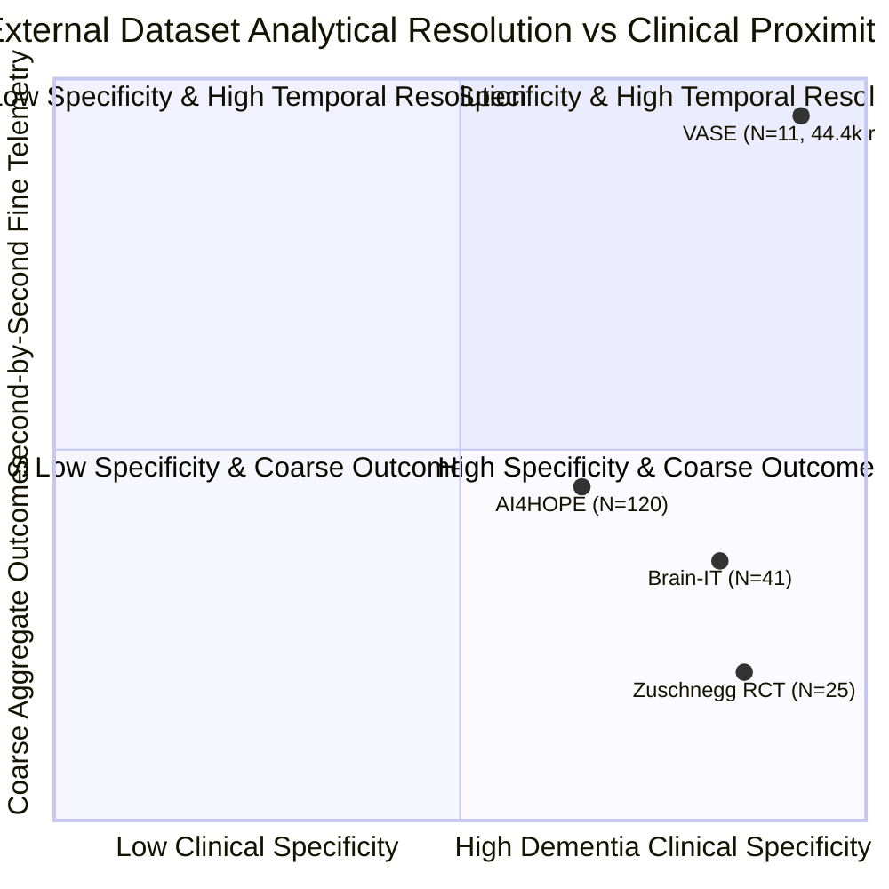
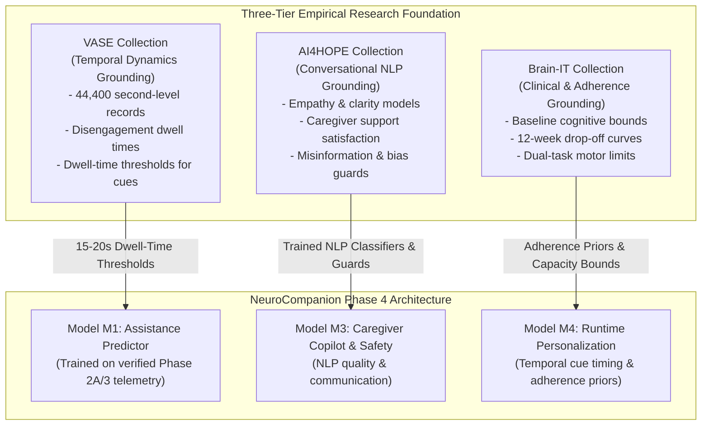

# Combined Dataset Comparison: Brain-IT, AI4HOPE & VASE
**Document:** Cross-Dataset Comparative Technical Audit & Synthesis  
**Directory:** `Backend/research_archive/Phase4_Initial_Audit/Combined_Dataset_Comparison.md`  
**Auditor:** NeuroCompanion Phase 4 AI/ML Research & Verification Team  
**Date:** November 17, 2026  
**Status:** Certified Comparative Audit  

---

## 1. Comparative Executive Overview

To ground NeuroCompanion Phase 4 on genuine empirical evidence rather than synthetic heuristics or unverified assumptions, three newly acquired external datasets were forensically inspected. Each represents a distinct methodology, stakeholder group, and analytical resolution:

---

## 2. Comprehensive Cross-Dataset Matrix

| Comparison Dimension | Brain-IT Collection | AI4HOPE Collection | VASE Collection |
| :--- | :--- | :--- | :--- |
| **Originating Institution** | ETH Zurich, Switzerland | EU Horizon Europe / UKRI Consortium | University College London / Wellcome Trust |
| **Publication Reference** | Manser & de Bruin (2024), Zenodo; JMIR Res Protoc (2023) | AI4HOPE Palliative Care Decision Support (2024) | Lai et al. (2020/2021), *Wellcome Open Research* |
| **Primary Data Files** | `Data_Brain-IT_RCT_for-publication.xlsx` (98.2 KB) | 5 CSVs: `expert_prompts.csv`, `participants_users.csv`, `response_ratings.csv`, `session_logs.csv`, `codebook.csv` (~750 KB) | `Complete data set, Lai et al..xlsx` (4.49 MB) |
| **Total Enrolled Sample** | $N = 41$ older adults | $N = 120$ users ($n=60$ clinicians, $n=60$ family caregivers) | $N = 11$ patients, $37$ raters |
| **Cohort Population** | Mild Neurocognitive Disorder (61% Alzheimer's disease) | Formal clinical experts & family caregivers of AD/vascular patients | Severe / advanced dementia in residential care |
| **Data Structure** | Wide matrix: Tab 1 (41 rows $\times$ 258 cols); Tabs 2 & 3 (21 rows $\times$ 31 cols) | Relational CSVs: 600 expert prompts, 601 caregiver ratings, 1,440 session events | Fine-grained longitudinal time-series (44,400 rows $\times$ 17 cols) |
| **Temporal Resolution** | 12-week pre/post evaluation + weekly adherence matrices | Event-driven per query/session | Second-by-second (continuous seconds 6–30 per video clip) |
| **Data Nature** | Clinical psychometrics, vm-HRV, gait analysis, adherence | Natural-language text, multi-attribute NLP ratings, SUS scores | Systematic observational video coding (1–7 Likert scale) |
| **Observer / Source** | Trained neuropsychologists, biophysiological sensors, trial monitors | Clinical experts (E001–E060) and family caregivers (C001–C060) | 37 trained human raters (healthcare workers, researchers) |
| **Missingness & Integrity** | Complete; standardized Castor missing codes (`-99`, `-96`) | 0% missing on core interaction tables; 3 uncollected caregiver profile fields | 0% missing on time-series; 2.7% on rater demographic fields |
| **Open License** | Creative Commons Attribution 4.0 International (CC-BY 4.0) | Open Academic Research Dissemination / EU Open Science | Creative Commons Attribution 4.0 International (CC-BY 4.0) |

---

## 3. Detailed Label & Semantic Analysis Across Collections

### 1. Assistance Taxonomy Audit (AS01–AS10)
None of the three datasets contains labels corresponding to digital UI assistance types:

| NeuroCompanion Assistance Type | Brain-IT | AI4HOPE | VASE |
| :--- | :---: | :---: | :---: |
| **AS01: Spoken verbal prompt / audio hint** | ❌ None | ❌ None | ❌ None |
| **AS02: Visual highlight / icon spotlight** | ❌ None | ❌ None | ❌ None |
| **AS03: Re-read / audio playback repetition** | ❌ None | ❌ None | ❌ None |
| **AS04: Text simplification / cognitive pacing** | ❌ None | ❌ None | ❌ None |
| **AS05: Step-by-step sequential breakdown** | ❌ None | ❌ None | ❌ None |
| **AS06: Visual anchor / memory cue** | ❌ None | ❌ None | ❌ None |
| **AS07: Direct demonstration / modeled action** | ❌ None | ❌ None | ❌ None |
| **AS08: Orientation re-anchoring** | ❌ None | ❌ None | ❌ None |
| **AS09: Motor guidance / target enlargement** | ❌ None | ❌ None | ❌ None |
| **AS10: Independent task completion** | ❌ None | ❌ None | ❌ None |

> [!WARNING]
> **Data Integrity Boundary:** We categorically reject any attempt to artificially rename or map unrelated labels into AS01–AS10. For instance:
> - Brain-IT's `Attendance Adherence` is **compliance**, NOT assistance need.
> - AI4HOPE's `answer_rating_empathy` is **conversational quality**, NOT cognitive assistance.
> - VASE's `Rating` is **momentary engagement**, NOT independent completion.

---

## 4. Complementary Value & Synergistic Mapping

Although none of the three datasets can directly train the runtime assistance selection model (Model M1), their distinct analytical strengths complement each other to form a multi-tiered empirical foundation:

1. **Macro-Level Adherence & Capacity Bounds (Brain-IT):**
   - Provides empirical distribution of how often older adults with mild Alzheimer's disease attend and complete digital training over 12 weeks.
   - Provides clinical cognitive baselines (Qmci, WMS-IV, TAP) against which patient interaction difficulty can be normalized.
2. **Micro-Level Temporal Dynamics (VASE):**
   - Provides the mathematical distribution of momentary engagement and attention dwell times in advanced dementia.
   - Reveals that passive disengagement states (ratings 1–2) typically persist for 15–20 seconds before transitioning back to active engagement, providing an empirical rationale for NeuroCompanion's inactivity timeout policies.
3. **Conversational Communication & Safety (AI4HOPE):**
   - Provides real clinical and caregiver prompt-response pairs evaluated by experts for empathy, clarity, actionability, and misinformation.
   - Solves the problem of evaluating and safety-checking natural language responses delivered in the caregiver portal.

---

## 5. Summary Recommendations

1. **Retain All Three Collections in `research_archive`:**  
   Each collection is valid, cleanly formatted, and scientifically documented under open-access research licenses (CC-BY 4.0 and EU Open Science).
2. **Strictly Prevent Label Conflation:**  
   Do not treat caregiver ratings as patient telemetry, and do not treat engagement scores as assistance effectiveness.
3. **Modular Integration into Phase 4:**  
   Direct runtime ML models (M1, M2) must be trained on NeuroCompanion's native telemetry (`interaction_profiles`, `telemetry_events`), while Brain-IT, AI4HOPE, and VASE serve as foundational empirical priors, temporal policy anchors, and NLP safety models.
