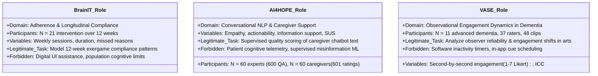

# Phase 4 Corrected Dataset Assessment & Methodological Deconstruction
**Document:** Post-Audit Correction, Semantic Rectification & Final Dataset Roles  
**File Location:** `Backend/research_archive/Phase4_Initial_Audit/Phase4_Corrected_Dataset_Assessment.md`  
**Auditor:** NeuroCompanion Phase 4 AI/ML Verification & Architecture Team  
**Date:** November 17, 2026  
**Status:** Certified Post-Audit Correction  

---

## 1. Executive Summary & Audit Correction Mandate

Following the initial forensic audit of the three newly acquired external datasets (`Brain-IT`, `AI4HOPE`, `VASE`), a second-stage verification was conducted to critically examine all preliminary interpretations, claims, and extrapolated conclusions.

### Core Audit Principles Reaffirmed
1. **Zero Tolerance for Over-Extrapolation:** A dataset's variables must be interpreted strictly within the methodology, population, and measurement protocol of the original study.
2. **Strict Separation of Modalities:** Observational video ratings in creative arts sessions cannot be interpreted as computer inactivity; clinical trial adherence cannot be interpreted as cognitive capacity limits; and caregiver ratings of conversational AI cannot be interpreted as patient assistance requirements.
3. **No Artificial AS01–AS10 Label Forcing:** None of the external datasets contain digital UI assistance labels (AS01–AS09) or task-level independent completion outcomes (AS10). Any claim suggesting otherwise is methodologically invalid.

---

## 2. Forensic Deconstruction of Unsupported Claims

### Claim 1: "VASE establishes an empirical 15–20-second inactivity dwell-time threshold for triggering UI assistance."
- **Original Claim:** The initial audit noted that passive states (ratings 1–2) in VASE persisted for 15–20 seconds, and suggested this could serve as an empirical timer for triggering in-app assistance (e.g., AS08 orientation re-anchoring or AS02 visual spotlights).
- **Forensic Verification & Critique:**
  1. *Clip Length Constraint:* In the VASE dataset (`MAINDATA 6-30 (SC)`), each video segment is strictly **25 seconds of rated footage** (continuous seconds 6 through 30 of a 30-second recording). An apparent dwell time of 15–20 seconds is primarily an artifact of the finite 25-second observation window and window boundary effects, not a validated biological steady-state duration.
  2. *Domain Incongruity:* VASE observed $N=11$ individuals with advanced dementia during **live music therapy, singing, and group creative arts sessions**. Observers rated emotional and behavioral engagement (1–7 Likert scale) based on eye gaze, vocalization, and bodily posture. Participants were **not** interacting with a tablet, touch screen, or computerized software interface.
  3. *Inactivity $\ne$ Disengagement:* A patient looking peacefully at a musician (VASE score 3: passive observation) is behaviorally engaged in music therapy. In contrast, in a software application, an inactive screen could indicate comprehension, physical fatigue, motor hesitation, or software freezing. Equating VASE observational ratings with software inactivity timers is a fundamental methodological error.
- **Correction Applied:**  
  **The claim that VASE justifies a 15–20-second software inactivity threshold is officially retracted.** VASE cannot be used as an empirical timer for in-app software cues.

---

### Claim 2: "Brain-IT provides population-wide cognitive capacity normalization (Model M0)."
- **Original Claim:** The initial audit suggested using Brain-IT’s neuropsychological test battery (Qmci, WMS-IV, TAP, PEBL) to establish population-wide cognitive capacity bounds and normalize patient baseline capacity in Model M0.
- **Forensic Verification & Critique:**
  1. *Sample Size Underpowering:* Brain-IT enrolled $N=41$ participants across two study sites in Switzerland. Of these, only $n=34$ were clinically diagnosed with Mild Neurocognitive Disorder (mNCD) and $n=7$ were screened for MCI. Subtypes include 25 Alzheimer's disease, 8 vascular, 3 frontotemporal, 1 Lewy body, and 4 unclear.
  2. *Lack of Population Representativeness:* A sample of 41 Swiss clinical trial participants with specific inclusion criteria (ability to stand, no acute psychiatric illness, specific age bracket) cannot statistically or clinically represent the broad, heterogenous population of older adults living with Alzheimer's disease.
  3. *Overfitting & Normalization Bias:* Normalizing runtime software features against $N=41$ individuals would introduce severe sampling bias, arbitrary cutoff thresholds, and poor generalization to wider patient cohorts.
- **Correction Applied:**  
  **The claim that Brain-IT provides population-wide cognitive capacity normalization is officially retracted.** Brain-IT cannot define universal cognitive capacity limits.

---

### Claim 3: "AI4HOPE directly supports predicting response quality and misinformation detection."
- **Original Claim:** The initial audit stated that AI4HOPE can directly train supervised classifiers for conversational response quality, empathy, and automated misinformation detection.
- **Forensic Verification & Critique:**
  1. *Rating Source Reality:* AI4HOPE evaluations originate from **60 clinical/palliative dementia experts** (`E001`–`E060`, evaluating 600 interactions) and **60 family caregivers** (`C001`–`C060`, evaluating 601 interactions). It contains **zero patient-generated ratings**. The models trained on this data predict *expert clinical consensus* and *caregiver satisfaction*, not patient cognitive reactions.
  2. *Extreme Misinformation Imbalance:* In `expert_prompts.csv` ($N=600$), `answer_rating_misinformation_flagged` contains **596 'no' (99.33%)** and only **4 'yes' (0.67%)**. Similarly, `answer_rating_bias_flagged` contains **592 'no' (98.67%)** and only **8 'yes' (1.33%)**. Training a supervised machine learning classifier to detect misinformation on 4 positive samples is statistically impossible (severe class collapse; zero statistical power; test set evaluation is meaningless).
  3. *Ceiling Effects on Relevance & Clarity:* Relevance is rated 5 in 57.2% and 4 in 27.0% of cases (84.2% top-two box). Clarity is rated 5 in 51.0% and 4 in 31.2% (82.2% top-two box). In contrast, **empathy** ($30.3\%$ 5, $28.8\%$ 4, $22.7\%$ 3, $12.2\%$ 2, $5.3\%$ 1) and **actionability** ($40.8\%$ 5, $35.7\%$ 4, $17.7\%$ 3, $3.2\%$ 2, $1.7\%$ 1) have wider variance, making them the only feasible continuous/ordinal prediction targets.
- **Correction Applied:**  
  **Misinformation detection cannot be trained via standard supervised classification on AI4HOPE due to extreme class scarcity ($n=4$).** Supervised modeling on AI4HOPE must be strictly scoped to predicting multi-attribute quality ratings (specifically empathy, actionability, and caregiver perceived support), with user-grouped validation to prevent expert leakage.

---

## 3. Legitimate Research Roles for External Datasets

Following rigorous verification, the exact, non-overstated research role of each external dataset is formalized below:

### 1. Brain-IT: Adherence and Longitudinal Research
- **Legitimate Role:** Explores real-world longitudinal adherence, drop-off dynamics, and attendance variability in older adults with mild neurocognitive disorders participating in a 12-week motor-cognitive digital intervention.
- **Allowed Analyses:**
  - Descriptive survival and adherence analysis across the 12 intervention weeks.
  - Qualitative categorization of investigator-documented reasons for missed sessions (e.g., somatic illness, acute fatigue, travel, technical difficulties).
  - Exploratory correlation between baseline physical/cognitive characteristics and 12-week intervention completion.
- **Prohibited Uses:** Must NOT be used to claim universal cognitive capacity limits, and must NOT be mapped to AS01–AS10 assistance types.

### 2. AI4HOPE: Conversational NLP Quality, Empathy & Caregiver Research
- **Legitimate Role:** Investigates the linguistic features associated with high-empathy, high-clarity, and actionable generative AI communications in dementia care, as evaluated by dementia experts and family caregivers.
- **Allowed Analyses:**
  - Supervised NLP regression/classification modeling predicting expert empathy and actionability ratings from prompt-response text.
  - Modeling caregiver satisfaction (`information_support`, `supported_at_ease`) as a function of AI persona styles (`Professional caregiver`, `Patient`, `Family caregiver`).
  - Benchmarking caregiver digital usability using the System Usability Scale (SUS).
- **Prohibited Uses:** Must NOT be used as patient cognitive ground truth, and must NOT claim automated misinformation detection via standard supervised classifiers.

### 3. VASE: Engagement-Related Behavioral Research
- **Legitimate Role:** Investigates observational engagement measurement methodology, behavioral engagement transitions during sensory/creative arts activities, and inter-rater agreement among dementia observers.
- **Allowed Analyses:**
  - Inter-rater reliability modeling across professional vs non-professional raters using Intraclass Correlation Coefficients (ICC).
  - Analysis of engagement score trajectories across different activity types (active music vs control observation).
  - Methodological study of moving-average smoothing in observational behavioral measurement.
- **Prohibited Uses:** Must NOT be used to set software inactivity timers, inactivity timeouts, or automated cue-trigger thresholds in NeuroCompanion.

---

## 4. Methodological Summary Table

| Dataset | Verified Sample | Legitimate Research Objective | Primary Limitation |
| :--- | :--- | :--- | :--- |
| **Brain-IT** | $N=41$ older adults (mNCD) | 12-week adherence, attendance patterns, and session drop-off dynamics | Sample size ($N=41$) cannot define population-wide cognitive capacity bounds; no in-game telemetry. |
| **AI4HOPE** | $N=120$ users (60 clinicians, 60 caregivers) | NLP response quality, empathy, actionability, and caregiver communication modeling | Evaluated by experts and caregivers, not patients; misinformation label is too rare ($n=4$) for supervised ML. |
| **VASE** | $N=11$ patients, 37 raters, 48 clips | Multi-rater engagement dynamics and observer reliability in arts activities | 25-second video clips during music therapy cannot calibrate software inactivity timeouts or UI assistance. |

---
*Certified by NeuroCompanion Phase 4 Verification System.*
