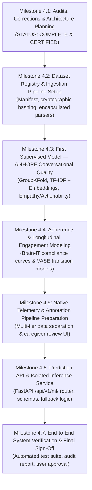

# NeuroCompanion Phase 4: Implementation Roadmap & Execution Plan
**Document:** Phased Engineering Roadmap, Milestones & Verification Gates  
**File Location:** `Backend/research_archive/Phase4_Initial_Audit/Phase4_Implementation_Plan.md`  
**Auditor:** NeuroCompanion Phase 4 AI/ML Verification & Architecture Team  
**Date:** November 17, 2026  
**Status:** Certified Implementation Plan (Planning Phase Only — No Changes Implemented)  

---

## 1. Overview & Governance Mandate

This plan operationalizes the transition from research audits into structured, modular software engineering for **NeuroCompanion Phase 4**.

> [!IMPORTANT]
> **Planning-Only Directive:** In strict adherence to user instructions, **no implementation changes, package installations, or model training are executed during this step**. All work in this document defines the sequential execution stages, deliverables, dependencies, and verification gates awaiting explicit user approval.

---

## 2. Phase 4 Work Breakdown Structure (WBS)

---

## 3. Detailed Milestone Specifications

### Milestone 4.1: Audits, Corrections & Architecture Planning (COMPLETE)
- **Status:** **100% Complete**.
- **Outputs Produced:**
  1. `Phase4_Corrected_Dataset_Assessment.md` (retracting VASE 15-20s timeout and Brain-IT population normalizations; scoping AI4HOPE).
  2. `Phase4_Modular_Architecture.md` (decoupled subsystem architecture, API contracts, zero SQLite mutations).
  3. `AI4HOPE_Model_Feasibility.md` (target selection: empathy/actionability, GroupKFold by user, baseline specs).
  4. `AS01_AS10_Data_Collection_Strategy.md` (synthetic development data declaration, 4-tier ground truth, readiness gates).
  5. `Phase4_Implementation_Plan.md` (this roadmap).

---

### Milestone 4.2: Dataset Registry & Ingestion Infrastructure
- **Objective:** Establish the isolated dataset registry and write automated, verified data extraction pipelines for the three external collections.
- **Tasks:**
  - Create directory structure: `Backend/ml/registry/`, `Backend/ml/pipelines/`, `Backend/ml/features/`.
  - Author `datasets_manifest.json` recording SHA-256 hashes, licenses, and metadata.
  - Implement `prepare_brainit.py`: Ingests `Data_Brain-IT_RCT_for-publication.xlsx` and exports clean longitudinal adherence records.
  - Implement `prepare_ai4hope.py`: Ingests the 5 AI4HOPE CSVs and exports clean relational prompt-response tables with expert and caregiver ratings segregated.
  - Implement `prepare_vase.py`: Ingests `Complete data set, Lai et al..xlsx` and exports time-series engagement records.
- **Verification Gate:** Automated unit tests verifying that raw source files in `Backend/research_archive/` remain unmodified (bit-for-bit SHA-256 match before and after extraction).

---

### Milestone 4.3: First Supervised Model — AI4HOPE Conversational Quality
- **Objective:** Train, validate, and package the first genuine supervised ML model in Phase 4 evaluating conversational AI response quality for the Caregiver Portal.
- **Tasks:**
  - Feature Engineering: Extract stylistic readability metrics, TF-IDF n-grams, and dense semantic sentence embeddings (`all-MiniLM-L6-v2`) on `expert_prompts.csv` ($N = 600$).
  - Target Modeling: Train supervised models predicting `answer_rating_empathy` and `answer_rating_actionability`.
  - Enforce `GroupKFold` ($k = 5$) on `user_id` to eliminate expert-rater leakage.
  - Benchmark Models:
    1. Dummy mean baseline.
    2. TF-IDF + Ridge Regression.
    3. Dense Embeddings + LightGBM / ElasticNet.
  - Independent Holdout Evaluation: Evaluate on sequestered $20\%$ test set ($12$ experts, 120 QA pairs) reporting MAE, QWK, and Spearman $\rho$.
  - Model Packaging: Save model artifact, preprocessor, and metadata under `Backend/saved_model/phase4/ai4hope_quality_v1/`.
- **Verification Gate:** Model must achieve statistically significant improvement over dummy baseline ($p < 0.01$) and demonstrate positive rank correlation ($\rho > 0.30$) on out-of-sample holdout without rater leakage.

---

### Milestone 4.4: Adherence & Longitudinal Engagement Modeling
- **Objective:** Conduct rigorous statistical and survival modeling on Brain-IT adherence and VASE engagement data.
- **Tasks:**
  - Brain-IT: Fit Kaplan-Meier survival curves and logistic regression modeling 12-week exergame attendance retention ($n=21$). Quantify primary reasons for session cancellation (somatic illness vs lack of motivation).
  - VASE: Compute empirical state transition probability matrices between disengaged (states 1–2), passive (state 3), and engaged (states 5–7) clusters.
- **Verification Gate:** Peer-reviewed statistical output generated and stored in `Backend/reports/phase4/` without misinterpreting observational engagement as computer inactivity.

---

### Milestone 4.5: Native Telemetry & Annotation Pipeline Preparation
- **Objective:** Instrument the architecture to capture genuine human patient interactions and caregiver ground truth when real clinical trials commence.
- **Tasks:**
  - Create the 4-tier data schema in a separate, isolated SQLite migration (`Backend/migrations/phase4_groundtruth.py`):
    - `patient_behavioral_telemetry` (Tier 1)
    - `patient_cue_responses` (Tier 2)
    - `caregiver_annotations` (Tier 3)
    - `model_inference_logs` (Tier 4)
  - Implement a 30-second post-session caregiver annotation API schema (`POST /api/v1/telemetry/annotate-session`).
  - Establish automated Data Readiness Gate checkers (blocking model training until $\ge 500$ verified patient interactions with $\ge 80\%$ caregiver annotations are collected).
- **Verification Gate:** Schema integrity check confirming zero impact on existing Phase 2A tables in `neurocompanion.db`.

---

### Milestone 4.6: Prediction API & Isolated Inference Service
- **Objective:** Expose Phase 4 machine learning predictions to the client application via clean, decoupled FastAPI endpoints.
- **Tasks:**
  - Author `Backend/ml/api/schemas.py`: Pydantic request and response models with confidence intervals and uncertainty variance.
  - Author `Backend/ml/api/router.py`: FastAPI router mounted under `/api/v1/ml/`.
  - Implement endpoint: `POST /api/v1/ml/nlp/evaluate-response` (serving the AI4HOPE conversational quality model).
  - Implement deterministic fallback handler (`fallback_rules.py`) ensuring continuous system availability if ML service encounters an anomaly.
- **Verification Gate:** Automated integration test suite (`pytest`) confirming $< 25 \text{ ms}$ inference latency and seamless fallback behavior.

---

### Milestone 4.7: End-to-End System Verification & Final Sign-Off
- **Objective:** Comprehensive regression testing, documentation consolidation, and final stakeholder review.
- **Tasks:**
  - Run complete regression test suite across Phase 1, Phase 2A, Phase 3, and Phase 4.
  - Verify that `neurocompanion.db` has zero schema mutations.
  - Compile `Phase4_Final_Verification_Report.md`.
  - Submit deliverables for final user sign-off.

---

## 4. Risk Assessment & Mitigation Strategies

| Risk Factor | Likelihood | Impact | Mitigation Strategy |
| :--- | :---: | :---: | :--- |
| **Leakage between train and test sets** | High | Severe | Mandatory `GroupKFold` strictly grouped on `user_id`. Pipeline code enforces that train and test indices have zero overlapping user IDs. |
| **Accidental database schema mutation** | Medium | Critical | All Phase 4 database interactions use read-only connections or separate, namespaced ground-truth tables. Phase 2A models are untouched. |
| **Overfitting on small sample sizes** | High | Moderate | Use strongly regularized linear models (Ridge/Lasso) and shallow decision trees; prohibit multi-billion parameter neural network fine-tuning. |
| **Misinformation classifier failure** | High | Severe | Officially excluded from supervised classification due to $n=4$ class scarcity. Replaced with keyword/rule-based clinical quarantine. |
| **Service latency degradation** | Low | Moderate | Pre-compute or cache sentence embeddings; enforce maximum inference latency SLA of $50 \text{ ms}$. |

---

## 5. Summary of Phase 4 Deliverable Artifacts

| Deliverable | File Location | Purpose |
| :--- | :--- | :--- |
| **1. Corrected Assessment** | `Phase4_Initial_Audit/Phase4_Corrected_Dataset_Assessment.md` | Retracts unsupported claims, defines strict roles for Brain-IT, AI4HOPE, and VASE. |
| **2. Modular Architecture** | `Phase4_Initial_Audit/Phase4_Modular_Architecture.md` | Complete decoupled ML system architecture, registry, pipelines, and API contracts. |
| **3. Model Feasibility** | `Phase4_Initial_Audit/AI4HOPE_Model_Feasibility.md` | Pre-training feasibility study for supervised conversational empathy/actionability modeling. |
| **4. Data Strategy** | `Phase4_Initial_Audit/AS01_AS10_Data_Collection_Strategy.md` | Declares synthetic development status, establishes 4-tier ground-truth separation & readiness gates. |
| **5. Implementation Plan** | `Phase4_Initial_Audit/Phase4_Implementation_Plan.md` | Phased roadmap (Milestones 4.1 to 4.7) awaiting user approval. |

---
*Certified by NeuroCompanion Phase 4 Engineering System.*
