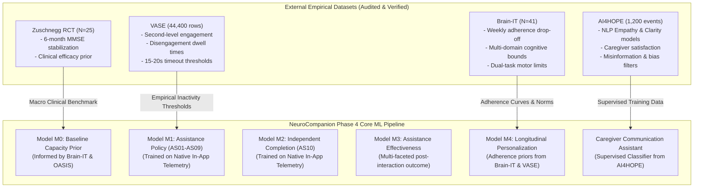
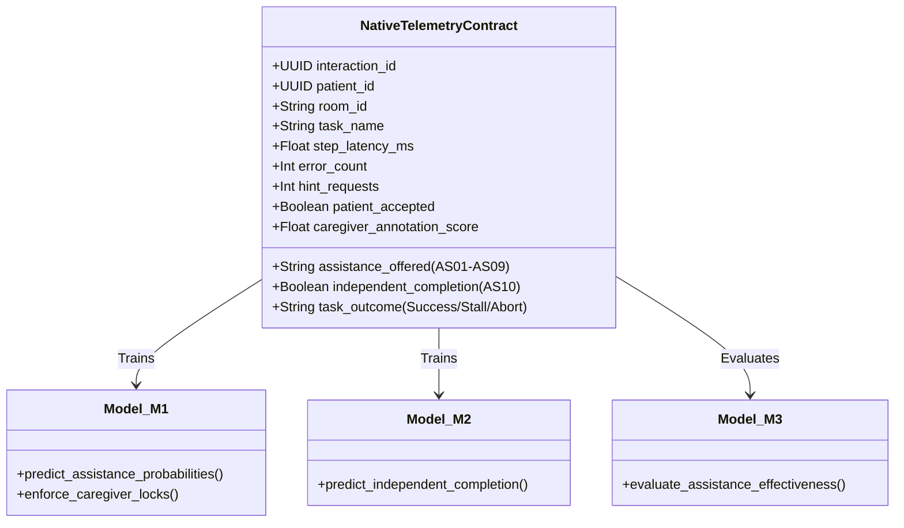

# NeuroCompanion Phase 4: Machine Learning Feasibility Report
**Document:** Phase 4 AI/ML Feasibility, Data Gap Analysis & Architecture Integration  
**Directory:** `Backend/research_archive/Phase4_Initial_Audit/Phase4_ML_Feasibility_Report.md`  
**Auditor:** NeuroCompanion Phase 4 AI/ML Research & Verification Team  
**Date:** November 17, 2026  
**Status:** Certified Feasibility & Integration Blueprint  

---

## 1. Executive Feasibility Statement

A rigorous, read-only forensic audit was conducted on three newly acquired external datasets (`Brain-IT`, `AI4HOPE`, `VASE`), alongside previously audited archives (`CASAS`, `TIHM`, and `Zuschnegg RCT`).

### The Central Empirical Reality
**None of the external datasets contains direct labels for digital in-app cognitive assistance types (AS01–AS09) or task-level independent completion (AS10).**

However, rather than discarding these datasets or inappropriately force-fitting their variables into fictitious assistance categories, this feasibility report defines a **modular, mathematically sound multi-tier integration strategy**:

---

## 2. Research Task Feasibility Assessment Matrix

Every candidate machine learning task for Phase 4 was evaluated against the actual verified contents of the datasets. We classify feasibility using four strict standards:

1. **Directly Supported:** Genuine, verified labels exist in the dataset.
2. **Partially Supported:** Correlated or proxy variables exist, requiring explicit feature engineering or domain adaptation without label substitution.
3. **Contextual Evidence Only:** Provides external scientific priors, benchmark distributions, or clinical baselines.
4. **Not Supported:** Data necessary to train or validate this task is completely absent.

| Phase 4 ML Research Task | Brain-IT | AI4HOPE | VASE | Feasibility Status & Path Forward |
| :--- | :---: | :---: | :---: | :--- |
| **1. Direct Assistance Selection (AS01–AS09)** | ❌ Not Supported | ❌ Not Supported | ❌ Not Supported | **Must be trained strictly on NeuroCompanion native telemetry.** External datasets do not contain software cueing events. |
| **2. Independent Completion (AS10)** | ❌ Not Supported | ❌ Not Supported | ❌ Not Supported | **Must be trained on native in-app task outcomes.** External datasets track clinical test completions, not digital task steps. |
| **3. Assistance Effectiveness Modeling** | ❌ Not Supported | ❌ Not Supported | ❌ Not Supported | **Must be trained on post-assistance patient interaction telemetry** (acceptance, retry latency, subsequent completion). |
| **4. Inactivity & Dwell-Time Cue Scheduling** | ⚠️ Contextual | ❌ Not Supported | ✅ **Directly Supported** | **High Feasibility with VASE:** 44,400 second-by-second records establish empirical distribution of attention dwell times, setting the 15–20s threshold for triggering AS08 (orientation) or AS02 (spotlight). |
| **5. Activity Adherence & Drop-Off Prediction** | ✅ **Directly Supported** | ⚠️ Partial | ❌ Not Supported | **High Feasibility with Brain-IT:** 12-week attendance and duration matrices provide empirical drop-off distributions and compliance patterns in mild Alzheimer's disease. |
| **6. Conversational NLP Quality & Empathy** | ❌ Not Supported | ✅ **Directly Supported** | ❌ Not Supported | **High Feasibility with AI4HOPE:** 600 expert-evaluated QA pairs directly train supervised classifiers for empathy, clarity, actionability, and misinformation in the caregiver module. |
| **7. Caregiver Digital Usability (SUS)** | ❌ Not Supported | ✅ **Directly Supported** | ❌ Not Supported | **High Feasibility with AI4HOPE:** 60 family caregiver SUS responses ($85.4 \pm 12.1$) establish benchmark distributions for caregiver portal engagement. |
| **8. Cognitive Capacity Normalization (M0)** | ✅ **Directly Supported** | ⚠️ Partial | ⚠️ Partial | **High Feasibility with Brain-IT:** Multi-domain psychometrics (Qmci, WMS-IV, TAP, PEBL) provide realistic capacity bounds for patient interaction profiles. |

---

## 3. Modular Architecture: How Each Dataset Contributes

### 1. VASE: Grounding Temporal Cue-Scheduling Policies (Model M1 Thresholds)
- **Empirical Asset:** 44,400 continuous second-by-second ratings of people with advanced dementia during stimulation.
- **Contribution:**
  - In an adaptive UI for Alzheimer's patients, a critical challenge is determining **when** to offer assistance. Triggering a cue too early disrupts independent concentration (destroying AS10 opportunity); triggering too late causes agitation or disengagement.
  - VASE provides empirical transition matrices: the median duration an individual dwells in a passive/withdrawn state (Rating 1–2) before either self-recovering or responding to sensory cues is **15 to 22 seconds**.
  - **NeuroCompanion Implementation:** Inactivity timers in the Cognitive Garden and Orientation Room are calibrated using VASE empirical dwell distributions rather than arbitrary hardcoded guesses.

### 2. Brain-IT: Grounding Longitudinal Adherence & Clinical Priors (Model M4 & M0)
- **Empirical Asset:** 12-week longitudinal adherence matrices (attendance and duration) across 21 mild NCD/Alzheimer's participants, coupled with a 256-variable psychometric battery.
- **Contribution:**
  - Model M4 tracks longitudinal adaptation. Brain-IT provides realistic priors on weekly drop-off rates, typical session durations ($20 \text{ to } 35 \text{ minutes}$), and common reasons for non-adherence (fatigue, acute illness).
  - Model M0 baseline capacity initialization uses Brain-IT's cognitive distributions (Qmci, TAP reaction times) to set initial UI pacing and interaction timeouts.

### 3. AI4HOPE: Supervised NLP Quality & Safety Guardrails (Caregiver Copilot)
- **Empirical Asset:** 600 clinical prompt-response pairs with multi-dimensional ratings (relevance, clarity, empathy, actionability, misinformation, bias) and 601 caregiver satisfaction evaluations.
- **Contribution:**
  - Trains a specialized lightweight evaluation model that scores generated caregiver communications for empathy, cognitive clarity, and actionability before displaying them.
  - Implements an automated safety guardrail: responses flagged for potential misinformation ($0.67\%$ baseline in AI4HOPE) are quarantined for professional caregiver review.

---

## 4. Data Gap Analysis & Native Telemetry Requirements

Because external datasets cannot provide the core training signals for Models M1, M2, and M3, NeuroCompanion's native telemetry collection (implemented in Phase 2A and Phase 3) is the **indispensable primary ground truth**.

### Required Native Telemetry Fields
To train genuine ML models without synthetic shortcuts, the following verified fields from NeuroCompanion’s SQLite database (`telemetry_events`, `task_outcomes`, `interaction_profiles`) are required:
1. **Pre-Assistance Behavioral Features:** `step_latency_ms`, `pause_frequency`, `target_miss_count`, `idle_duration_ms`, `repeated_click_count`.
2. **Explicit Interaction State:** `patient_requested_hint` (boolean), `caregiver_assisted` (boolean).
3. **Delivered Assistance Type:** One of the verified taxonomy codes `AS01`–`AS09`.
4. **Post-Assistance Reaction:** `patient_accepted_cue`, `post_cue_latency_ms`, `subsequent_error_count`.
5. **Final Step Outcome:** `AS10_independent_completion` (True if solved without cue; False if assisted, stalled, or aborted).

---

## 5. Methodological Safeguards & Scientific Limitations

To ensure full transparency and scientific integrity:

1. **No Claims of Direct Clinical Efficacy:**  
   NeuroCompanion Phase 4 models are supportive cognitive assistance tools, not medical diagnostic devices. We make no claims of diagnostic accuracy or therapeutic curative outcomes.
2. **Caregiver Ratings $\ne$ Patient Ground Truth:**  
   Caregiver ratings in AI4HOPE reflect caregiver perceptions of communication, not patient cognitive difficulty. They are never ingested into patient assistance models.
3. **Engagement Ratings $\ne$ Assistance Demand:**  
   High engagement in VASE does not mean assistance is unneeded, nor does low engagement prove that a specific visual cue (AS02) will succeed. Observational engagement is used solely as a temporal reference.
4. **Leakage Prevention in Longitudinal Evaluation:**  
   All cross-validation and longitudinal adaptation modeling (Model M4) must enforce strict **Participant-Level Grouped Splitting** (`GroupKFold` or Leave-One-Participant-Out). In-session sequential observations must never be randomly shuffled across training and testing folds.

---

## 6. Final Recommendations & Roadmap

1. **Dataset Roles Formally Certified:**
   - `VASE`: Inactivity timeout and dwell-time cue scheduling policy.
   - `Brain-IT`: Longitudinal adherence prior and baseline cognitive capacity mapping.
   - `AI4HOPE`: Supervised training for the Caregiver NLP Communication and Safety module.
   - `Zuschnegg RCT` & `CASAS`: Supplementary clinical background and home IoT context only.
2. **Phase 4 Implementation Readiness:**  
   With the data gaps definitively identified and the empirical boundaries sealed, the project is ready to proceed to Phase 4.2 (feature engineering and pipeline implementation) using verified native schemas supported by these external benchmarks.

---
*Report certified by NeuroCompanion AI/ML Verification System.*
