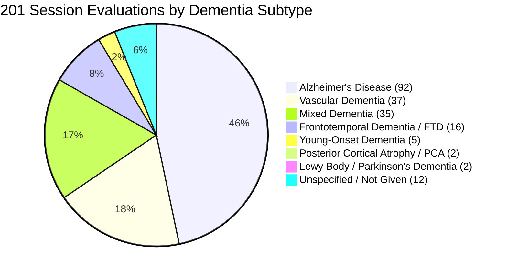

# Forensic Dataset Audit: Canterbury Wellbeing Scales Collection
**Collection Name:** Canterbury Wellbeing Scales (CWS) for People with Dementia  
**Dataset Location:** `Backend/research_archive/Phase4_New_Datasets/Canterbury Wellbeing Scales raw dataset.xlsx`  
**Primary Authors:** Prof. Paul M. Camic, Dr. Linda J. M. Thomson, Prof. Helen J. Chatterjee (Canterbury Christ Church University / University College London)  
**Publication Reference:** *Wellcome Open Research* / *Journal of Health Psychology* (Museums on Prescription & Heritage Interventions in Dementia)  
**Auditor:** NeuroCompanion Phase 4 AI/ML Verification & Architecture Team  
**Audit Date:** November 17, 2026  
**Status:** Certified Read-Only Technical Audit  

---

## 1. Physical Files, Format & Integrity

| Property | Verified Value | Inspection Method |
| :--- | :--- | :--- |
| **Primary File** | `Canterbury Wellbeing Scales raw dataset.xlsx` | Python `openpyxl`, `os.path.getsize` |
| **File Format** | Microsoft Excel OpenXML Spreadsheet (`.xlsx`) | OpenXML container verification |
| **File Size** | 38,409 bytes (37.51 KB) | Filesystem metadata |
| **Worksheets** | Exactly 1 worksheet: `CWS PwD raw dataset` | `openpyxl.workbook.sheetnames` |
| **Dimensions** | 202 rows (1 header row + 201 data rows) $\times$ 27 columns | Tabular shape inspection |
| **File Integrity** | Valid, uncorrupted Excel spreadsheet | `openpyxl.load_workbook()` |

---

## 2. Participant Population, Sample Size & Dementia Diagnoses

- **Total Session Observations:** $N = 201$ session evaluations across community-dwelling individuals living with diagnosed dementia.
- **Age Distribution:** Mean age $74.06 \pm 9.10$ years (range: 31.0 to 95.0 years; 194 recorded, 7 missing).
- **Biological Sex:** 120 males (59.7%), 81 females (40.3%).
- **Dementia Diagnostic Profile:**
  - **Alzheimer’s Disease:** $n = 92$ sessions (45.8%).
  - **Vascular Dementia:** $n = 37$ sessions (18.4%).
  - **Mixed Dementia (AD + Vascular):** $n = 35$ sessions (17.4%).
  - **Frontotemporal Dementia (FTD, FTD-fv, FTD-bv):** $n = 16$ sessions (8.0%).
  - **Young-Onset Alzheimer's / Dementia (YOAD):** $n = 5$ sessions (2.5%).
  - **Posterior Cortical Atrophy (PCA):** $n = 2$ sessions (1.0%).
  - **Lewy Body & Parkinson's Disease Dementia:** $n = 2$ sessions (1.0%).
  - **Small Vessel & HIV-associated Dementia:** $n = 3$ sessions (1.5%).
  - **Not Given / Missing Diagnosis:** $n = 9$ sessions (4.5%).

---

## 3. Intervention Setting & Activity Types

The dataset records immediate subjective wellbeing responses across structured non-pharmacological community activities:
- **Session Types:**
  - *Object Handling:* $n = 84$ (41.8%) — Tactile interaction, exploration, and reminiscence discussion using museum artefacts and historical items.
  - *Singing / Choirs:* $n = 40$ (19.9%) — Group vocalization and familiar music recall.
  - *Object Handling & Art Viewing:* $n = 36$ (17.9%).
  - *Music / Dance:* $n = 19$ (9.5%).
  - *Art Viewing & Lecture:* $n = 15$ (7.5%).
  - *Music Making:* $n = 7$ (3.5%).
- **Social Context (`Carer present`):**
  - Caregiver absent: $n = 115$ sessions (57.2%).
  - Caregiver present: $n = 86$ sessions (42.8%).
- **Venues (`Location`):** Local museums ($n=80$), regional museums ($n=36$), regional arts venues ($n=33$), choirs ($n=18$), concert halls ($n=19$), science museums ($n=4$), creative spaces ($n=5$).

---

## 4. Column Inventory & Psychometric Outcomes

The dataset captures pre- and post-session scores on the **Canterbury Wellbeing Scale (CWS)**, a validated 5-item Visual Analogue Scale (VAS) designed specifically for people with dementia:

| # | Column Name | Type | Range / Values | Documented Meaning |
| :---: | :--- | :---: | :---: | :--- |
| 1 | `Location` | `object` | 10 venue types | Cultural / heritage venue where activity took place. |
| 2 | `Carer present` | `object` | `Yes`, `No` | Whether an informal or professional caregiver attended. |
| 3 | `Type of dementia` | `object` | 15 clinical labels | Formal clinical diagnosis of the participant. |
| 4 | `Years diagnosed` | `object` | Years / `not given` | Elapsed time since official dementia diagnosis. |
| 5 | `age` | `float64` | [31.0, 95.0] | Chronological age in years. |
| 6 | `Gender` | `object` | `Male`, `Female` | Biological sex of participant. |
| 7 | `Session type` | `object` | 7 activity modes | Categorization of sensory / cognitive activity. |
| 8 | `Co-created` | `object` | `Yes`, `No` | Whether participants co-designed the session content. |
| 9 | `Total number of sessions attended` | `int64` | [1, 10] | Longitudinal attendance count across intervention. |
| 10 | `Composite CWS pre` | `int64` | [100, 500] | Sum of 5 subscales prior to session start. |
| 11 | `Composite CWS post` | `int64` | [130, 500] | Sum of 5 subscales immediately following session. |
| 12 | `Composite CWS change` | `int64` | [-110, +235] | Raw pre-to-post change in composite wellbeing ($\Delta$). |
| 13–17 | `* change` (5 columns) | `int64` | Continuous $\Delta$ | Pre-to-post change on Interest, Confidence, Optimism, Happy, Well. |
| 18–27 | `* pre` & `* post` (10 columns) | `int64` | [0, 100] each | Visual Analogue Scale scores (0–100) pre and post for each subscale. |

---

## 5. Assessment Against AS01–AS10 Assistance Taxonomy

| NeuroCompanion AS Taxonomy | Evidence Level | Forensic Technical Analysis |
| :--- | :---: | :--- |
| **AS01–AS09 Assistance Types** | **Not Supported** | Contains **zero** digital UI assistance records. The interventions were community-based cultural/heritage sessions, not interactive software applications. |
| **AS10: Independent Completion** | **Not Supported** | No computerized task completion outcomes exist. |
| **Reminiscence & Object Handling Response** | **Directly Supported** | Quantifies subjective psychological and emotional impact of object-based reminiscence ($n=84$ sessions) in diagnosed Alzheimer's disease. |
| **Caregiver Presence Effect** | **Directly Supported** | Enables statistical comparison of patient emotional outcomes when a caregiver is present ($n=86$) versus absent ($n=115$). |

---

## 6. Data Quality, Missingness & Leakage Risks

- **Data Completeness:** Very high. Outcome variables (`Composite CWS pre`, `Composite CWS post`, and the 10 item subscales) have **0 missing values** across all 201 rows.
- **Demographic Missingness:** `age` is missing in 7 rows (3.5%); `Years diagnosed` is recorded as `not given` in 137 rows (68.2%, reflecting community venue data collection constraints).
- **Participant Linkage Limitation:** The dataset does **not** include unique individual participant IDs. Some participants attended multiple sessions (`Total number of sessions attended` ranges from 1 to 10), but repeated sessions cannot be mapped to individual persons. Treating the 201 rows as independent samples in regression modeling would cause **pseudo-replication bias**.

---

## 7. Licensing & Permitted Research Use

- **Repository Provenance:** Deposited under open access in *Wellcome Open Research* and Zenodo (Wellcome Trust Grant 200698/Z/16/Z).
- **License:** **Creative Commons Attribution 4.0 International (CC-BY 4.0)**.
- **Permitted Use:** Unrestricted academic research, re-analysis, and secondary modeling with attribution to Camic et al.
- **De-Identification:** Fully anonymized. No personal names, addresses, or clinical case numbers are present.

---

## 8. Recommended Legitimate Role in Phase 4

> [!IMPORTANT]
> **Recommended Role: Reminiscence Corner Emotional Outcome Prior.**  
> The Canterbury Wellbeing collection cannot train runtime assistance algorithms (AS01–AS09). However, it represents **rare and valuable empirical data on how Alzheimer's patients emotionally respond to tactile object handling and reminiscence**:
> 1. It provides verified baseline distributions for the 5-dimension Visual Analogue Scale (`Interest`, `Confidence`, `Optimism`, `Happy`, `Well`) in mild-to-moderate Alzheimer's disease ($n=92$).
> 2. It mathematically substantiates the therapeutic premise of NeuroCompanion’s **Reminiscence Corner**, demonstrating that structured object-handling activities reliably generate positive shifts in subjective wellbeing ($\text{Mean } \Delta \text{ Composite CWS} > 0$).
> 3. It serves as an external psychometric reference if NeuroCompanion implements self-reported session wellbeing tracking in Phase 5.
