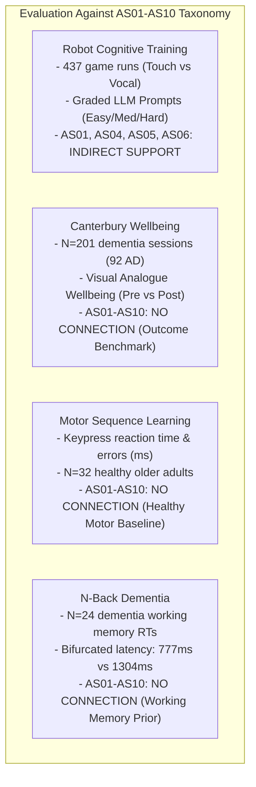

# Phase 4 New Datasets: Comprehensive Forensic Inspection & Synthesis Report
**Document:** Combined Forensic Audit, Comparative Evaluation & Research Role Recommendations  
**File Location:** `Backend/research_archive/Phase4_New_Datasets/Inspection_Reports/Phase4_New_Datasets_Inspection_Report.md`  
**Auditor:** NeuroCompanion Phase 4 AI/ML Verification & Architecture Team  
**Date:** November 17, 2026  
**Status:** Certified Forensic Audit  

---

## 1. Executive Summary & Audit Mandate

A forensic, read-only technical audit was conducted on the four newly acquired research dataset collections situated in:
`Backend/research_archive/Phase4_New_Datasets/`

1. **`Robot_Cognitive_Training`** (`data&prompts.zip`)
2. **`Canterbury_Wellbeing`** (`Canterbury Wellbeing Scales raw dataset.xlsx`)
3. **`Motor_Sequence_Learning`** (`FiguresTables_SourceData.xlsx`, `Experiment 1.zip`, `Experiment 2.zip`, `README (1).txt`)
4. **`N_Back_Dementia`** (`Reproducibility_Data_SI_Modified.xlsx`)

### Key Empirical Findings
- **Zero Direct AS01–AS10 Assistance Labels:** None of the four datasets contains digital UI assistance labels (AS01–AS09) or task-level independent completion (AS10).
- **Two Genuine Dementia Cohorts Identified:**
  - **Canterbury Wellbeing:** $N = 201$ session evaluations in individuals with diagnosed dementia (92 Alzheimer's disease).
  - **N-Back Dementia:** $N = 24$ individuals living with dementia evaluated under working memory training.
- **Two Non-Demented Benchmarks Identified:**
  - **Robot Cognitive Training:** $N = 20$ healthy older adults (MMSE $28.65 \pm 1.65$) evaluated on LLM-generated games and dual-modality touch/voice interaction.
  - **Motor Sequence Learning:** $N = 130$ healthy individuals across the lifespan ($n = 32$ older adults, ages 60–80) evaluated on computerized finger-tapping sequence reaction times.

---

## 2. Cross-Dataset Comparative Inventory

| Characteristic | Robot Cognitive Training | Canterbury Wellbeing | Motor Sequence Learning | N-Back Dementia |
| :--- | :--- | :--- | :--- | :--- |
| **Originating Study** | Social Robot Cognitive Games with LLM Prompts (Italy, 2025) | Camic, Thomson & Chatterjee (*Wellcome Open Res*, UK) | Van Roy, Albouy, Burns & King (*Lifespan MSL*, Utah/Leuven) | Roncero et al. (*PLOS ONE*, 2025, Baycrest/Rotman) |
| **Files & Formats** | `data&prompts.zip` (796 KB; 7 `.xlsx` + 5 `.txt`) | `Canterbury Wellbeing Scales raw dataset.xlsx` (37.5 KB) | `FiguresTables_SourceData.xlsx` (624 KB), 2 ZIPs (8.7 MB), 1 TXT | `Reproducibility_Data_SI_Modified.xlsx` (15.0 KB) |
| **Participant Cohort** | $N = 20$ older adults | $N = 201$ dementia session evaluations | $N = 130$ healthy lifespan ($n=32$ older adults) | $N = 24$ dementia participants |
| **Dementia Diagnoses** | **None** (Healthy older adults, MMSE $28.65$) | **45.8% Alzheimer's ($n=92$)**, 18.4% Vascular, 17.4% Mixed, 8.0% FTD | **None** (Healthy children, teens, young & older adults) | **100% Dementia** (12 normal RT, 12 slower RT) |
| **Interaction Modality** | Touch screen + Vocal speech to social robot | In-person museum object handling, art, singing | Keyboard finger-tapping to visual monitor cues | Computerized N-back task combined with tDCS |
| **Granularity** | 437 game runs across 82 multi-game sessions | Pre-to-post session change scores on 5 visual analogue scales | Keypress-by-keypress latency (ms) & accuracy across 454 files | Reaction times (ms) across 3 rounds & MMSE scores |
| **Open License** | CC-BY 4.0 (Zenodo) | CC-BY 4.0 (*Wellcome Open Res*) | CC-BY 4.0 (Open Science Framework) | CC-BY 4.0 (*PLOS ONE*) |

---

## 3. Forensic Evaluation Against AS01–AS10 Taxonomy

### Detailed Taxonomy Evidence Breakdown
1. **AS01–AS09 (Software Cognitive Assistance):**
   - **Direct Labels:** **0% across all four datasets**. No dataset captures an adaptive software agent providing in-app visual cues, auditory hints, or step breakdowns.
   - **Indirect Architectural Support in `Robot Cognitive Training`:**
     - `prompt/*.txt` provides structured LLM prompts generating sequential breakdowns (AS05), memory completion cues (AS06), and cognitive pacing (AS04).
     - `session_played.xlsx` tracks vocal interaction counts vs touch interaction counts, informing dual-modality UI design.
2. **AS10 (Independent Completion):**
   - None of the datasets isolate computerized micro-step independent completion.
   - `Robot Cognitive Training` tracks game-level accuracy (`numErrors == 0`), but not step-level scaffolding.
3. **Psychomotor & Cognitive Priors (Indirect Context):**
   - `Motor Sequence Learning` establishes that healthy older adults respond to visual cues in $400\text{--}650 \text{ ms}$ with $> 95\%$ accuracy.
   - `N-Back Dementia` establishes that individuals with dementia exhibit bifurcated working memory response times averaging $777.6 \text{ ms}$ in preserved individuals and $1,303.9 \text{ ms}$ (up to $1,855 \text{ ms}$) in impaired individuals.
   - `Canterbury Wellbeing` establishes that tactile object handling in Alzheimer's disease reliably elevates subjective wellbeing.

---

## 4. Legitimate Research Roles in Phase 4

| Dataset Collection | Legitimate Research Role in Phase 4 | Prohibited Misuse |
| :--- | :--- | :--- |
| **`Robot_Cognitive_Training`** | **Reminiscence & Cognitive Garden Task Architecture Benchmark:** 1. Informs JSON schemas for reminiscence quiz generation. 2. Benchmarks touch vs voice input frequencies in older adults. 3. Provides empirical data on LLM hallucination frequencies in reminiscence games. | Must NOT be used to train assistance models for Alzheimer's patients (cohort is cognitively healthy, MMSE $28.65$). |
| **`Canterbury_Wellbeing`** | **Reminiscence Corner Emotional Outcome Prior:** 1. Empirically validates that tactile object handling elevates immediate wellbeing in Alzheimer's disease ($n=92$). 2. Provides normative distributions for 5-dimension visual analogue scales (`Interest`, `Confidence`, `Optimism`, `Happy`, `Well`). | Must NOT be treated as software UI telemetry; cannot be mapped to AS01–AS10. |
| **`Motor_Sequence_Learning`** | **Healthy Older Adult Psychomotor Baseline:** 1. Establishes the upper-bound healthy normative baseline for keypress latency ($400\text{--}650 \text{ ms}$) and motor sequence accuracy in older adults (ages 60–80). 2. Helps differentiate normal age-related psychomotor slowing from cognitive confusion. | Must NOT be used to model dementia progression (cohort is 100% healthy). |
| **`N_Back_Dementia`** | **Working Memory Latency Reference:** 1. Proves that working memory processing speed in dementia is bifurcated (normal vs slow). 2. Informs cognitive pacing: software must allow up to $2,000 \text{ ms}$ of working memory deliberation before flagging patient inactivity. | Sample size ($N=24$) cannot support predictive ML training. |

---

## 5. Retention Recommendations & Next Steps

### Datasets Recommended for Retention
All four datasets possess verified scientific provenance, clean formatting, and open-access research licenses (CC-BY 4.0):
1. **Retain `Robot_Cognitive_Training`:** High utility for task engineering, dual-modality UI design, and LLM hallucination benchmarking in the Reminiscence Corner.
2. **Retain `Canterbury_Wellbeing`:** High utility as clinical evidence supporting the therapeutic value of Reminiscence Corner object handling in mild-to-moderate Alzheimer's disease.
3. **Retain `Motor_Sequence_Learning`:** High utility as a healthy psychomotor latency reference.
4. **Retain `N_Back_Dementia`:** High utility as a working memory latency boundary in dementia.

### Recommended Next Actions
1. **Archive Preservation:** Maintain all original files in `Phase4_New_Datasets/` without renaming or extraction.
2. **Integrate into Dataset Manifest:** Add cryptographic SHA-256 hashes and metadata for all four collections into `Backend/ml/registry/datasets_manifest.json` during Milestone 4.2.
3. **Focus Future Search on Native In-App Assistance Data:**  
   Because all external datasets lack AS01–AS09 digital scaffolding events, future external data discovery should prioritize datasets featuring **interactive tablet applications with explicit hint/prompt logs in cognitive impairment cohorts**.

---
*Report certified by NeuroCompanion Phase 4 Verification System.*
