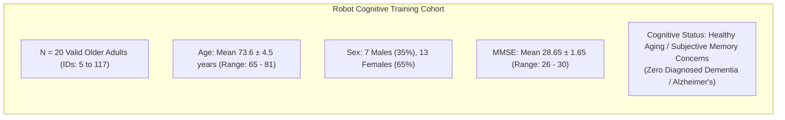

# Forensic Dataset Audit: Robot Cognitive Training Collection
**Collection Name:** Robot Cognitive Training (LLM-Generated Personalized Cognitive Games on a Social Robot)  
**Dataset Location:** `Backend/research_archive/Phase4_New_Datasets/data&prompts.zip`  
**Auditor:** NeuroCompanion Phase 4 AI/ML Verification & Architecture Team  
**Audit Date:** November 17, 2026  
**Status:** Certified Read-Only Technical Audit  

---

## 1. Physical Files, Format & Integrity

| Property | Verified Value | Inspection Method |
| :--- | :--- | :--- |
| **Archive File** | `data&prompts.zip` | Python `zipfile` |
| **Archive Size** | 815,673 bytes (796.5 KB) | Filesystem metadata |
| **Archive Integrity** | Valid, uncorrupted ZIP archive containing 15 member entries | Python `zipfile.ZipFile.testzip()` |
| **Uncompressed Size** | ~1.35 MB total across member files | Internal ZIP headers |
| **Member File Count** | 7 Excel spreadsheets (`.xlsx`) + 5 Prompt text files (`.txt`) + 3 directory nodes | `zipfile.namelist()` |
| **Modification Timestamp** | 2025-05-12 / 2025-05-13 (Study execution period) | Internal file headers |

### Archive Member Breakdown
```text
data&prompts.zip
├── data/
│   ├── database/
│   │   ├── game_session.xlsx             (21,466 bytes, 82 session records)
│   │   └── session_played.xlsx           (321,926 bytes, 437 individual game runs)
│   ├── User_data.xlsx                    (15,039 bytes, 20 older adult participants)
│   ├── Hallucinations.xlsx               (50,204 bytes, 450 LLM hallucination checks)
│   ├── Questionnaire_end_of_session.xlsx (29,090 bytes, Godspeed + UEQ-S evaluations)
│   ├── SAM_questionnaire.xlsx            (16,408 bytes, 160 Self-Assessment Manikin ratings)
│   └── Short_UEQ_Data_Analysis_Tool.xlsx (347,027 bytes, User Experience Questionnaire template)
└── prompt/
    ├── User profile prompt.txt           (5,274 bytes, JSON schema for profile extraction)
    ├── Real Event prompt.txt             (5,726 bytes, multi-choice quiz prompt)
    ├── Memory Story Quiz prompt.txt      (7,702 bytes, JSON quiz generator prompt)
    ├── Memory Completion prompt.txt      (4,367 bytes, sentence completion prompt)
    └── Reorder Activities prompt.txt     (6,632 bytes, activity sequence reordering prompt)
```

---

## 2. Participant Population, Sample Size & Clinical Diagnosis



- **Enrolled Cohort Size:** $N = 20$ older adult participants (Table `data/User_data.xlsx`, Rows 0–19; Rows 20–24 contain blank padding and summary statistics: Mean MMSE $28.65$, SD $1.65$).
- **Geographic & Linguistic Setting:** Italy (Italian column headers: `ETA'`, `SESSO`, `Partecipante`, `ID utente`).
- **Cognitive Diagnosis:** **Healthy Older Adults / Preserved Cognitive Function**.
  - All participants scored $\ge 26/30$ on the Mini-Mental State Examination (MMSE).
  - **No participants have a diagnosis of Alzheimer's disease, mild cognitive impairment (MCI), or dementia.**

---

## 3. Detailed Data Tables & Variable Inventory

### 1. Game Run Telemetry (`data/database/session_played.xlsx`, 437 rows $\times$ 18 cols)
Contains fine-grained telemetry for 437 individual game runs:
- `ID_USER`: Participant ID (e.g., 223, matching User_data IDs).
- `idsession_played_game`: Unique game run identifier (3390 to 3826).
- `fk_game_session_id`: Session foreign key (links to `game_session.xlsx`).
- `type`: Cognitive game type:
  - `StoryQuizGame` ($n = 110$, 25.2%): Multiple-choice questions testing recall of a personalized story.
  - `CompleteGame` ($n = 110$, 25.2%): Memory completion of sentences with missing words.
  - `RealEventGame` ($n = 109$, 24.9%): Quizzes based on verified real-life autobiographical events.
  - `ReorderGame` ($n = 108$, 24.7%): Chronological sequencing of daily or historical activities.
- `current_level`: Adaptive difficulty setting (`easy`, `medium`, `hard`).
- `numErrors`: Integer count of incorrect attempts during the game.
- `totalPoints`: Points scored by the participant.
- `gameTime`: Total game duration in seconds.
- `gameReactTime`: **Reaction latency** in seconds before making choices.
- `touch_interaction`: Count of physical touch inputs on the robot screen.
- `vocal_interaction`: Count of verbal/speech utterances detected by the robot.
- `creation_date`: Exact timestamp of gameplay.

### 2. Session Summary (`data/database/game_session.xlsx`, 82 rows $\times$ 12 cols)
Aggregates performance across 82 full multi-game sessions:
- `idUser`, `totalGamesPlayed` (typically 5 games per session), `totalNumCorrectAnswers`, `totalNumErrors`, `totalUserPoints`, `totalTime`, `total_touch_interaction`, `total_vocal_interaction`.

### 3. LLM Hallucination Log (`data/Hallucinations.xlsx`, 450 rows $\times$ 11 cols)
Audits the fidelity of LLM-generated game items against the participant's original user profile:
- `sessionID`, `user`, `game`, `level`, `Messages`, `Hallucinations (NEW)`, `Hallucinations (OLD)`, `Description`.

### 4. Subjective Evaluations (SAM & Godspeed)
- `SAM_questionnaire.xlsx` (160 rows): Self-Assessment Manikin measuring Valence, Arousal, and Dominance pre- and post-session.
- `Questionnaire_end_of_session.xlsx` (23 rows): Godspeed scale (Anthropomorphism, Animacy, Likeability, Perceived Intelligence, Safety) and UEQ-S.

---

## 4. Assessment Against AS01–AS10 Assistance Taxonomy

| NeuroCompanion AS Taxonomy | Evidence Level | Forensic Technical Analysis |
| :--- | :---: | :--- |
| **AS01: Spoken verbal prompt / hint** | **Partially Supported (Indirect)** | The robot platform employs vocal output (`total_vocal_interaction`), but vocal cues were structured instructions rather than adaptive software hints. |
| **AS02: Visual highlight / spotlight** | **Not Supported** | No visual screen highlighting records exist. |
| **AS03: Audio playback / repetition** | **Not Supported** | No explicit audio replay logs are captured. |
| **AS04: Text simplification / pacing** | **Partially Supported (Indirect)** | The LLM prompts explicitly enforce graded difficulty (`easy`, `medium`, `hard`) by adjusting sentence length and vocabulary complexity. |
| **AS05: Step-by-step sequential breakdown** | **Partially Supported (Indirect)** | The `ReorderGame` implements sequential chronological breakdown of multi-step activities, providing task structure models. |
| **AS06: Visual anchor / memory cue** | **Partially Supported (Indirect)** | Prompts generate personalized reminiscence questions based on family names, familiar pets, and past events (reminiscence anchoring). |
| **AS07: Direct demonstration** | **Not Supported** | No modeled action logs. |
| **AS08: Orientation re-anchoring** | **Not Supported** | No spatial/temporal re-orientation triggers. |
| **AS09: Motor guidance / target enlargement** | **Not Supported** | Screen touch targets were fixed; no adaptive motor sizing was tested. |
| **AS10: Independent completion** | **Partially Supported (Indirect)** | Recorded as game-level accuracy (`numErrors == 0`), but micro-step completion without assistance is not isolated. |

---

## 5. Data Quality, Missingness & Leakage Risks

- **Data Integrity:** High. Relational keys (`fk_game_session_id`, `idUser`) link cleanly between `game_session.xlsx` and `session_played.xlsx`.
- **Missing Values:** Minimal in telemetry tables. In `User_data.xlsx`, rows 20–24 contain blank padding and summary rows that must be filtered out during ingestion.
- **Population Mismatch / Clinical Leakage Hazard:**  
  Because all 20 participants are cognitively healthy older adults (MMSE $28.65$), their reaction times ($gameReactTime$) and error rates cannot be treated as representative of Alzheimer's patients. Attempting to train a dementia assistance model on this data would create severe **domain-shift bias**.

---

## 6. Licensing & Permitted Research Use

- **Repository Provenance:** Zenodo open-access research repository (associated with social robotics and LLM personalized cognitive stimulation research).
- **License:** Creative Commons Attribution 4.0 International (CC-BY 4.0) (standard for Zenodo open-science deposits).
- **Permitted Use:** Academic and research adaptation permitted with attribution.
- **De-Identification:** Clean. Participants are identified solely by arbitrary numerical IDs (e.g., 5, 223).

---

## 7. Recommended Legitimate Role in Phase 4

> [!IMPORTANT]
> **Recommended Role: Reminiscence & Cognitive Garden Game Structure Benchmark.**  
> While this dataset cannot train patient assistance models due to its healthy older adult cohort, it provides **immense architectural value for NeuroCompanion’s Cognitive Garden and Reminiscence Corner**:
> 1. Its 5 LLM prompt templates (`prompt/*.txt`) provide tested, structured JSON schemas for generating memory completion and activity reordering tasks.
> 2. Its 437 game runs provide an **empirical benchmark for dual-modality interaction** (comparing touch vs vocal interaction frequencies in older adults).
> 3. Its hallucination audit (`Hallucinations.xlsx`) offers empirical ground truth on the failure modes of generative AI when synthesizing biographical reminiscence stimuli.
